<p align="center">
  
</p>

<h1 align="center">Inertia</h1>

<p align="center">
  <strong>Every coding agent, one calm desktop.</strong><br />
  Run Codex, Claude, Cursor, Kimi Code, OpenCode and Antigravity side by side,<br />
  next to your projects, Git review and terminals, in a workspace that stays on your computer.
</p>

<p align="center">
  <a href="https://github.com/eduardtomas1/inertia/releases/latest"><strong>Download the latest release</strong></a>
  &nbsp;·&nbsp; <a href="docs/INSTALLING.md">Installation guide</a>
  &nbsp;·&nbsp; <a href="docs/user/README.md">User guide</a>
  &nbsp;·&nbsp; <a href="CHANGELOG.md">Changelog</a>
</p>

<p align="center">macOS · Windows · Linux &nbsp;·&nbsp; Intel and ARM64 &nbsp;·&nbsp; Apache 2.0</p>

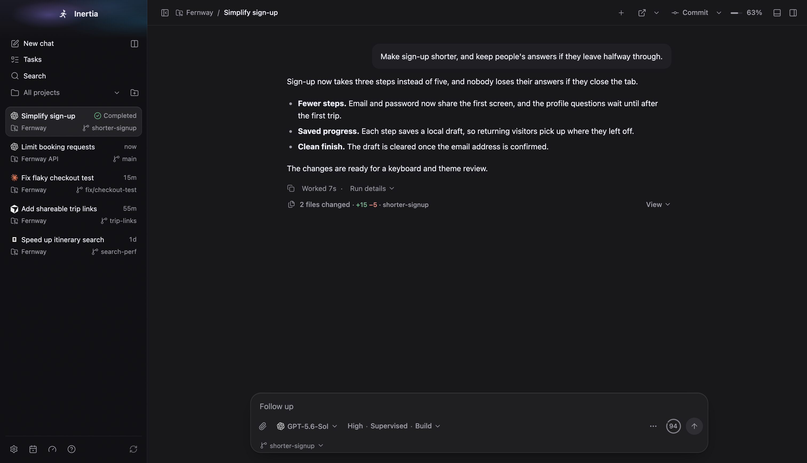

Inertia is a desktop app for working with coding agents. Each chat belongs to a project, runs on an account you already have, and sits beside the files, diffs and terminals it is changing. Open several chats at once, hand them tasks, and review every change before it leaves your machine.

## Start in a minute

1. **Install** the build for your platform from the [latest release](https://github.com/eduardtomas1/inertia/releases/latest).
2. **Add a project.** Open a local folder or clone a repository from an HTTPS or SSH Git URL.
3. **Connect an agent** in **Settings → Agents**, then choose **New chat** and describe the task. To spend API credits instead of a subscription, add an Anthropic or OpenAI key under [Accounts and API keys](docs/user/getting-started.md#accounts-and-api-keys) and pick that route in the model chooser.

<table>
  <tr>
    <td width="50%">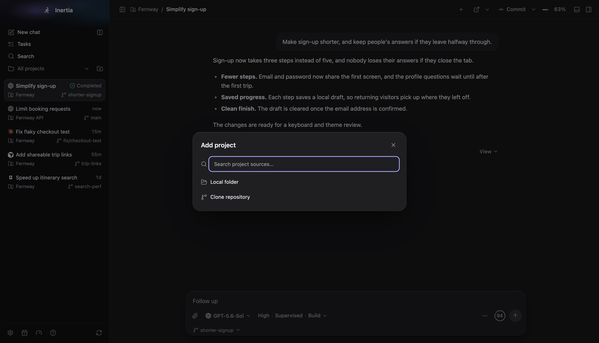</td>
    <td width="50%">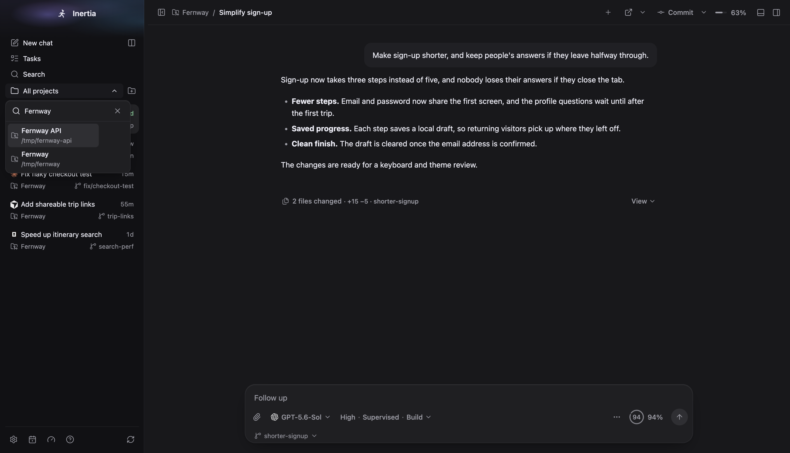</td>
  </tr>
</table>

## Built for the coding loop

- **Give the agent context.** Attach images, PDFs, text, Markdown, CSV, JSON and spreadsheets. Type `@` to reference a project file or another chat, and `$` to insert a provider skill.
- **Decide how it works.** Choose the model, reasoning level, response speed, work mode and access from the composer. `/plan` and `/build` switch modes; in Plan mode the agent proposes steps before touching anything.
- **Keep follow-ups moving.** While an agent works, Enter sends a follow-up and Tab queues it for the next turn.
- **Switch providers without losing the chat.** Pick another provider and the next message continues with the earlier messages as context. The timeline marks the switch with a **Context handoff** divider.
- **Get visual answers.** An agent can reply with a chart, table, diagram or mockup rendered in the chat, themed like the app and sandboxed from the network and your files. See [Visual replies](docs/user/chats-and-agents.md#visual-replies).
- **Pay less for long API chats.** Return to a chat of 200K tokens or more on an Anthropic or OpenAI key after its prompt cache has expired and the send button reads **Compact and send**. See [Compact on return](docs/user/chats-and-agents.md#compact-on-return).
- **Choose the access you are comfortable with.** **Supervised** keeps provider approvals, **Auto-accept edits** allows supported file edits, and **Full access** lets the agent act without asking.

## Find anything

Press **Ctrl/Cmd+K** to find commands, settings, projects, chats and saved messages. Type at least two characters to search your own messages and the agents' final answers across every unarchived chat, then open a match to jump to its turn.

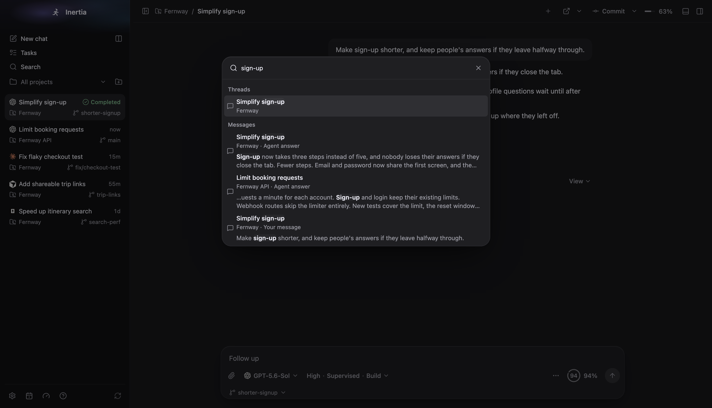

## Work side by side

Drag a chat onto the workspace to split it. Up to four chats show at once, each with its own project, tools and draft, and up to eight chats can have their own windows. Send one brief to two agents with a [Duo](docs/user/duo.md) and let a third model judge the results, or attach a [watcher](docs/user/watcher.md) that reviews, guards scope or explains a chat as it runs.

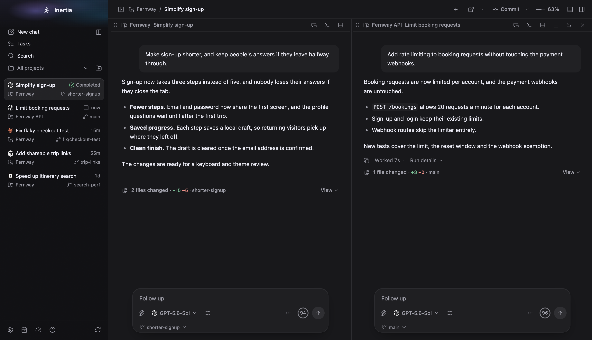

## Review before it ships

The **Changes** surface shows every file an agent touched. Mark hunks as reviewed, select lines to ask about them, request a revision or revert them, then commit exactly the paths you choose. The branch menu creates and switches branches and starts chats in an isolated worktree. Pull only fast-forwards, and Inertia never force-pushes. If a turn went wrong, **Revert** restores the project to before it and saves your current edits in a recovery checkpoint first.

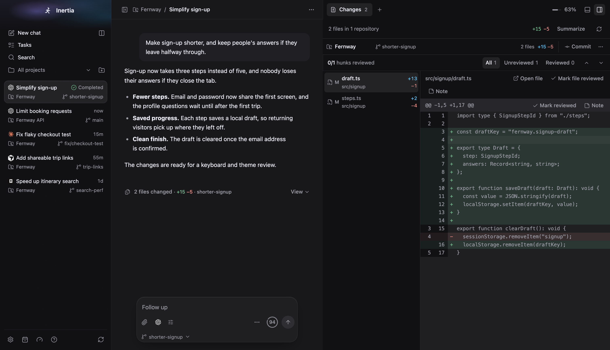

## Keep the goal in view

The **Goal** surface shows the provider's own objective next to notes that stay in Inertia, so what is shared with the agent and what is local is always explicit. The **Plan** surface renders the agent's plan as a document and marks each step as the provider reports progress.

<table>
  <tr>
    <td width="50%">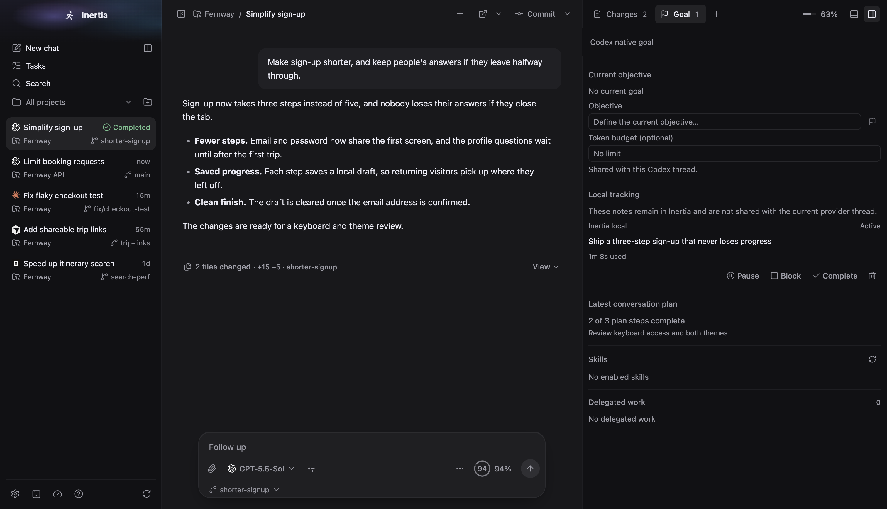</td>
    <td width="50%">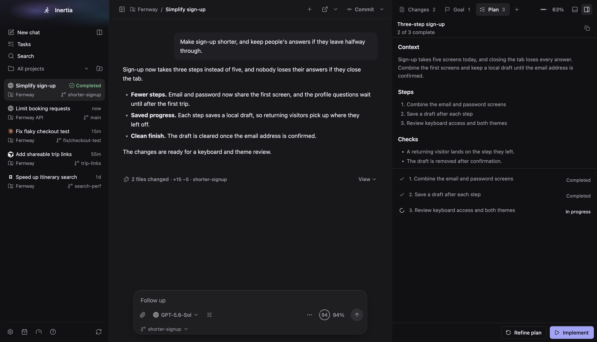</td>
  </tr>
</table>

## Hand tasks to an agent

**Tasks** is a short list with due dates and priorities. Type a task and press Enter to keep it, or Tab to hand it to an agent straight away. **Start** opens a chat with the task as its first message, and the row says what the agent is doing until it is ready for you.

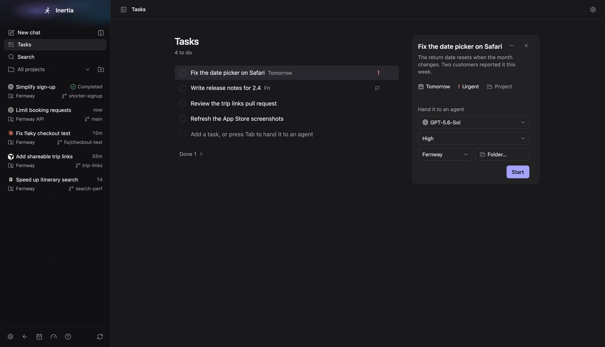

## Everything the chat touched, one panel away

The right panel opens **Changes**, **Files**, **Browser**, **Terminal**, **Attachments**, **Background tasks**, **Usage**, **Goal** or **Plan**, and each chat remembers its own. Browse and edit project files in place, run terminals with tabs and splits, open local development pages for the agent to use, and preview any attachment: zoom with + and −, pan with the arrow keys, reset with 0.

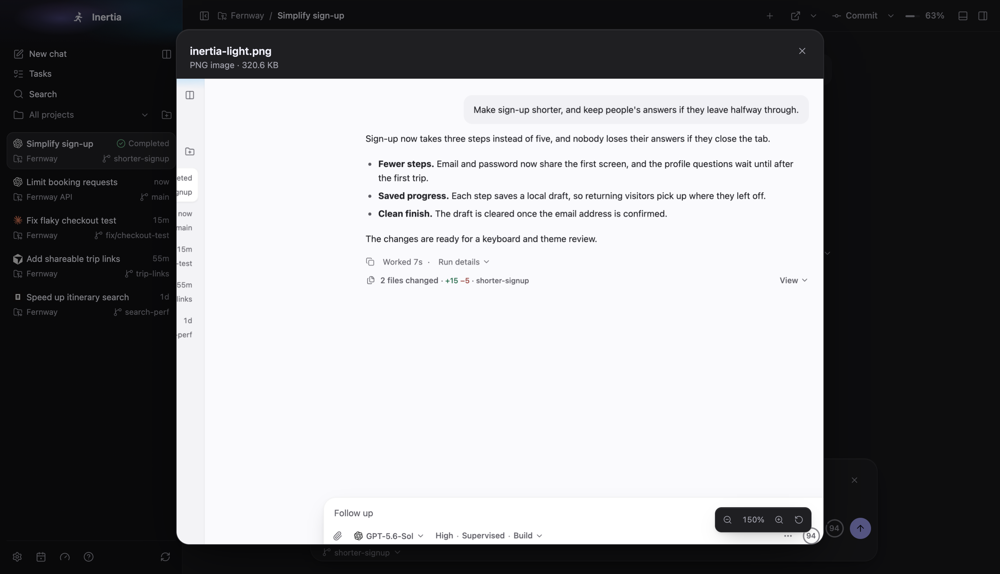

## Local by default

History and preferences stay on your computer. Each provider keeps its own sign-in, and API keys and custom backend credentials live in your operating system's credential vault, never in Inertia's database. Desktop notifications leave out prompt and response text. Diagnostics are a local history you can search, export or clear, and **Report an issue** shows you the exact text before anything reaches GitHub.

Optional [Private Connect](docs/PRIVATE_CONNECT.md) pairs a browser on another device over your Tailscale network while this computer stays online, with Monitor or Collaborate access per device. Its boundaries are in the [security model](docs/PRIVATE_CONNECT_SECURITY.md).

## Make it yours

Choose System, Light or Dark and a colour theme from the theme library, or pick one custom colour per appearance and let Inertia derive readable shades. Set the interface scale from Compact to Large, choose how running work is shown, and turn on a sound, desktop notifications or the desktop mascot when a task ends.

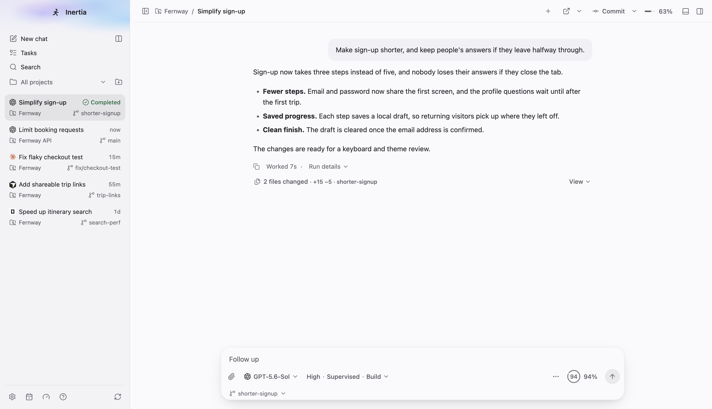

<details>
<summary><strong>More</strong></summary>

- **Resume at reset.** When a chat stops at a subscription limit, the composer offers **Resume at reset** and **Snooze until reset**; Inertia must be running to resume.
- **Usage and limits.** **Usage** shows locally recorded usage across chats and providers, and each provider's remaining quota per window with a countdown to its reset. **Daily work** summarises tokens, runtime and conversations for a day.
- **Import CLI conversations.** Bring a project's Codex or Claude Code history into Inertia from **Settings → Projects**; the chat continues the original session.
- **Chats without a project.** Choose **No project** in the composer to work in a chat folder of its own.
- **Start from a terminal.** Run Inertia with `--new-chat` to open a chat for the current folder, or `--new-chat <path>` for another.
- **Background tasks.** A surface lists the chat's delegated agents and the commands Inertia started, with what each is doing.
- **Prompt presets.** Save reusable prompts and keep per-chat drafts in Scratch prompts; presets never send automatically.
- **Snapshots and reviewed screenshots.** Attach the foreground window with its accessibility context, or on Linux capture, crop, mask and approve a screenshot before it is sent.
- **Discord.** Prepare release notes and a commit preview for a Discord webhook from **Settings → Devices & integrations**.

</details>

## Install

| Platform | Architectures | Package |
| --- | --- | --- |
| macOS | Apple silicon, Intel | DMG or ZIP |
| Windows | x64, ARM64 | Installer |
| Linux | x64, ARM64 | AppImage, with verified in-app updates |

Every release ships `SHA256SUMS.txt`; compare the checksum before opening a package. macOS and Windows builds update manually while code signing is unavailable. Worktree chats need Git 2.36 or newer. The [installation guide](docs/INSTALLING.md) covers Gatekeeper and SmartScreen prompts, the AppImage executable bit and the Canary channel.

## Run from source

Use Node.js **22.13 or newer in the Node 22 line**.

```sh
npm ci
npm run dev
```

`npm run check` runs quality checks, the test suite and the production build. Desktop interaction tests run with `npm run test:e2e`. See [AGENTS.md](AGENTS.md) for repository conventions and [RELEASING.md](docs/RELEASING.md) for packaging, Stable and Canary channels, signing and updates.

## Help

Start with [Troubleshooting](docs/user/troubleshooting.md), grouped by symptom. If an agent stops responding, refresh it in **Settings → Agents**. For app problems, use **Settings → Help → Diagnostics → Copy support summary**, review it and attach it to a [bug report](https://github.com/eduardtomas1/inertia/issues/new?template=bug_report.yml); avoid sharing raw logs, databases or credentials. If an older Windows update leaves startup blocked by unconfirmed process cleanup, follow the [profile recovery steps](docs/WINDOWS_STARTUP_RECOVERY.md).

[Apache 2.0](LICENSE). Packaged builds include third-party notices and dependency licenses.
