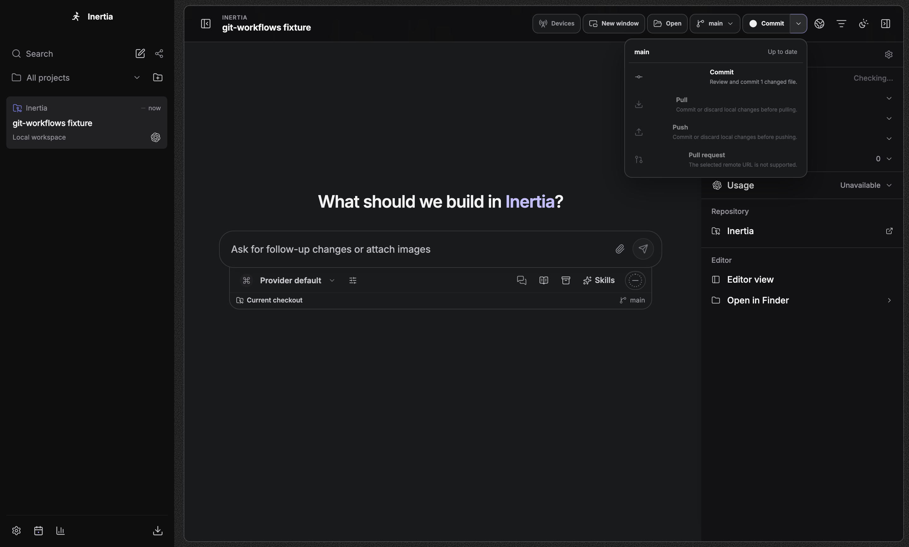
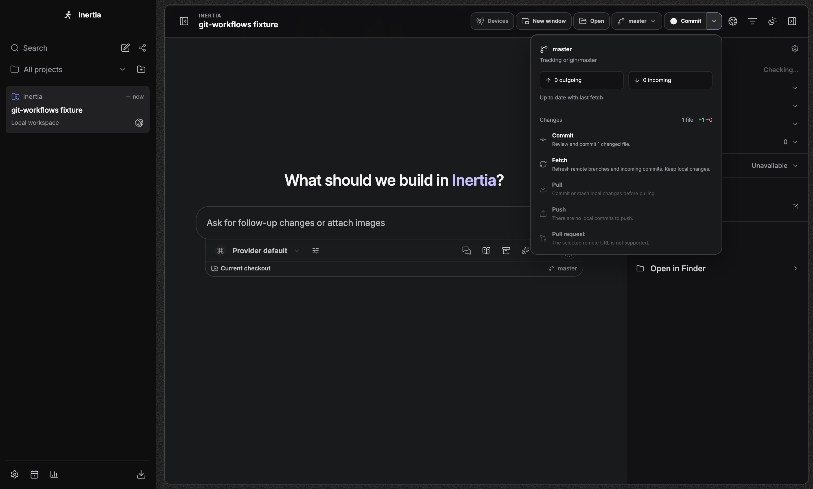
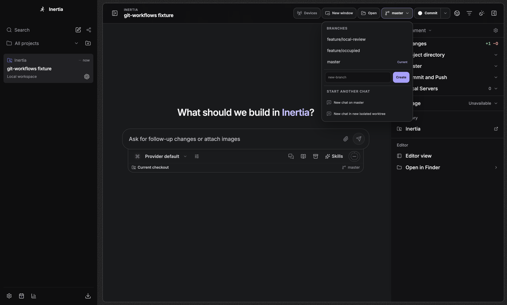
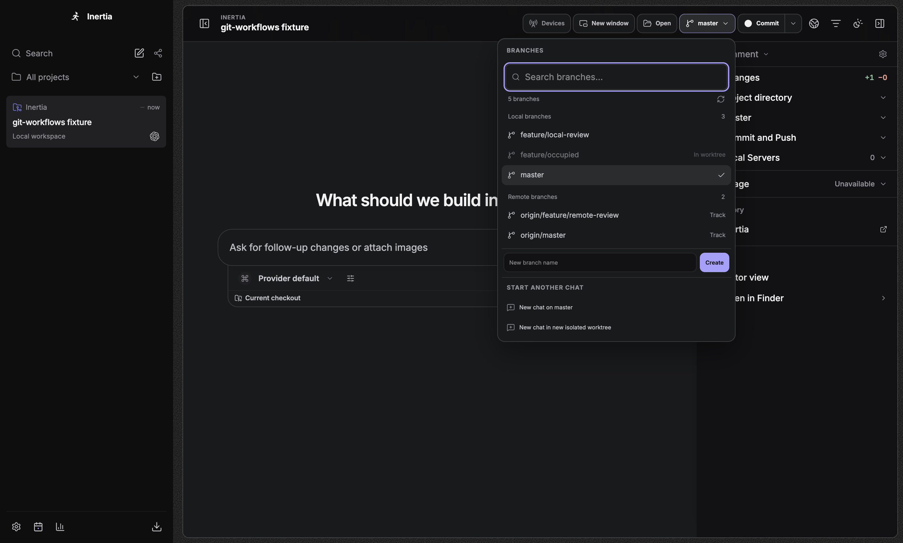

# Git workflows

Git controls operate on the active chat's checkout, or the project root in an
imported-project draft. Header Fetch/Pull/Push commands use the same scope that
loaded the repository authority. The Changes panel can also
target one discovered nested repository; each action retains that repository's
runtime-issued authority. Opening the menus does not start a network scan.

## Everyday actions

- **Branch menu:** search local and remote branches, see which branches are
  already checked out in another worktree, create a branch, or start another
  chat in an isolated worktree. Choosing a remote branch creates a local branch
  of the same name with explicit tracking. A local name collision is reported
  rather than replaced. Switching requires a complete, clean status. Commit or
  stash local changes first; creating a new branch can carry existing work.
  Enter selects the first available search result; arrow keys keep the focused
  result visible. A failed change stays in the menu with the query and a retryable
  error. Selecting the current branch only closes the menu. Changing projects
  or chats dismisses the old menu and ignores its late completion.
- **Git menu:** see the current branch, upstream, incoming/outgoing counts, and
  changed-file totals. The primary button follows the next available step:
  review a commit, pull incoming commits, or push/publish existing commits.
  The full menu keeps unavailable actions and their explanations readable.
- **Fetch:** refresh remote branches without changing local files or staged
  content. Fetch uses the tracked remote, then `origin`, then a sole remote.
  Ambiguous selection requires configuring tracking or using the terminal.
  A missing configured upstream remote is reported instead of falling back to
  another remote.
  Fork workflows fetch the upstream independently of the push remote. Fetch is
  also available for a dirty checkout and from a nested repository's Changes
  controls. Stop an active fetch from the chat's **Background tasks** surface;
  the activity stays live until owned process cleanup settles.
- **Pull:** requires an upstream and a complete, clean checkout. Only a
  fast-forward is permitted; Inertia does not auto-stash, rebase, resolve
  conflicts, or recurse into submodules. Fetch first to update the incoming
  count. A branch with no upstream is labeled as such, not as up to date.
- **Commit / Push / Pull request:** retain Inertia's complete-diff review
  receipts, selected-path commit transaction and separate authenticated PR
  flow. Existing commits can be pushed while unrelated uncommitted work remains.
  A behind/diverged branch must be reconciled first. No force push is offered.
- **Commit message:** the message field is multi-line. The first line is the
  subject; a counter turns to a warning past 72 characters but never blocks the
  commit. Leave a blank line before the body. Enter inserts a new line and
  Cmd/Ctrl+Enter commits; messages stay bounded to 10,000 characters.
  **Draft message** fills the field from local evidence only, with no provider
  call: the first sentence of the chat's current review summary becomes the
  subject and the rest the body, or, without a summary, the subject names the
  selected files' common folder (or their count) and the body lists each file
  with its status. Once the field has text the button reads **Replace with
  draft**, so a typed message is only replaced by that explicit click.
- **Stage and unstage:** the Changes list groups files into **Staged** and
  **Changes**. **Stage** / **Unstage** on a row or in its context menu, and
  **Stage all** / **Unstage all** in the group headings, move whole files
  between the working tree and the index so you can shape the index yourself.
  Commit still stages exactly the paths checked in the commit dialog. Staging
  runs `git add --all` for the selected paths. Unstaging runs `git rm --cached`
  for a newly added file whose working copy matches the index, `git restore
  --staged` for other entries (both sides of a staged rename), and, before the
  first commit, a path-limited `git reset`. All three change only the index;
  working-tree files are never modified or deleted. Requests carry 1–200
  repository-relative paths and the repository's live authority (the panel
  sends larger selections in batches). The runtime resolves each path through
  realpath and symbolic-link containment against the repository root, accepts
  only paths the current status reports as changed, refuses unmerged files and
  embedded repositories (stage those from their own scope), and refreshes the
  status afterwards. Pathspecs are passed literally on standard input
  (`--literal-pathspecs --pathspec-from-file=- --pathspec-file-nul`), never
  through a shell. Detached chat windows cannot stage or unstage.

Counts reflect locally available remote-tracking refs, not a live network
guarantee. A truncated status is shown as incomplete and cannot authorize
commit/pull through these controls. Git failures use bounded, credential-free
guidance for authentication, connectivity, non-fast-forward rejection, index
locks, occupied branches, and missing author identity.

## History and blame

History and blame are read-only. They never check out, reset, revert,
cherry-pick or change the index; a diverged branch is still reconciled in the
terminal.

- **History:** choose **History…** in the Git menu. Commits on the current
  branch are listed newest first (subject, short SHA, author, relative date),
  50 at a time; **Load more** continues. Selecting a commit shows its message,
  its changed files with added and removed line counts, and a read-only diff.
  A merge is compared with its first parent and a root commit with the empty
  tree. Arrow keys, Home, End, Page Up and Page Down move through the list;
  Escape closes the dialog. History uses the same repository scope as the
  header Git menu, so it opens for the chat checkout (or the project root in a
  draft); switching chats closes it.
- **Blame:** in the Files preview, **Blame** (off by default) adds a narrow
  gutter showing the short SHA and author at the first line of each run of
  lines from the same commit (SHA only when the preview is narrow). Hover or
  focus an entry for the date and commit summary; Up and Down move between
  entries. Commit diffs in History use the Changes panel's highlighting,
  falling back to plain text for very large files. Blame loads in 2,000-line pages
  as you scroll and describes the file on disk, so uncommitted lines are
  marked **Not committed**. It is unavailable in Markdown preview mode, for
  untracked, binary and symbolic-link files, and for files over 16 MiB.

Author email addresses are never returned. Detached chat windows cannot use
history or blame; they remain main-window Git reads.

### Commands and bounds

| Command | Git invocation | Bounds |
| --- | --- | --- |
| `git.log` | `rev-parse --verify --quiet HEAD^{commit}` on the first page, then `log -z --no-color --no-show-signature --encoding=UTF-8 --format=%H%x00%h%x00%P%x00%an%x00%aI%x00%s --max-count=N [--skip=S] <head> -- [:(literal)<path>]` | 1-100 commits per page (default 50); 2 MiB output, truncated to complete records |
| `git.commit.show` | `show -s --no-show-signature --encoding=UTF-8 --format=… <sha>^{commit} --`, then `diff-tree -r -M --no-commit-id --no-ext-diff --no-textconv -z --raw --numstat` and `diff-tree … -p --src-prefix=a/ --dst-prefix=b/`, each with `<first parent> <sha>` or `--root <sha>` | SHA must match `^[0-9a-f]{7,40}$`; body 8 KiB, 500 files, diff 256 KiB, each with a truncation flag |
| `git.blame` | `ls-files -z -- :(literal)<path>`, then `blame --porcelain --no-textconv --encoding=UTF-8 -L<start>,<end> -- <path>` | 2,000 lines per call; 8 MiB output, truncated to complete lines with a continuation line |

Every invocation goes through the bounded inspection runner (argument arrays,
no shell, optional locks and filesystem monitors disabled, owned process-tree
cleanup) with a 5-second per-process clock inside the shared Git read
deadline. The log cursor is opaque: it records the head the first page was
anchored to, the number of commits already shown and the last commit's SHA.
Later pages walk from that anchor, so new commits do not shift pages, and the
last SHA is re-read to detect rewritten history.

Paths for `git.log` and `git.blame` are relative to the repository scope and
must stay inside it after realpath resolution; a symbolic link that escapes is
refused. Untracked files return an empty blame result rather than an error.
Omitting `repositoryPath` reads the chat checkout; a nested repository passes
`repositoryPath` with the authority issued by its last status refresh, as the
other repository-scoped Git commands do.

## Worktrees

Settings → Projects → **Worktrees** lists every checkout Git knows for the
selected project's repository. The list loads only when you choose **Show
worktrees**, then on **Refresh** and after each action. Each row shows the
path, branch, a clean/changes badge, and a link that opens the owning chat.
Paths inside the repository are shown relative to its root; Inertia's own
isolated chat worktrees are shown with their full path; any other checkout
shows only its folder name, so another location on disk is never revealed.
Detached chat windows cannot list, remove or prune worktrees.

**Remove** is offered only when every rule below holds. Otherwise the button
stays focusable but inactive, its reason is shown beneath the row, and the
runtime refuses the same request with the same reason without changing
anything:

1. The worktree is not the repository's main checkout and lies inside
   Inertia's managed worktree folder.
2. Inertia created it: a chat in this project holds a completed ownership
   receipt whose path matches the worktree's realpath. Interrupted creations
   and Duo comparison worktrees are left to chat deletion.
3. That chat is not running, waiting for input, holding provider processes, or
   resumed in a provider terminal, and no other workspace activity is active
   for it.
4. No other chat uses the worktree as its checkout, and the owning chat's
   checkout path still matches the receipt.
5. Git does not report it locked or prunable, and it is still on the branch
   Inertia created.
6. `git status` reports no modified, staged or untracked files, and no ignored
   files (for example build output or `.env`), which removal would delete. A
   status that cannot be confirmed counts as not clean.
7. The receipt's repository, administrative-directory and filesystem identity
   still match (`inspectOwnedWorktreeCleanupState`), so a replaced worktree
   is kept.

The confirmation names the path and branch. The runtime then takes an
exclusive reservation on the worktree checkout (no chat run can start there)
under the repository's source-control serialization, repeats every check, and
runs `git worktree remove -- <path>`. `--force` is never passed, so Git itself
also refuses locked or unclean worktrees. Git cannot bind removal to the
inspected identity atomically; the repeated checks plus Git's own clean check
mean a concurrent replacement can at most lose ignored files, never tracked or
untracked work. After Git reports the worktree absent, the receipt is released
and the chat keeps its historical checkout path: it stays readable, never
falls back to the main checkout, and can then be deleted without a cleanup
step. The generated branch (`inertia/<chat prefix>`) is deleted only when
`for-each-ref --merged=refs/heads/<main checkout branch>` contains it, and
then only with `git branch -d` (never `-D`); otherwise it is kept and the
result says so.

**Prune** runs `git worktree prune`, which only clears Git's administrative
records for worktrees whose folders are already gone. It never deletes files
or branches.

| Command | Git invocation | Bounds |
| --- | --- | --- |
| `worktree.list` | `worktree list --porcelain -z`, then per worktree `status --porcelain=v1 -z --untracked-files=normal --ignored=traditional --ignore-submodules=none` | 200 worktrees, 1 MiB list output; status 512 KiB and 2,000 counted entries; 5 s per process, 30 s for all status checks, 4 at a time |
| `worktree.remove` | the list inspections above, `worktree remove -- <path>`, then `for-each-ref --merged=refs/heads/<source> --format=%(refname) refs/heads/<branch>` and `branch -d -- <branch>` | removal uses the default 30 s local clock; inspections 5 s |
| `worktree.prune` | `worktree list --porcelain -z`, `worktree prune`, `worktree list --porcelain -z` | 5 s per process |

All invocations use argument arrays without a shell through the bounded Git
runner; reads run as inspections with optional locks and filesystem monitors
disabled. Coverage: `tests/server/worktree-commands.test.ts` (real temporary
repositories), `tests/shared/worktree-contracts.test.ts`,
`tests/server/detached-chat-worktree-policy.test.ts` and
`tests/renderer/settings-project-worktrees.dom.test.tsx`. Removal was exercised
on Linux; Windows junctions and macOS path aliases rely on the shared realpath
comparison and were not run here.

## Checkpoints

Inertia records a checkpoint before each chat turn and after it finishes, under
`refs/inertia/checkpoints/<chat>/<checkpoint>`. A checkpoint holds tracked files
as they are on disk, including tracked files that match an ignore rule, and the
untracked files Git does not ignore. Ignored untracked files are never
included.

Capture runs Git with an isolated configuration, raw attributes (no clean or
smudge filters) and an empty hooks directory. It starts from a copy of the
repository index so unchanged files are not hashed again: the copy keeps the
index timestamp so Git still re-reads files written in the same second as the
index, and assume-unchanged flags are cleared so hidden edits are captured. A
project folder below the repository root, a split index, or an index that
cannot be copied falls back to rebuilding the index from `git ls-files
--stage`, which is slower but equivalent. Objects and the checkpoint reference
are flushed to disk (`core.fsync=objects,reference`, batch method) before the
reference is published. On a 24,130-file repository a checkpoint takes about
0.25 s, down from about 5 s.

When a checkpoint cannot be captured, the turn still runs and its request row
says **No checkpoint for this turn**. The reason shows on hover and is part of
the label's text for screen readers.

**Revert** first saves current edits in a recovery checkpoint, then restores
the selected one. It refuses when the restore would overwrite or replace an
ignored file, because ignored files are not in the recovery checkpoint. The
check lists wholly ignored directories once (for example `node_modules/`) and
looks inside them only for paths the checkpoint would write. When Git matches
ignore rules without regard to case (`core.ignorecase`, the default on macOS
and Windows), so does this check.

## Design reference and architecture

Reviewed current T3 Code upstream at
[`11601da846e7d82db63a6f4773e3a02421619b60`](https://github.com/pingdotgg/t3code/tree/11601da846e7d82db63a6f4773e3a02421619b60).
The implementation is adapted to Inertia's existing Electron/runtime split;
it does not import T3 Code dependencies or copy its service architecture.

| Upstream source studied | Decision in Inertia |
| --- | --- |
| [GitActionsControl](https://github.com/pingdotgg/t3code/blob/11601da846e7d82db63a6f4773e3a02421619b60/apps/web/src/components/GitActionsControl.tsx) and its logic module | Keep a compact split action, readable disabled reasons, explicit branch/upstream context and progressive workflow states. Retain Inertia's authenticated full-diff review before committing. |
| [BranchToolbarBranchSelector](https://github.com/pingdotgg/t3code/blob/11601da846e7d82db63a6f4773e3a02421619b60/apps/web/src/components/BranchToolbarBranchSelector.tsx) | Add searchable, grouped local/remote choices, loading/error/retry states and explicit remote tracking. Keep keyboard focus visible, preserve failed choices for retry, and retain chat/checkout mismatch evidence instead of silently rewriting chat identity. |
| [GitVcsDriverCore](https://github.com/pingdotgg/t3code/blob/11601da846e7d82db63a6f4773e3a02421619b60/apps/server/src/vcs/GitVcsDriverCore.ts) | Add a separate scoped fetch; guard detached/missing-upstream pull; preserve fast-forward semantics. Avoid automatic network polling and destructive reset paths. |
| [GitManager](https://github.com/pingdotgg/t3code/blob/11601da846e7d82db63a6f4773e3a02421619b60/apps/server/src/git/GitManager.ts) and [GitWorkflowService](https://github.com/pingdotgg/t3code/blob/11601da846e7d82db63a6f4773e3a02421619b60/apps/server/src/git/GitWorkflowService.ts) | Reuse Inertia's canonical checkout serialization, scan invalidation, authority binding and durable activity rather than introducing another Git manager or cache. |

`src/server/git` owns Git execution and parsing. The runner uses argument arrays,
sanitized environments, bounded output/deadlines and runtime-owned process
trees. Inspections disable optional index locking, fsmonitor, external diff and
text conversion. Branch listing uses one inspection for local/remote refs and
occupancy, bounded to 1,000 branches and 1 MiB; larger lists fail with explicit
terminal guidance. Branch discovery requires the runtime-issued authority for the active checkout
and verifies its filesystem identity and Git metadata before and after inspection.
Occupancy is projected as a boolean, not another worktree's filesystem path. Remote names containing slashes are matched by longest prefix.
Custom fetch mappings must identify exactly one source branch on the selected
remote before tracking checkout, including a uniquely renamed mapping such as
`refs/heads/server` to `refs/remotes/origin/client`. Excluded or ambiguous sources,
and sources that map to multiple upstream destinations, are rejected; Git itself can create a branch before
reporting this ambiguity, so this check runs before mutation.

Fetch has a shared 180-second workflow deadline and a 120-second network limit;
the output limit is 64 KiB. Its explicit refspec updates only that remote's
tracking branches, with tags, pruning, `FETCH_HEAD`, submodule recursion and
automatic maintenance disabled. Configured head mappings within that remote's
tracking namespace, including renamed destinations and source exclusions, are
honored. Head mappings to local branches or another remote, and non-head mappings
into this remote's tracking namespace, are rejected with terminal guidance. This
preserves existing configuration and prevents Git from tracking the wrong ref.
Unrelated non-head mappings (for example tags into `refs/tags/`) are ignored.
When no head mapping exists, Fetch uses the normal remote-tracking namespace;
selecting one of those branches adds that normal mapping to the local repository
configuration before creating the tracking branch. Existing unrelated mappings
and exclusions are retained, and a config-lock failure cannot create a branch.
Overlapping remote names such as `origin` and `origin/team` are rejected before fetch can overwrite another remote's tracking
refs; this guard is covered by a reproducing regression test. It uses the same scoped mutation serialization
and invalidation as other Git actions. Cancellation and disconnect retain
ownership until cleanup finishes. Branch validation no longer disguises
timeout, missing-executable or process-cleanup failures as invalid names.

Workspace discovery and worktree ownership/cleanup rules remain governed by
their existing bounded implementations. This branch incorporates released
v0.0.54 fixes; the Git feature is integrated in v0.0.55. It introduces
no dependency, provider protocol or database migration changes.

## Evidence

Focused unit, integration and Happy DOM tests cover real bare remotes, dirty/index
preservation, fork routing, tracking collisions, occupied worktrees, missing
tracking, detached HEAD, overlapping remote namespaces, cancellation/deadlines,
safe errors, optional-boolean validation at the IPC boundary, command authority,
stale checkout ownership, search, keyboard focus,
and single-surface mutation errors.

Five independent Electron scenarios in `tests/e2e/git-workflows.spec.ts` exercise
actual IPC and Git operations against temporary repositories and local bare
remotes:

1. Recover from a failed fetch, expose the busy state during real ref contention,
   then fetch the new remote ref while preserving local file content.
2. Retain the search and inline failure after a blocked dirty checkout, preserve
   text-editing keys, scroll keyboard focus through a long list, and restore
   focus after dismissal/current-branch selection.
3. Commit through Inertia's existing selected-path review transaction, then push
   the existing commit while preserving unrelated uncommitted content.
4. Fetch with no configured head mapping, establish the exact local tracking
   branch, fetch incoming commits, and pull a fast-forward in a compact light-theme
   window without viewport overflow. Verify checkout bytes with Git’s configured
   filters, including CRLF checkout behavior.
5. Fetch from an imported-project draft while preserving its text and local
   changes, without materializing a chat.

The five scenarios pass on macOS arm64 using Node 22 and Electron 44, including
a run under `CI=true` with Git’s initial branch forced to `master`. A separate
five-run Browser restart/cleanup repetition also passed on the preceding
`cf4d6d3b` implementation.
Screenshots below are actual desktop captures. Before images use
released main commit `3121f209`; after images use this PR on the same release
baseline. Dark captures use a 1440×920 content-size request (the primary display
may constrain height), and compact light captures use 1100×760.

| v0.0.54 controls | Updated controls |
| --- | --- |
|  |  |
|  |  |

[Fetch busy](screenshots/pr-312-git-fetch-busy-dark.png) ·
[Fetch failure](screenshots/pr-312-git-fetch-error-dark.png) ·
[Retryable branch failure](screenshots/pr-312-git-branch-error-dark.png) ·
[Selected-path commit dialog](screenshots/pr-312-git-commit-review-dark.png) ·
[Outgoing commit with unrelated edits](screenshots/pr-312-git-outgoing-dark.png) ·
[Incoming commit in light theme](screenshots/pr-312-git-incoming-light.png) ·
[Up-to-date compact light overview](screenshots/pr-312-git-overview-light.png)

CI supplies applicable Linux and Windows coverage for the final PR commit.
Live SSH/HTTPS credentials and authenticated pull-request creation are not used
by these local-remote desktop scenarios; the existing credential and PR-flow
contract tests remain in the full gate.
