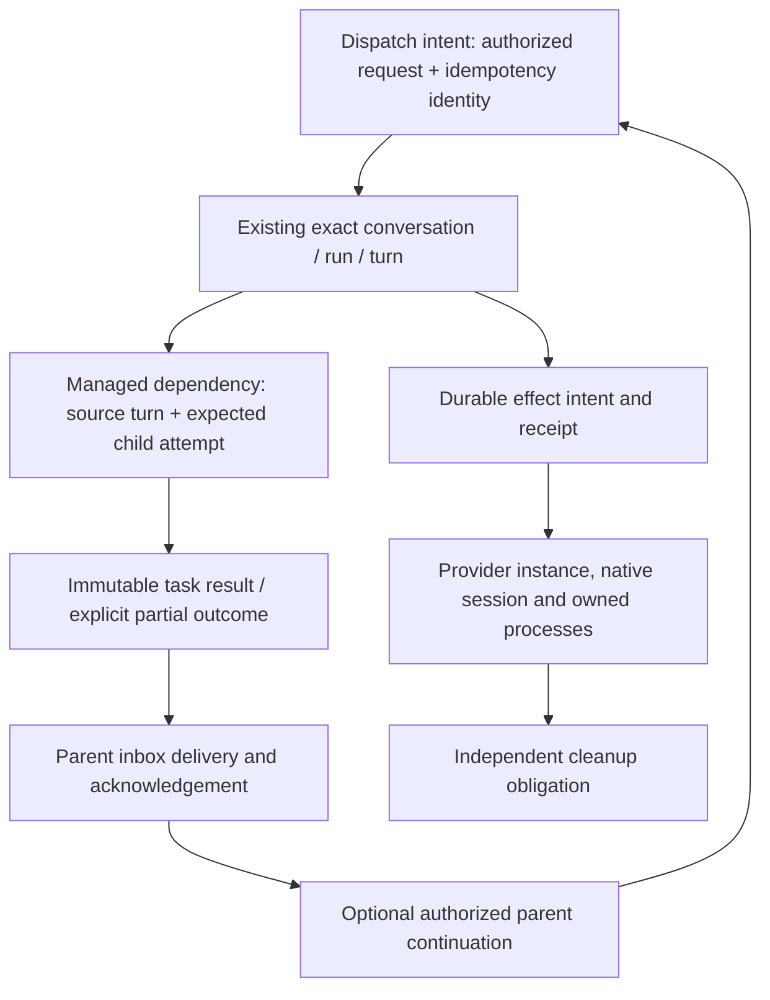

# Inertia ORCHESTRATOR V2: comparison and design discussion

This is a research recommendation, **not an approved implementation plan**. It combines the [independent Inertia audit](inertia-current-state.md) at `9340d9f2b66a880890337d1b1563d5944ce7025d` with the [T3 audit](t3code-orchestration.md) at `dd148481531a0a090780a2ade20588566db099a2`. Source and test entry points are in the two source maps.

## Recommendation

Make durable coordination a first-class layer around Inertia's existing turn lifecycle. Preserve its exact run/turn identity, process-cleanup proof, route-bound context grants, vault, worktree receipts and renderer synchronization. Add common dispatch/effect identities and explicit child-result delivery before broadening provider count or exposing a large new tool surface.

T3's strongest contribution is the relationship between durable intent, execution ownership, provider capability and recovery. Inertia already implements many of those protections in individual domains. The initial task is to connect them through a small set of common contracts, then migrate one workflow at a time. A wholesale copy of T3's schema, Effect runtime or large orchestrator module is not required to reproduce its useful behavior.

The best first demonstrable slice is: **an authorized managed child can finish while the parent is idle or the app restarts, and its result can cause at most one authorized parent continuation without cancelling a replacement child or replaying accepted work.** This exercises the missing coordination contract using existing providers and turn execution.

## Capability comparison

“Gap” below means absent from the inspected Inertia application/host contract, not an assertion that the native provider can never perform it.

| Area | Inertia today | T3 at the pinned current source | Consequence |
| --- | --- | --- | --- |
| Execution authority | Supervised local runtime; explicit IPC; privileged vault and process ownership | Workspace-owning server; normalized commands/events; shared clients | Keep Inertia's process/trust boundary. |
| Stable identity | Project/conversation/run/turn, route/config revision, runtime generation and provider ownership | App thread/run/attempt/node plus instance/session/native-thread mappings | Map concepts explicitly; avoid replacing existing exact tuples with a bare job ID. |
| Durable admission | `TurnLedgerRepository.begin` atomically creates message/turn and consumes certain workflow claims | Receipt, events, projections and effect intent share a transaction | Extend Inertia's admission boundary with narrowly defined dispatch/effect records. |
| Command deduplication | Domain-specific queue/context/managed-operation mechanisms; WebSocket request IDs generally correlate | Durable command receipts plus operation-specific retry keys | Define an idempotency contract for each new mutation; do not retry every transport failure. |
| Publication | Generation-scoped in-memory replay ring backed by authoritative DB state | Sequenced persisted domain events and projections | Durable business intent and renderer replay are different requirements; decide whether a new event log is worth its cost. |
| Completion | Exact terminal state, settlement diagnostics and separate unresolved cleanup obligations | Provider result, finalization and child workflow/result availability are separate | Preserve cleanup as a distinct fact in any new task state. |
| Queue | Durable, route-bound, bounded to three items; explicit release/hold rules | Durable queued runs with selection, reorder/steer and typed system deliveries | Add selection/switch semantics only with migration and ordering policy. |
| Steering | Supported by Codex/Claude/OpenCode paths; exact owner leases and uncertain delivery | Capability-driven native or restart strategy; queued promotion | Reuse existing uncertainty handling rather than hiding it behind a generic “send.” |
| Provider/model changes | Compatibility-aware resume or fresh bounded handoff; narrow safe fallback | Retained native backings plus coverage-aware return/delta handoff and fallback | A multiple-backing registry and coverage/delivery ledger would be a substantive addition. |
| Context | Bounded execution manifests, source/route filtering, explicit grants and paged retrieval | Budgeted chronological whole-entry selection, omitted-item references, native/inline delivery state | Combine coverage tracking with existing Inertia provenance; do not weaken endpoint filtering. |
| Fork/merge-back | No general app command/host API found | Lazy native-or-portable fork at stable boundary; context merge-back | New product/domain contract, not just exposing existing checkpoint restore. |
| Native children | Provider-owned bounded traces; control differs by provider | Native lineage child views, generally distinct from managed mutable threads | Avoid assigning app cancellation/wake authority based on observation alone. |
| Managed children | Visible chats, same project, direct ownership, per-call approval, budgets and exact-turn cancellation | App-owned delegated tasks, nested completion, status/wait/follow-up, durable parent deliveries | Extend existing lineage with optional task result/inbox semantics. |
| Parent notification | No generic managed-child completion inbox found; watchers have specialized wake/delivery state | Batched completion delivery, later wakes, durable acknowledgement and restart guards | Learn from both T3's completion machinery and Inertia's watcher delivery claims. |
| Authorization | Managed mutations explicitly ask on each call, including Full Access; source/target revalidated | Caller capabilities/mode ceilings, live ownership and mutation-lock checks | Decide product authorization semantics before enabling autonomous child control. |
| Restart | Ordinary recovery interrupts unfinished work; planned updates have exact guarded continuation | Reconciliation plus policy-controlled continuation/notifications and held user queue | Do not relabel generic crash replay as “resume.” |
| Usage limits | Account-aware opt-in plan, fresh quota/identity checks and bounded dispatch | Durable reset/run recovery state; Stop disarms automatic resume | Retain Inertia's account checks and adopt a common recovery decision representation. |
| Goals | Native Codex goals; local goal metadata does not implement a general autonomous loop | Provider-native goals can span native turns inside one app run | Keep native goal semantics distinct from a future app-owned workflow goal. |
| Scheduling | Separate update, quota, watcher and Duo workflows; no general cron/job scheduler found | Scheduled tasks alongside ordinary thread services | Unify readiness/claim/outcome interfaces before merging scheduler implementations. |
| Workspaces | Shared/reused/isolated choices with source identity, ownership receipts and compensation | Thread handoff, delegated worktrees and current containment guards | Keep Inertia's more specific filesystem proof; explicitly choose shared-edit policy. |
| Reversal | Checkpoints and selective reversal with validation/recovery receipts | Native rollback coordinated with checkpoint restoration | Specify native conversation and filesystem reversal separately; external effects cannot be generally undone. |
| Provider breadth | Six registered adapters; Cursor ACP, no Pi/general ACP registry path | Cursor SDK, Pi, OpenCode2, registry ACP and more | Add integrations after capability contracts, not all at once with the core rewrite. |
| Native import | Codex/Claude bounded, project-scoped, deduplicated and provenance-preserving | Broader provider-specific inventory/import where supported | Preserve restricted imported-session authority and old history provenance. |
| Agent tools | Reviewed compiled packs, per-run authority and bounded calls | Broad typed MCP control, grouped action schemas and instance-aware injection | Expose the same domain services; retain a minimal preload and reviewed privileged tool registry. |
| Remote/mobile | Private Connect scoped gateway, separate authority from local desktop transport | Shared client runtime and workspace-owning remote environments | Remote parity is a later scope choice, not a reason to replace local security boundaries. |

Inertia evidence is in [inertia-current-state.md](inertia-current-state.md), especially sections 4–14, and [inertia-source-map.md](inertia-source-map.md). T3 evidence is grouped [T02–T16](t3code-source-map.md#t02), [T23–T27](t3code-source-map.md#t23). The [announcement map](announcement-coverage.md) covers the detailed provider/UI bullets without treating every bullet as a required first milestone.

## Preserve these invariants explicitly

1. **Outcome is not cleanup.** A child may be terminal while its provider process has unresolved ownership. A dependency can inspect the result, but workspace reuse or a replacement runtime still needs the appropriate cleanup proof.
2. **Authority belongs to a specific source and target.** Record parent turn/run, expected child attempt, project, route and context grants. A delayed stop or approval cannot target a replacement run.
3. **Accepted work is not safely retryable just because the caller timed out.** Persist intent and look up its result before deciding whether a retry is new execution.
4. **Provider output is evidence, not authority.** Normalize IDs/content; never turn an observed native child or imported transcript into a new cancellation grant.
5. **Historical context is not a native session clone.** Preserve source attribution, route filtering, withheld/omitted markers and retrieval limits. Do not transfer credentials, private reasoning or live tool state.
6. **A project/path string is not filesystem ownership.** Retain canonical identity, realpath/symlink containment, branch/head receipts, safe compensation and refusal when ownership is uncertain.
7. **The renderer is a projection.** Queue progression, budgets, claims, timers and recovery stay in the runtime. Preserve generation/sequence, detail subscriptions, focus and keyboard behavior.
8. **Migration cannot manufacture permission.** Legacy turns and inferred lineage remain historical/observation-only until a valid authority relationship is established.

These are existing Inertia obligations, not optional T3 compatibility choices. See the [Inertia audit](inertia-current-state.md) and repository [AGENTS.md](../../AGENTS.md).

## Proposed contract model for discussion

These names describe responsibilities; they do not prescribe new class names or duplicate tables. Prefer adding references to existing turns and ownership records. The diagram models the proposed managed-coordination slice, not every provider operation: current Inertia compaction uses exact provider run/turn correlation IDs without creating a durable `AgentTurn`, so a broader effect model must also represent non-chat operations explicitly.

**Dispatch intent.** Define stable caller/request identity, normalized request digest, immutable selection/route/workspace snapshot, source authorization, and accepted/rejected/ambiguous outcome. Reusing a key with different intent should reject or replay under an explicitly documented rule. Joining the intent to `TurnLedgerRepository.begin` avoids an accepted message without a work owner.

**Effect receipt.** Record kind, owner tuple, preconditions, attempt, completion and recovery classification. Separate replay-safe writes from native process operations. Claiming and settling require guarded writes. Do not install a generic lease timeout that can launch a second process while the first is still alive.

**Managed dependency.** Record the exact child task attempt, parent source turn, permitted control and completion condition. “Terminal,” “successful,” “result available” and “cleanup confirmed” are different conditions. Preserve immutable original results across follow-ups; represent subsequent work as another attempt/task relation.

**Parent inbox.** Store delivery identity, child result reference, destination and acknowledgement. Batched messages must name precisely the results they acknowledge. A restart between queueing and acknowledgement must neither lose the result nor produce repeated parent turns. A completed parent foreground turn remains historically completed when a new continuation starts.

**Context transfer.** Record source boundary, destination route, grants, budget/omissions and delivery coverage. Native resume, portable handoff, fork and task-result notification need distinct semantics. In particular, T3's later removal of child-result history handoffs is a useful design lesson.

**Capability outcome.** Retain supported/negotiated/unverified/unavailable distinctions. Add provider/backing/operation-specific capability checks where needed, including individual task stop, native fork/revert, background work, async questions and dynamic tool versions. Never infer support from a provider's brand name.

## Decisions to make before coding

| Decision | Recommended starting position | Alternative / cost |
| --- | --- | --- |
| Full event-sourced replacement or incremental durable intents? | Add dispatch/effect records around existing SQLite turn transactions; keep renderer replay separate. Reevaluate a domain event log with measured replay/audit requirements. | A full event-sourced cutover offers consistent replay but requires extensive schema, migration, projection and compatibility work. |
| Meaning of “work like T3”? | Prioritize reliable managed delegation, queue/context continuity and transparent lineage. | Full provider/mobile/remote/tool parity dramatically broadens scope. |
| Managed mutation authorization? | Keep current explicit approvals while designing an opt-in authorization grant bounded by project, allowed operations, mode and lifetime. | Removing per-call prompts without scoped authorization would change product policy and existing guarantees. |
| Parent wake policy? | Opt-in, durable, exact-result-based continuation; never override Stop/archive or unresolved input. | Always waking can surprise users, spend tokens and collide with newer work. |
| Nested tasks and budgets? | Start with current depth/concurrency bounds; make budget ownership visible and define unknown usage. | Arbitrary nesting and hard cross-provider cost caps need accounting and cancellation semantics beyond current telemetry. |
| Shared checkout or isolated children? | Preserve explicit choice; recommend isolated worktrees for parallel modifying tasks. | Shared checkouts are useful for read-only work but require explicit write/attribution policy. |
| Historical provider backings? | Design an instance/backing coverage registry before adding “switch back” continuity promises. | Always-fresh portable sessions are simpler but discard native continuity and require clear lossy-context UX. |
| Fork vs workspace branch? | Keep conversation lineage and Git lineage separate, linked where relevant. | Treating one as the other creates false merge/rollback expectations. |
| Cross-project agent access? | Retain current project and user-granted context boundaries initially. | Current T3 explicit targeting is broader; adopting it is a separate authority decision. |
| Provider expansion? | Stabilize contract tests on current Codex/Claude/OpenCode, then choose Cursor SDK, Pi or ACP registry individually. | Simultaneous migrations make failures hard to attribute and expand the portability matrix. |
| Cutover and compatibility? | Append migrations and introduce capability/version negotiation for new protocol fields. Preserve a recovery path and legacy authority semantics. | T3's one-time database copy is an example, not automatically the right storage strategy for Inertia. |

## Suggested implementation sequence, once approved

| Phase | Concrete deliverable | Existing seam to reuse | Exit evidence |
| --- | --- | --- | --- |
| 0 — Contracts | Written state/authority tables and accepted decisions above | Shared contracts, turn ledger, provider capability manifest | Agreement on completion, cleanup, retry and wake semantics; no production change needed. |
| 1 — Durable admission/effects | One idempotent dispatch path and individually acknowledged coordination effect | `TurnLedgerRepository.begin`, `TurnController`, settlement tasks/effects | Crash matrix proves no duplicate accepted turn/provider launch; failure remains attributable. |
| 2 — Managed result inbox | Stable task result, status/wait and opt-in parent wake for existing managed chats | `AgentThreadManager`, lineage repositories, watcher claim/delivery patterns | First demonstrable slice passes across restart, timeout, stop and replacement runs. |
| 3 — Queue and continuation policy | Common readiness/block reason and typed delivery identity for one additional workflow | Queued-message, update and quota schedulers | Ordering and user-stop precedence preserved; no simultaneous competing schedulers. |
| 4 — Provider/backing/context | Explicit selection transitions, coverage/delivery ledger and safe switch-back/fallback | Continuation policy, route-filtered context manifests/retrieval | Cross-provider round trip preserves stated coverage without violating grants or duplicating native input. |
| 5 — Fork and workspace lifecycle | Lazy native/portable conversation fork and context merge-back, separately scoped Git operations | Provider adapters, creation/worktree receipts, reversal services | Native boundaries, source rollback, inherited history and shared-workspace refusal proven. |
| 6 — Presentation and additional integrations | Lineage/detail UI, bounded task projections; selected provider/tool/scheduling expansion | Existing sync/detail/streaming stores, host packs and portable fixtures | DOM/E2E/platform/provider checks appropriate to each change; context and bundle budgets stay bounded. |

Each phase should be a reviewable series of changes. It is not necessary to convert all existing watcher, Duo, update and quota logic in the first release. A partial migration must have one authoritative owner per workflow, not old and new loops dispatching the same job.

## Acceptance scenarios to carry into implementation

These are proposed tests, not tests added or executed by this research PR. Reuse existing fixture helpers where they already express the case. See [Inertia test evidence](inertia-source-map.md) and [T3 replay evidence](t3code-source-map.md#t28).

| Scenario | Required observation | Cheapest useful layer |
| --- | --- | --- |
| Same dispatch identity delivered twice concurrently | One accepted turn and effect identity; deterministic replay/conflict response | Repository transaction + admission integration |
| Crash after intent commit, before provider launch | Recovery makes one classified decision; no unowned message | Persistence/recovery fixture |
| Provider may have accepted before connection loss | Ambiguity retained; no blind duplicate prompt | Deterministic transport replay |
| Old provider event arrives after replacement attempt | New attempt unchanged; stale observation attributable | Reducer/controller integration |
| Terminal result persisted but stop proof missing | UI outcome and cleanup obligation differ; unsafe reuse remains blocked | Cleanup/ownership integration |
| Child result arrives after parent foreground completes | Original parent outcome unchanged; one optional new continuation | Managed task/inbox integration |
| Crash between result storage, inbox claim, queue and acknowledgement | Result remains available; at most one authorized wake | Persistence fault-injection matrix |
| Several children complete during one wake | Message and acknowledgement name the same cohort; later results remain pending | Inbox state tests |
| Parent wait times out | Child continues; caller receives a wait outcome, not a false task cancellation | Manager unit/integration |
| Child asks blocking input while parent waits | Needs-action result appears promptly; permission approval stays human-owned | Tool/request integration |
| Parent fails after child has a replacement turn | Only owned exact child work can be cancelled | Existing managed-target race fixtures |
| User stops a limited/waiting thread while a sweep runs | Recovery cannot rearm it from stale data | Scheduler/dispatch race fixture |
| Two queued selections request different providers | Each runs with its admitted selection and historical order | Queue/transition integration |
| Switch A → B → A after a long history | Native coverage and missing-context delivery are explicit; prompt unchanged | Handoff/provider replay |
| History injection consumed before an error | No repeated injection into uncertain native state | Delivery/recovery fixture |
| Route/endpoint changes after context approval | Stale grant cannot reveal filtered source material | Context policy integration |
| Provider advertises no fork/rewind/individual-stop | Clear unsupported result before filesystem or unrelated-run mutation | Capability contract tests |
| Source rolls back after a fork | Fork's promised history remains usable; source boundary stays attributable | Adapter replay + persistence |
| Worktree path is swapped or checkout lies outside project | Admission/cleanup refuses unproved ownership | Existing path/receipt integration |
| Native rollback succeeds but filesystem restore fails | Partial outcome/recovery recorded; no false all-or-nothing success | Reversal fault fixture |
| Old database contains inferred lineage only | Upgrade preserves history without inventing control rights | Migration fixtures |
| Renderer reconnects with gap/new generation | Authoritative state rehydrates; duplicate child/result UI does not appear | Sync/DOM tests; E2E for wiring |
| Large graph plus streaming activity | Bounded summary/detail payloads; focus/scroll preserved | Projection unit + geometry E2E/benchmark |
| Linux/Windows process cleanup differs from macOS | Existing process-tree, guardian and receipt guarantees survive | Platform integration/packaged gates |

## Scope deliberately left for later discussion

A generic cron service, arbitrary plugin loading, linked remote-environment delegation, broad cross-project control, every ACP registry agent, automatic Git merge and hard cross-provider monetary budgets are separate product decisions. They are documented research leads, not hidden requirements of the first local coordination slice.

No production code has been changed in this research phase. The next useful conversation is to select the first behavior and authorize its contract and acceptance tests.
