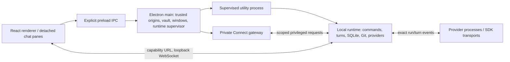

# Inertia orchestration: current-state audit

Audit date: 2026-10-29. Source baseline: `9340d9f2b66a880890337d1b1563d5944ce7025d`. This is the independent Inertia research track for Orchestrator v2; it makes no claims about T3. The companion [source map](inertia-source-map.md) identifies implementation symbols, line anchors, test assertions, and verification limits.

## 1. Findings that should shape the design

Inertia already has a substantial orchestration foundation: a durable SQLite turn ledger; exact conversation/run/turn ownership; provider-specific adapters and capability attestation; process-cleanup receipts; guarded queued messages and continuations; bounded, attributed context transfer; managed top-level chats; and separate watcher and Duo workflows. Replacing these with a generic agent loop would discard meaningful behavior unless their contracts survive.

The missing general abstraction is narrower: the inspected implementation does not expose a durable, provider-neutral job graph with dependency edges, a managed-parent completion inbox, generic scheduling, and a common cross-chat budget. Existing workflows own those concerns separately and with different semantics. This is an audit conclusion from the inspected command schema, controllers, repositories, and tools, not proof that every conceivable orchestration feature is absent.

Four distinctions are especially important:

1. **A turn's outcome, provider cleanup, and UI synchronization are separate facts.** A terminal result does not by itself prove process termination. A stop that exhausts its deadline can finish the user-visible turn while retaining durable ownership and recovery obligations.
2. **Native subagents and managed chats are different products.** Provider-native delegates belong to a native turn/session and appear as bounded traces. Managed chats are visible top-level conversations with their own route, turns, workspace, approvals, lineage, and cancellation authority.
3. **Native resume, fresh context handoff, and replay are different operations.** Native session reuse stays within compatibility rules. Provider/backend changes can create a new session with selected portable history. Renderer event replay is an ephemeral synchronization aid. None is a universal execution rewind.
4. **Identity and authorization survive asynchronous boundaries.** Safe extension requires retaining exact run/turn tuples, route/configuration identity, source-context grants, and filesystem receipts; a conversation ID alone is often insufficient.

Observed behavior is described in the present tense below. Design proposals are explicitly labeled. “Not found” means not found within the listed audit surface. Test inventory is not represented as test execution.

## 2. Scope and method

The audit followed the actual runtime composition root, command routing, durable admission and settlement, provider contracts, continuation logic, host tools, managed-chat mutations, workflow schedulers, worktree operations, import, and renderer synchronization. It inspected relevant implementation bodies and selected test assertions. The source map separates assertion-reviewed tests from additional indexed coverage.

This track made documentation changes only. It did not inspect the user's real app database, provider session directories, credentials, or accounts; invoke live providers; install dependencies; rebuild native modules; switch branches; commit; or push. The coordinating track owns Git and the full verification gate.

Environment observed: Darwin arm64; default shell Node v26.5.0; project engine requirement `>=22.13 <23`; focused checks used `/opt/homebrew/opt/node@22/bin/node` v22.23.2. Effective tool permissions were unrestricted filesystem, network enabled, and approval policy `never`. The exact serving model and reasoning effort were not observable; the requested Astra/XHigh configuration cannot be independently certified by this chat.

## 3. Process and trust boundaries



Electron main creates sandboxed windows with context isolation and Node integration disabled. Trusted renderer IPC is checked before privileged actions. The preload exposes explicit calls, including obtaining a runtime connection; it is not a generic filesystem/process API. Main owns OS credential storage, runtime supervision, windows and browser evidence brokers, and Private Connect hosting.

The main process forks an Electron utility process with a sanitized runtime environment. `src/server/index.ts:startRuntime` is the composition root inside that supervised runtime: it opens persistence, establishes recovery/admission gates, constructs controllers, and listens on an ephemeral port at `127.0.0.1`. The renderer receives a capability-bearing WebSocket URL. The WebSocket boundary validates origins and path authority, limits clients and concurrent requests, and distinguishes detached-window authority.

The architecture is therefore neither “everything runs in Electron main” nor “the React app controls providers.” Privileged runtime code performs persistence, Git operations, provider lifecycle management, and host-tool execution. The renderer holds projections and sends validated commands.

Process safety is a distinct cross-platform subsystem. Main supervision, generation leases, boot identity, cleanup receipt journals, POSIX guardians, Linux policy/cgroup support, and Windows process-tree handling participate in recovery. Startup can refuse replacement admission when cleanup remains unconfirmed. Platform-specific manual recovery paths exist; they should not be flattened into “kill the PID and restart.” This audit did not execute those OS recovery paths.

Evidence: source map A1–A6, A10; `src/main/index.ts:1101`, `src/server/index.ts:148`, `src/server/runtime/websocket-boundary.ts:85`, `src/main/runtime-supervisor.ts:240`.

## 4. Durable model and identity

### Identity layers

| Identity | Meaning and why it must remain distinct |
| --- | --- |
| Project ID | Product grouping and authorization scope; not sufficient proof of the current filesystem object. |
| Conversation ID | Durable chat and selected workspace/route. Many turns and native sessions can belong to it. |
| Repository/workspace identity | Canonical path plus operation-specific identity checks; worktree creation/cleanup additionally uses pinned source and ownership receipts. |
| Run ID + turn ID | Exact application execution attempt and durable turn. Used with conversation/provider identity for events, interactions, steering, stop, and cleanup. |
| Provider-native session/thread ID | Opaque transport identity for compatible native continuation; not a replacement for application turn ownership. |
| Provider task/tool IDs | Native delegate correlation and, where supported, individual cancellation. Never promoted automatically into managed-chat authority. |
| Runtime generation + system boot ID | Process ownership/recovery scope. Different from WebSocket sequence and native session lifetime. |
| Backend profile/revision/endpoint identity | Non-secret route identity and compatibility evidence. Credential generations invalidate stale verification without revealing secrets. |
| Queue item, dispatch plan, host operation, launch or wake ID | Domain-specific durable idempotency and workflow ownership. |
| Renderer sequence | Generation-local ordering for projections; not a durable business-event identity. |

`RuntimeStore` is a facade over many repositories rather than a single monolithic event log. Persisted records include projects/conversations, messages, agent turns, activities, reasoning/plans, usage, execution-context manifests/blobs, context packets and read/delivery provenance, queue entries, managed-thread lineage and mutation operations, provider-run ownership, worktree ownership, paired launches, watcher links/wakes/findings/deliveries, and restart/limit-reset plans. This list describes the audited domains, not every table.

Turn creation captures route/harness/model selection and exact ownership. `TurnLedgerRepository.begin` joins the user message and turn creation in a database transaction; it can also consume queued work, continuation plans and context packets and store execution context. This is the useful existing admission boundary for future dispatch intents.

Settlement has another transactional projection path. Terminal outcome, answer/session metadata, usage and checkpoint references are coordinated with durable conversation/workspace projections. Historical inferred associations and imported transcript turns must retain their provenance; they do not become evidence that Inertia originally supervised those provider processes.

### Migration behavior

The current catalog declares schema **106**; legacy migrations occupy the first 17 positions. Later additions establish explicit turns, execution context, model routing, managed chats, provider/worktree ownership and newer workflows. The final recent sequence includes queued messages (81), managed target ownership (82), session recovery (84), CLI import (92), context reads/transport (94–95), restart continuation (97), watcher links/access (99/101), failure kinds (103), compact-on-return (104), turn indexes (105), and Duo briefs (106).

The runner validates the catalog, rejects unknown applied versions, executes pending migrations and their ledger inserts transactionally, and performs a final foreign-key check for migrations requiring table rebuilds. It restores foreign-key enforcement afterward. Released migrations are append-only under repository policy. Orchestrator v2 should add new migrations and representative upgrade fixtures rather than reinterpret historical rows as new ownership grants.

Evidence: B1–B6; `src/server/persistence/turn-ledger-repository.ts:262`, `src/server/persistence/migrations/runner.ts:278`.

## 5. Commands, events, and projections

Client commands form a validated discriminated union. The command router builds a total ownership index: every command must have exactly one handler. Runtime-level admission checks shutdown, app-update holds, recovery safety and scoped authority before dispatch.

Commands are **not globally serialized**. The WebSocket handler admits bounded concurrent requests; individual domains use conversation admissions, managed mutation queues, checkout reservations, in-memory maps, durable claims, and compare-and-set checks. A request ID is generally correlation, not universal durable deduplication. Queue enqueue and context packet acceptance have stronger domain-specific replay behavior.

Durable database changes precede their authoritative publication where the relevant handler owns that contract. Delivery remains fallible after acceptance. The renderer distinguishes `not-sent`, `rejected`, and `ambiguous`; it does not automatically resend every mutation after a timeout. Ambiguous requests remain registered for late settlement, and late mutation completion can trigger authoritative rehydration.

`RuntimeSequencer` explicitly says it is not an event store. Its defaults retain at most **2,048 events / 4 MiB** in memory. A shell snapshot or oversized event establishes a fresh-hydration boundary. A generation mismatch, cursor ahead of the head, or evicted cursor requires authoritative refresh.

The sync hub owns each socket before hydrating it, replays eligible frames or emits fresh shell/detail state, hydrates pending interactions, then sends a synchronization-complete marker. Detail subscriptions are tied to up to four mounted pane owners. Unsubscribed detail becomes a cursor-only frame to preserve sequence continuity; main windows still receive the interaction inbox. Detached authority applies its own filtering.

The renderer sequence guard rejects gaps and mixed generations and ignores duplicates. “Online” follows completed synchronization, not merely an open TCP/WebSocket connection. These contracts matter if v2 adds richer work graphs: a graph projection should participate in this mechanism rather than establish a second incompatible state authority.

Evidence: C1–C5, U1–U3. No durable universal command inbox/outbox or append-only runtime event store was found in the audited paths.

## 6. End-to-end turn lifecycle

### Send and admission

1. Validate the command and obtain conversation admission.
2. Resolve the route, current model/effort/performance selection, workspace, skills, images and requested context.
3. Enforce update/recovery gates, native-goal mutation gates, watcher/Duo authority and the single-active-turn rule for that conversation.
4. Acquire the relevant provider-terminal/compaction transition reservation; recheck mutable selections after asynchronous preparation.
5. Retain attachments and assemble bounded execution context.
6. Transactionally persist the user message, turn, associated context/delivery/queue facts, and any claimed continuation.
7. Adopt the exact turn into live maps; repair a durable queued turn if adoption fails.
8. Publish acceptance and state; start provider work.
9. Resolve host tools and persist provider-run ownership **before** entering the provider launch path.

The distinction between durable acceptance and provider start is visible in errors and repair code. A UI acceptance response means the turn was admitted, not that the provider has completed or even successfully launched.

Ordinary turn exclusivity is per conversation. Checkout reservations protect specific provider-terminal transitions, workspace operations and destructive/exclusive operations. The ordinary send path releases its transition reservation after start. The audit does **not** establish a universal exclusive checkout lock held for every provider's entire lifetime. Multiple chats sharing a checkout therefore need an explicit v2 concurrency policy; existing isolated-worktree options are relevant.

### Running, interactions and steering

`AuthoritativeRunStateEngine` reduces transport state, retry state, pending approvals/questions, live descendants, cancellation, requested terminal outcome and committed terminal state. Revision counters change monotonically. A child task becoming terminal cannot finish the root. Once cancellation or terminal settlement has been requested, ordinary later provider events cannot reopen the turn.

Approvals and structured questions carry exact provider/conversation/run/turn ownership. Pending interaction cleanup targets that tuple. Asynchronous replies must not authorize whichever turn happens to be current later.

Active follow-up steering is supported by the Codex App Server, Claude Agent SDK and OpenCode SDK paths. A follow-up lease captures the current exact owner, serializes admission and assigns a submission sequence. The coordinator waits for provider start, revalidates ownership, calls steer, and records accepted input. If the provider accepted but the root completed, the accepted follow-up is still persisted. Delivery uncertainty remains unconfirmed; it is not blindly retried as a new prompt.

### Queue and stop-and-send

The runtime queue is durable, bounded to three items per conversation, and tied to a saved route. Enqueue replay uses a request identity plus an intent digest. Attachments are retained with queue ownership; route changes can block dispatch. Dispatch claims the first waiting entry only after cleanup and busy/compaction/hold checks.

Successful turn completion normally releases the queue. An interruption specifically attributed to app update also permits its guarded continuation behavior; arbitrary failure is not treated as permission to drain everything. Ambiguous follow-ups are held for explicit handling. Stop-and-send captures the approved exact turn, enqueues first, then calls exact cancellation; a replacement run must survive a delayed stop.

### Settlement and cleanup

Provider result processing and process cleanup are joined but remain separate facts. The controller persists ownership before launch; the run coordinator tracks exact live owners and cleanup receipts. Normal settlement requests a terminal outcome and waits for owned stop/cleanup. The terminal coordinator flushes text/reasoning, finalizes running activities and delegate traces, persists the terminal projection, then verifies the durable tuple/outcome before releasing active state.

If a persistence attempt fails, the code retries/reads durable state rather than assuming nothing happened. If terminal persistence repeatedly fails, it retains the active owner instead of claiming success.

If stop proof fails or times out, the bounded stop path can settle/release the visible turn while retaining a durable provider ownership marker and unconfirmed-stop state. **Terminal status is not a cleanup receipt.** Startup and later admission/recovery must respect those retained obligations. Likewise, cancellation intent is not proof that the process tree was killed.

Finally, settlement notifies independent owners—queue, title generation, managed threads, Duo, watcher—using `Promise.allSettled`. A callback failure is isolated; the dispatcher does not retry all callbacks because a conversation-level callback might now target a newer turn. This is a natural seam for durable, individually acknowledged effects if v2 needs stronger delivery guarantees.

Evidence: D1–D9, Q1; assertion-reviewed tests T1–T5. The reducer interleaving test covers 12,005 bounded action sequences across five provider labels; this is strong reducer evidence, not exhaustive adapter or distributed-schedule coverage.

## 7. Resume, handoff, fork and reversal semantics

| Operation | Current behavior | Boundary |
| --- | --- | --- |
| Compatible native resume | Uses a saved provider session/thread after route compatibility checks. | The provider owns hidden native state; application ownership remains a new exact turn. |
| Model/effort change | Compatibility is provider/backend-specific. Verified official routes can allow model switching; an effort change is not automatically a session boundary. | Do not infer portability from equal display names. |
| Backend/provider change | Starts a fresh session where policy requires, optionally assembling bounded route-eligible history and file evidence. | Carries selected visible context, not a clone of the previous provider state. |
| Installed-provider change | May still attempt native resume on eligible native/official routes; it does not universally force fresh context. | A narrow failed-resume fallback can then apply. |
| Missing native session fallback | A cleaned-up, unavailable session may be replaced within the same application turn before provider activity/output/interactions. | One guarded fallback; not a general retry after side effects. |
| Imported native session | Codex/Claude import may retain the native session with explicit restrictions. | Imported unavailable sessions are excluded from the automatic in-turn fallback. |
| Application crash recovery | Unfinished work becomes interrupted after safe startup reconciliation. | No universal automatic execution replay. |
| Planned app update | Durable continuation plan can dispatch a new guarded turn. | Exact previous turn, route and update reason; bounded retries. |
| Native fork / provider rollback | No general application command or host-tool abstraction found. | Parser handling of upstream rollback records and a Claude delegate role named fork do not establish a user-facing fork API. |
| Checkpoint restore / selective reversal | Restores attributed filesystem state with safety checks and recovery records. | Does not rewind the native provider session, messages, or reasoning. |

The fresh-session fallback has unusually important guards. It requires an old session, a prepared fallback, no terminal/deferred settlement, no assistant/reasoning output, no pending approval/input, no provider activity, and no imported native-session ownership. The transport wrapper additionally requires failure classified as session unavailable and confirmed cleanup, excludes operation/goal starts, and does not recursively retry the second start.

Compaction is another distinct control operation. It allocates exact run/turn correlation IDs but deliberately creates no durable `AgentTurn`. It requires a compatible saved session, holds provider-terminal/checkout authority, rechecks configuration, joins exact cleanup, records compaction/usage evidence and invalidates prompt-delivery caching. Unknown cleanup retains the lock. Compact-on-return has additional account/route/failure and watcher exclusions. A v2 operation model must therefore allow provider work that is not a user-message turn. Evidence: H10.

For provider handoff, history is filtered by route/endpoint provenance. The packet labels source and target, workspace relationship and omitted/withheld material. File summaries supplement the chat within remaining limits; they are not proof of unchanged filesystem contents. Native reasoning, provider-private tools and complete hidden session state are not portable simply because messages are copied.

Evidence: H1–H4; assertion-reviewed provider-handoff cases T6 and fresh-session guard tests indexed in T15.

## 8. Context, retrieval, provenance and budgets

Inertia has both proactive context assembly and explicit retrieval. It does not rely exclusively on dumping all prior messages into every prompt.

The turn request assembler has explicit byte and count limits: 32 context references, 48 segments, a 240 KiB assembled budget, 64 KiB per stored blob and visible text limit, and hidden-instruction limits of 16 KiB per block / 32 KiB total. Separate packet/import/attachment limits apply. The exact constants and materialization stages are linked in H5.

Execution-context persistence stores a content-addressed manifest and referenced blobs. Instruction digests and continuation restoration/omission facts provide provenance without treating every hidden instruction as ordinary transcript text. Packet acceptance/consumption joins turn admission so a lost renderer acknowledgment does not require duplicating the supplied context.

Conversation context packets have their own bounded source and excerpt representation, sharing choices and delivery records. Agent retrieval through `inertia_request_context` can list turns or page through selected turn material. A chat's own history and context already granted to the current turn have direct paths; unrelated chat access uses a user context chooser. Route/endpoint restrictions are reapplied to reads; withheld turns are reported explicitly. Watchers receive a narrower watched-chat policy and per-wake read allowance.

Retrieval pages are bounded to 30 KiB; default turn listing is 20, maximum 50, and message reading has a separate 1 MiB bound. Text is treated as untrusted evidence, metadata is scrubbed, command secrets are scrubbed, and reads are audited. Images require suitable verified model support; this is not an arbitrary file-read bridge.

Budgets are heterogeneous:

| Budget | Current owner |
| --- | --- |
| Prompt/context/tool result bytes and counts | Host assembly, retrieval and bridge contracts. |
| Native Codex goal token budget | Provider-native goal control. |
| Local goal objective/budget metadata | Application workflow state; does not create a generic autonomous loop. |
| Claude USD ceiling | Native Claude SDK request on the built-in Anthropic route; includes SDK subagent spending according to the request contract. |
| Managed chat creates/mutations/depth/concurrency | Managed-thread repository and manager. |
| Watcher wakes, reads and findings | Watcher link/wake policy. |
| Usage-limit reset wait | Account-aware limit-reset scheduler. |

These are not a unified tokenizer-aware allocation or total project cost budget. A v2 budget abstraction must define scope, estimation versus observed usage, native delegate inclusion, overrun behavior, and how unknown usage is represented. It should not relabel a UTF-8 byte cap as a token guarantee.

Evidence: H5–H8, M1–M4, S1–S4.

## 9. Providers, models, accounts and capabilities

The production registry contains six adapters. Older CLI harness IDs remain in persisted type vocabulary for compatibility, but are not all registered production implementations.

| Production harness | Transport and native continuity | Active steer | Native delegate visibility / individual stop | Inertia host tools |
| --- | --- | --- | --- | --- |
| Codex App Server | App-server RPC/events; native thread resume; native goals. | Supported. | Native delegate trace/liveness support; general individual stop is not exposed by the audited stop controller. | Dynamic tools on new native threads; imported resumed threads are restricted. |
| Claude Agent SDK | SDK query/message lifecycle; native session resume. | Supported. | SDK task traces; exact live task stop supported. | SDK bridge. |
| Cursor ACP | ACP process; resume and several features negotiated. | Not in shared steer allowlist. | Negotiated delegate support/telemetry; no shared individual stop path. | Per-run MCP bridge when eligible. |
| Kimi ACP | ACP process; resume negotiated; explicit compaction unavailable in manifest. | Not in allowlist. | No native subagent-create support declared in manifest. | Per-run MCP bridge when eligible. |
| OpenCode SDK | Owned local server/SDK; native session. | Supported. | Native delegate support; no shared individual stop path. | Per-run host bridge. |
| Antigravity CLI | Native `agy` stream-JSON headless CLI; conversation resume. | Not in allowlist. | No delegate-create support declared in manifest. | Unavailable in the audited manifest. |

This table states implementation contracts, not live installation readiness. Native tools in a provider are distinct from Inertia's host tools. Manifest declarations use native, host-exact-turn, negotiated and unavailable support; runtime attestation also binds installation identity, implementation/protocol revision, configuration and observed/verified evidence. An installed executable or familiar provider name is not sufficient to activate every capability.

The route model separates harness, backend protocol, profile ID, configuration revision, endpoint identity, model and reasoning selection. Custom Responses backends are handled through Codex; custom Messages-compatible routes through Claude. Cursor/Kimi/OpenCode/Antigravity retain their own managed/native routing restrictions. Custom probes must match the current route and credential generation; stale evidence must not silently authorize new endpoints. Built-in/default and custom/official endpoint routes have different compatibility allowances.

Credentials are kept in Electron main's OS-backed vault, with safe public presence/masked state and opaque generations. The runtime resolves secrets through its privileged broker for launch/probe work, not through the renderer or application database. The vault rejects Linux plaintext fallback, serializes mutations, persists encrypted material atomically, and distinguishes clearing a credential from deleting a profile tombstone. Native provider-account authentication and application-managed API credentials are separate systems.

Native sign-in is also provider-specific. The auth command map has distinct bounded status/login paths for Codex, Claude, Cursor, Kimi and OpenCode; Antigravity has no bounded noninteractive status probe in that map. User-requested sign-in is handed to the existing terminal, and an installation lease spans negotiation and handoff so an updater cannot silently replace the executable between them. Backend compatibility probes separately use per-profile/model admission ordering, configuration and credential generations, and installation fingerprints. A late older probe must not overwrite newer evidence. Evidence: V4–V5.

The audit did not authenticate any provider, verify current remote model availability, or call a backend probe. Names/versions here are the reviewed repository contract, not claims about today's upstream service.

Evidence: P1–P8, V1–V5. Portable protocol fixtures, rather than live calls, are the release-blocking contract; the secret-free canary is a separate upstream-drift mechanism.

## 10. Native delegates and managed top-level chats

### Provider-native delegates

Native delegate traces are turn-owned observability, not an independent application job scheduler. Adapters interpret provider task/agent/tool identities, status/liveness, parent references and bounded output. Metadata availability differs. For example, the Claude trace projection deliberately does not invent a model for a fork-role task when it is not attributable.

Native parent completion needs adapter-specific treatment. Codex's continuation gate can hold a root terminal candidate while exact live delegates remain and allow a bounded grace window for parent continuation. Claude distinguishes a background task notification from a parent answer, reconciles live task sets, and can report abandoned delegates or a parent that never resumed. These are transport lifecycle rules, not proof of a generic host mailbox.

The shared individual-subagent stop command currently requires a live Claude trace, a provider task ID, and the same active run/turn before and after the provider call. A v2 “stop child” abstraction must report unsupported control rather than approximate it with an unrelated conversation-level cancellation.

### Managed chats

`AgentThreadManager` exposes list, inspect, context request, create, send, status, latest result, stop and archive. These tools operate on visible independent conversations, not invisible local worker objects. The reviewed tool set does not include generic native fork, wait-all, a durable parent inbox, project CRUD, or a standalone worktree-management API.

Managed mutations require an explicit host approval **on every call, including Full Access**. This is existing product behavior, not a permission requirement imposed by this audit chat. The operation is first reserved durably with source conversation/run/turn, hashed tool-call identity and request fingerprint. Replays/conflicts/budgets are checked, then approved work passes through a per-source mutation queue and is revalidated before acting.

Limits include depth 2, four creates and eight mutations per source turn, 65,536 aggregate create/send input characters (JavaScript string length), and three active children per source conversation. Create prompts are separately bounded; context/result replies are bounded and neutralized as untrusted data.

A child defaults to inherited route/model/effort and cannot request stronger access than the parent. It stays in the same project. Creation supports the shared project checkout, a validated attached worktree, or a new isolated worktree through the same creation service used by UI flows. Durable lineage records source conversation, source turn/run, root, harness and depth.

Successful creation means the child turn was queued/started. Status and latest-result tools must be consulted before relying on completion. The latest-result path does not claim an old answer is the result of a newer running turn.

Cancellation is intentionally asymmetric:

- Parent completion leaves independent child work running.
- Parent non-success cancels only exact child runs dispatched by that source turn.
- A later replacement child run survives an old parent failure or delayed stop approval.
- The parent can mutate only managed targets for which it has direct ownership.
- Interrupted pending management operations are marked interrupted during recovery; they are not indiscriminately replayed.

The built-in build instruction tells the model to wait for its background commands and inspect dispatched chats before finishing, then states that nothing runs after its final reply (`request-context.ts:50`). That is an instruction to the model, not an enforced managed-child join: the manager explicitly leaves independent children running after parent success. V2 should decide whether it wants a behavioral instruction, an enforced join, or an explicit detached-child policy, and make the user-facing promise match.

These properties are a strong starting point for an optional durable coordination layer. A proposed parent wake inbox would need an explicit opt-in policy, exact expected child attempt, deduplication, acknowledgments, restart recovery and authority to dispatch a new parent turn. It cannot be inferred merely from existing lineage.

Evidence: M1–M6, N1–N3; assertion-reviewed tests T4. The host bridge rejects reuse of a provider call ID within a run, even though the managed-operation repository has a durable replay path; these are different layers.

## 11. Host tools and extension boundaries

The host capability registry is compiled, reviewed application behavior. It validates pack and tool identities, instructions and schemas, produces a digest, and records evaluation metadata. Current packs cover orchestration, a frontend browser workbench when enabled, and sandboxed inline HTML visual replies. Repository code is not dynamically loaded as a privileged pack.

The per-run host-tool runtime bounds calls to 128 total and eight pending, with a five-minute host approval timeout. It binds invocation to the current provider thread/turn, propagates abort, rejects duplicate call identities and revokes pending authority at settlement. Tool schemas and returned content are separately bounded.

ACP-style bridges use a loopback-only, bearer-authenticated MCP endpoint owned by one provider run. It checks exact Host, rejects browser Origin headers, uses timing-safe token comparison, bounds body size/deadline/concurrency, and closes with the run. The token is passed to the provider configuration and is not a persisted renderer capability.

Codex dynamic tools are registered when a native thread starts. The audit found no general tool-capability epoch that transparently recreates an existing native thread when compiled host tools change. Imported native Codex sessions deliberately do not gain this bridge. A future tool ecosystem must define versioned session/tool compatibility and migration; widening preload or loading arbitrary repository plugins is not the current extension model.

Evidence: X1–X3, H5; specific provider registration coverage is indexed in the source map.

## 12. Goals, scheduling, retries, watchers and Duo

There is no single generic scheduler behind all continuation features.

**Goals.** Native Codex goals use provider-native control and compatibility/admission gates. Local goals persist objective/status/budget metadata, but their token/time counters can be null and they do not create a provider-neutral autonomous work loop. Skills are separately discovered/resolved for supported native routes and rechecked against the current route before dispatch.

**Planned restart continuation.** App updates prepare durable plans only for eligible active turns: not archived, not watcher-owned, without queued work or pending interactions. On restart the scheduler requires the exact prior latest turn to be interrupted for `app-update`, an unchanged route, and no conflicting work. It dispatches “Continue from where you stopped.” through the normal send path. It polls at five seconds and bounds attempts to three with backoff. Generic crash recovery marks unfinished turns interrupted; it does not automatically repeat them.

**Limit reset.** The usage scheduler offers/saves plans tied to a failed turn, saved route, account identity and reset evidence. Before dispatch it rereads account usage, requires compatible identity and available quota, handles busy work and retries with bounded backoff, and can mark stale/missed plans. This is an account-aware opt-in continuation, not a cron engine.

**Watchers.** A watcher is a separate linked conversation with durable wake state and attributed findings/delivery. The scheduler observes meaningful activities/plans/errors and terminal boundaries; streaming output can update the quiet clock without producing a new wake for every token. Wake dispatch claims a link, builds a bounded digest, records the wake and binds a new exact watcher turn. It has wake/context budgets and final-pass handling. Startup recovers interrupted wakes.

Watcher host tools are deliberately narrower: watched-chat context access replaces the normal orchestration/browser pack. Read-only enforcement is tiered: the shared policy maps Codex/Claude/OpenCode to Inertia enforcement, Cursor/Kimi to approvals, and Antigravity to provider enforcement, with checkout observation as additional evidence; a guard can be inconclusive if other activity makes changes unattributable. There are also editable watcher modes, so “all watchers are read-only” would be wrong. Findings can be manually or automatically delivered by queue/steer with watcher origin preserved. These policies should not leak into ordinary managed-chat authority by accident.

**Duo.** Duo prepares a paired launch with durable claim/dispatch state and an optional comparison conversation. Each side has its own selected route and workspace plan. Worktree creation is tied to pinned source/ownership and compensation; interrupted creation/recovery can require attention instead of deleting uncertain resources. Comparison uses locked source turns and bounded evidence, warning explicitly about failed/cancelled/interrupted partial results. It does not prove a general DAG scheduler or an automatic merge engine.

**Retry taxonomy.** Transport retries, no-side-effect native-session fallback, queue admission retries, planned-update continuation, limit-reset polling, watcher wake retries and Duo compensation have different owners and predicates. A generic retry loop around `message.send` would risk duplicate accepted work or stale authority.

Evidence: S1–S6; restart and queue test assertions are linked in the source map.

## 13. Worktrees, checkpoints and selective reversal

Conversation creation is centralized. Scratch conversations use separate scratch folders and cannot share/reuse project worktrees. Project conversations can use the project checkout, a validated worktree attached to another conversation in the same project, or a newly created isolated worktree.

New worktree creation pins the source workspace/repository identity, validates branch and filesystem conditions, records “creating” ownership before Git mutation, and records a creation receipt afterward. Cleanup uses expected branch/head, Git metadata, filesystem identity and ownership tokens. The implementation acknowledges a residual race: Git's worktree removal itself is not an atomic identity-conditional filesystem operation. Failure must preserve resources and recovery evidence when ownership cannot be proved.

Git is launched without a shell, using bounded time/output/input and sanitized environments. Path/realpath containment, secure root capabilities and pinned identities are checked at mutation boundaries. These protections cannot be replaced by a UI-only path check.

Checkpoint restoration is a filesystem operation under checkout reservation. Before destructive restore it validates the target and ignored-file rules, captures a recovery checkpoint and persists that checkpoint. It is separate from selective reversal.

Selective reversal inspects the complete bounded diff, staged and unstaged state, file/mode/line selection, workspace scope and repository fingerprints. Apply requires the reviewed validation receipt and rechecks state immediately before mutation. Persistent registry/backup refs support recovery. Undo requires the current file and index to match the recorded post-state; later unrelated edits cause refusal rather than overwrite.

No inspected mechanism makes native session rollback atomic with filesystem restoration. If v2 introduces “rewind chat,” its specification must separately address conversation history, provider session state, filesystem/index, worktree lineage and external side effects. Existing checkpoints alone cannot promise that operation.

Evidence: W1–W6; workspace-scope, byte/line-ending and owned-worktree tests are indexed in T16.

## 14. CLI conversation import and deduplication

The implemented import families are Codex and Claude. Scan/preview/import commands are project-scoped and reject scratch destinations. Discovery knows Codex native sessions, archived Codex sessions as context-only, and Claude project sessions. It grants expiring candidate IDs rather than trusting an arbitrary renderer path.

Reading checks canonical containment, no-follow regular files, opened-handle identity and unchanged metadata/path after parsing. It verifies the transcript's cwd still matches the selected workspace. Input is streamed with byte/record/time limits and malformed/dropped-record handling; a preview revision is required by import admission.

Import is transactional and deduplicates provider/session identity, including ownership recorded in historical turns. It reconstructs visible user/assistant groups into completed imported turns with origin metadata and preserves a receipt/source key. Those reconstructed turns are not evidence of an Inertia-supervised original process or a complete native event history.

Native continuation is attached only for eligible sources. Archived Codex sessions remain context-only. Imported Codex native sessions disclose that Inertia tools are unavailable there. A later provider handoff can carry eligible imported visible history into a new session, subject to the same routing/provenance limits.

Evidence: I1–I3; continuation test cases indexed in T17. No generalized import for every production provider was found in the inspected import implementation.

## 15. Renderer, Private Connect and performance-sensitive behavior

The renderer separates shell snapshots, subscribed conversation details and streaming state. `useInertiaConnection` owns transport/correlation; projection hooks and timeline utilities own visible state. A small external streaming store supports selected subscriptions so every token need not rerender the whole workspace.

Timeline virtualization uses row count and render weight, estimates geometry, preserves scroll/focus anchors, and offers bounded minimap/navigation behavior. Focus and keyboard semantics have dedicated DOM tests; actual layout, virtualization, xterm and desktop wiring belong in Electron E2E. V2 should project richer orchestration state without forcing every child event into the complete shell snapshot or bypassing exact active-turn rendering.

Private Connect is a separate privileged gateway, not exposure of the desktop WebSocket token or preload API. Its monitor/collaborate presets map to read/prompt/input/stop scopes, with pairing approval, device/session grants, expiration/revocation and runtime filtering. Prompt admission records a valid device origin, respects update/compaction/provider-terminal gates, refuses an already-active conversation and uses the ordinary turn controller. Remote structured input and stop have their own scoped admission. The scope vocabulary does not imply a generic remote provider-permission approval API.

Performance choices visible in source include delayed post-readiness discovery, coalesced shell publication, bounded replay and detail subscriptions, bounded retrieval/import/trace data, streaming selectors and timeline virtualization. Benchmarks exist for startup, desktop screens/scrolling, provider refresh, Git spawn/checkpoints and content loading. This audit did not run performance benchmarks and provides no latency, throughput or regression claims.

Evidence: U1–U5, R1–R3, A1. New coordination metadata needs projection and retention limits as deliberately as transcript text does.

## 16. Test evidence and confidence

The focused run in this track passed **5 test files / 85 tests**:

```sh
PATH=/opt/homebrew/opt/node@22/bin:$PATH /opt/homebrew/opt/node@22/bin/node node_modules/vitest/vitest.mjs run tests/continuation-policy.test.ts tests/server/authoritative-run-state.test.ts tests/server/authoritative-run-state-interleavings.test.ts tests/server/provider-capability-manifest.test.ts tests/server/harness-capabilities.test.ts --maxWorkers=1
```

This used the installed dependency graph without installation or native rebuild. It proves the selected deterministic tests passed on the observed host. It does not prove all audited behavior passed locally.

The source map identifies assertion-reviewed coverage for cleanup proof, terminal persistence, ownership races, managed approvals/children, handoff route filtering and reducer interleavings. It also indexes broader tests for protocols, queue durability, restart plans, context grants, migrations, worktree/reversal, vault, watchers/Duo, Private Connect and renderer behavior. Indexed tests were not all executed or fully reviewed.

The repository's full `npm run check` combines quality checks, ordinary tests and bundled build. It does not by itself mean every portable, platform, packaging, E2E or performance gate ran. The coordinating track reports **exit 0** for the full gate on Node v22.23.2: **1,404 test files / 17,600 tests passed; 13 files / 149 tests skipped**, followed by successful builds and renderer bundle budgets. This track independently checked those counts and the build/budget tail in `.cache/orchestrator-v2/npm-check.log`; the coordinating chat supplied the process exit result. **This research track did not rerun the full gate.** Live provider behavior, real credentials, Windows/Linux execution, packaged restart/cleanup, E2E geometry and benchmark performance remain unexercised here.

## 17. Risk scenarios and unresolved design questions

These are design risks and questions, not newly confirmed defects unless explicitly stated.

| Scenario | Existing protection | Remaining question / proposed evidence |
| --- | --- | --- |
| Accepted send loses its acknowledgment, then a scheduler retries. | Delivery classification; specialized queue/context deduplication. | Define a durable v2 dispatch intent before generic retries. Test crash after admission and before acknowledgment without a second native start. |
| Child finishes while parent is offline or already succeeded. | Durable lineage/status; successful parent does not cancel child. | Define optional completion inbox ownership, deduplication and new-parent-turn dispatch. Test restart at every publish/ack boundary. |
| Delayed approval or stop targets a replacement run. | Exact run/turn captured and revalidated; existing manager race tests. | Preserve this identity in every new dependency edge, remote control and UI action. |
| UI says terminal but provider cleanup is unknown. | Durable ownership row, bounded stop path, startup recovery gates. | Expose job outcome and cleanup obligation separately; never reuse terminal alone as a release proof. |
| Multiple ordinary chats edit the shared checkout. | Specific reservations, worktree options and scoped reversal; not a universal lifetime mutex. | Choose intentional shared-edit policy versus opt-in isolation. Test parent/child simultaneous edits and attribution before adding auto-merge. |
| Endpoint changes between context approval and dispatch/read. | Route identity, filtered history, guarded admission/read grants. | Bind new context grants and graph edges to an explicit destination route and visibility policy. |
| Native session resumes with an older dynamic tool surface. | Existing imported-session restrictions and instruction digest handling. | Define capability epoch and graceful migration/fresh-session UX before expanding tools. |
| Cross-provider token/cost ceiling claims exactness. | Byte bounds, provider-specific usage and local budgets. | Specify estimation, unknown usage, accounting scope and overruns. Do not advertise a strict global cap without enforcement. |
| Generic retry treats provider activity as harmless. | Fresh-session fallback rejects activity/output/interactions and requires cleanup. | Reuse this narrow evidence model; test accepted tool side effects followed by transport failure. |
| New orchestration pack is treated as arbitrary plugin loading. | Compiled registry, explicit tools and per-run authority. | Decide whether extensibility is declarative or executable; retain privileged review boundary. |
| Recovery backfills missing lineage and thereby invents cancellation rights. | Managed target-ownership migration deliberately avoids inferred authority. | Require provenance for upgraded job edges; old records may stay observation-only. |
| Workflow callback fails after turn commit. | Independent all-settled callbacks and no unsafe global replay. | If reliable effects are required, persist per-effect intent/receipt rather than retrying all owners. |
| Watcher observes concurrent checkout changes. | Guard distinguishes inconclusive evidence and narrower tool policy. | Preserve uncertainty; do not attribute all diffs to watcher or source agent. |
| Broad rewind promises reversal of external actions. | Scoped filesystem checkpoints/reversal. | Define unsupported external effects and native-session behavior explicitly. |
| UI graph grows with every token/delegate. | Detail scopes, bounded replay, streaming selectors and virtualization. | Add bounded summary/detail graph projections and realistic geometry/performance tests. |

Unresolved product choices include whether managed children should auto-wake parents; whether wakes consume a new turn and require prior authorization; whether one parent can own several outstanding continuations; whether dependency completion means terminal, successful, user-accepted, or cleanup-confirmed; whether global concurrency and budgets include native delegates; and whether shared-worktree mutation is allowed by default.

## 18. Incremental migration seams

The following is a proposal grounded in existing boundaries, not an implementation plan already approved or code already present.

1. **Name the contracts first.** Separate job/dispatch intent, application turn, native session, managed child edge, result observation, cleanup obligation, context grant and filesystem ownership. Reuse existing tuples rather than generating a parallel identity system.
2. **Add durable dispatch intent and per-effect receipts above normal turn admission.** Let a small repository claim a specific attempt and join it to `TurnLedgerRepository.begin`. Continue calling `TurnController.queue/start` and existing provider adapters. Introduce idempotency only with explicit semantics for ambiguous prior acceptance.
3. **Extend managed lineage with optional dependency/completion records.** Preserve current visible-chat behavior and approvals. Initially expose read-only graph/status projection; later add opt-in parent wake dispatch with durable deduplication.
4. **Unify policy interfaces before unifying scheduler loops.** Queue, update, quota reset, watcher and Duo can report readiness/block reasons through common types while retaining their existing claims and recovery rules. Migrate one workflow at a time.
5. **Make context transfer a first-class grant/manifest reference.** Reuse packet delivery, route filters and paged retrieval. Add grant expiration/revocation and destination compatibility where new workflows need them; do not copy full hidden native sessions.
6. **Use capability attestation as the provider boundary.** Add explicit capability outcomes for fork, individual stop, wake, native goals and tool-surface versioning. Unsupported and unverified must remain distinct from supported.
7. **Keep workspace mutation in current services.** New graph nodes request validated creation/reuse/cleanup through existing ownership receipts and reservations. Define checkout concurrency before attempting automated merge or rewind.
8. **Project through the current sync protocol.** Add bounded shell summaries and subscribed detail, retaining exact generation and sequence semantics, keyboard/focus behavior and remote scope filtering.
9. **Migrate with recovery fixtures.** Append schema versions; test upgrades without invented authority, crashes around claims/admission/publication, delayed approvals against replacement runs, cleanup uncertainty and route changes. Retain deterministic provider contracts and separate real-provider drift checks.

Acceptance for a first v2 slice should be concrete: one durable managed-child completion can cause at most one authorized parent continuation across disconnect/restart, using the existing turn lifecycle, without leaking cross-route context, cancelling a replacement child, or claiming cleanup from terminal status alone.
