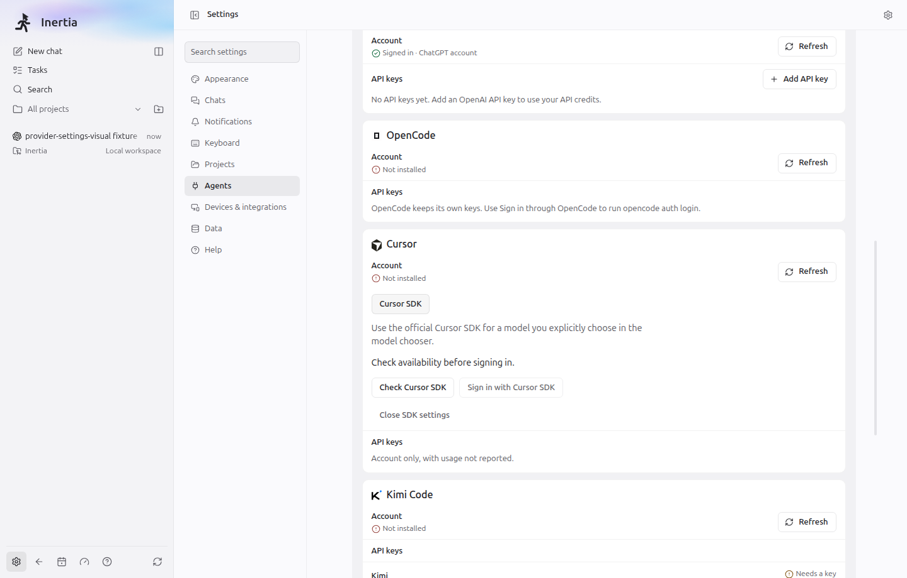

# Phase 3 final checkpoint evidence — 2026-10-30

Draft PR [#686](https://github.com/eduardtomas1/inertia/pull/686) is saved at the
user-requested stop checkpoint. This evidence covers the integration after
`e6189b9b7be91b0aad4f917c81f38c425985e8e5`; it is not final gate clearance.
The phase covers forks, context rollback and merge-back, together with the
already-started Cursor SDK provider and desktop integration. Later V2 phases
remain outside this checkpoint.

## Checkpoint disposition

Implementation and independent reviews are complete for this bounded phase;
**final integrated gate clearance is pending**. The user requested an immediate
state save and handoff on 2026-10-30; no further verification was started. The completed parent
`npm run check` exited 1: quality passed, tests failed, and `build:bundle` was
not reached. No merge or packaged SDK release clearance is implied.

Branch: `orchestrator-v2`. The local HEAD above was verified for this documentation
pass. The parent reconfirmed T3 HEAD
`32ecd71726fee16f335484c1f95cbce126d461f6` on 2026-10-30; no additional upstream
fetch was performed. The existing progress documents retain historical runs;
this checkpoint distinguishes those from completed correction evidence.

The [grouped changed-files inventory](../pr-evidence/orchestrator-v2/changed-files.md)
covers tracked changes against HEAD and every current untracked file, including
screenshots and this evidence. It is a working-tree snapshot, not a commit manifest.

## Completed parent gate and subsequent focused corrections

Counts overlap and must not be added. These are existing logs inspected for this
documentation pass; no build, test or provider call was run by its author.

| Evidence | Completed result and attribution |
| --- | --- |
| `/tmp/orchestrator-v2-final-check.log` | Parent reports EXIT 1; log records 3,540.60 seconds (about 59 minutes), 1,445 files passed / 9 failed / 9 skipped; 17,967 tests passed / 19 failed / 107 skipped; one unhandled error and one failed snapshot. Quality completed successfully (including lint, all TypeScript projects and architecture); build was not reached. |
| `/tmp/orchestrator-v2-continuity-duo-focused.log` | Continuity 45/45 passed after test-only corrections. Combined run was **not green**: 60 passed / 1 failed, with the remaining assertion in Duo inactive recovery. |
| `/tmp/orchestrator-v2-duo-focused-final.log` | Subsequent Duo inactive recovery correction: 16/16 passed. |
| `/tmp/orchestrator-v2-renderer-async-focused.log` | Lazy renderer timing corrections: 67/67 passed across two files. |
| `/tmp/orchestrator-v2-parent-final-regression.log` | Remaining regression batch: 61/61 passed across six files in 135.52 seconds. Migration expectations, Duo deletion lanes, source inventory, indexed query-plan snapshots, measured tool budgets and the Node login boundary pass without update flags. No unhandled error was reported. |
| `/tmp/cursor-sdk-bulk-delete-regression.log` | Replacement-store correction: 22/22 passed; outgoing and replay mutations now share validation. |
| `/tmp/orchestrator-v2-checkpoint-quality.log` | Final `npm run check:quality` passed after all corrections: workflow concurrency, 109 migration lineage entries, architecture, themes, both linters and all five TypeScript projects. |

The full-run failures span continuity, Duo inactive recovery, Duo deletion's
mock command lanes (also the unhandled error), renderer chooser timing,
migration expectations, source usage, agent-surface budget and query-plan
snapshots. Focused passes above do not turn that completed full run green.

## Saved handoff and remaining verification

The user requested an immediate stop, save and push to the draft PR. The final
full-suite rerun was interrupted with SIGINT (exit 130), after 521 completed
passing test lines and no reported test-failure lines. This is a partial run,
not clearance. Log: `/tmp/orchestrator-v2-frozen-full-tests.log`.

Completed after the original failed full gate: final quality passes; the
continuity, Duo and renderer corrections pass; the remaining six-file parent
batch passes 61 tests without update flags. Every original failing category
has passing focused coverage, but the complete frozen-source rerun did not finish.

Next agent should:

1. Read this report, [the changed-file inventory](../pr-evidence/orchestrator-v2/changed-files.md),
   the implementation plan and provider progress. Keep PR #686 draft.
2. Run the complete local test suite on the saved source. Use the shared heavy
   lock `/tmp/inertia-orchestrator-v2-heavy.lock` and bounded workers; monitor
   local tests to completion. The interrupted command was
   `npm test -- --maxWorkers=4 --reporter=verbose`.
3. Run final `npm run test:portable`, `npm run test:linux-package` and
   `npm run build:bundle`, one heavy job at a time. No final portable or build
   run was started after the last corrections. The last application output
   predates the Node-only bulk-delete mutation-validation correction.
4. Record exact outcomes and bundle bytes. Retain the existing notice and
   packaging blockers; do not waive them. The current reviewed renderer output
   passes, but the final rebuilt output remains unverified.

No later phase, live-account call, CI monitoring or merge is authorized by this
handoff. Use only Astra High subagents if delegating; do not use Claude agents.
No code comments or AI attribution. Existing screenshots are settled and ready;
regenerate only if subsequent changes affect them. No test job from this turn
is intentionally left running.

## Earlier focused and integration evidence

The following retained results were received from the owners on 2026-10-30.
They describe earlier source/build states and do not supersede the failed full
check or the pending final gates.

Runs overlap. Counts below must not be added.

| Check | Result and scope |
| --- | --- |
| Parent Cursor command, contract, model, command-policy and event-schema regression | 274 tests passed across five files after the catalogue seam landed. |
| Parent Cursor command and schema type-aware lint | Passed after the catalogue seam landed. |
| Cursor provider focused regression | 72 tests passed across 12 files; overlaps parent command coverage. |
| Provider-owned suite before containment review | 38 tests passed across ten files, including the real enrolled Node 22 worker, exact SDK 1.0.38, SQLite/tree-sitter native bindings and confirmed guardian cleanup after the literal loader fix. Store containment was subsequently found incomplete; this is historical evidence, not clearance of the replacement store. |
| Provider conformance after SDK fixture correction | 95 tests passed. |
| Provider packaging-focused tests | Three files passed; this does not clear the license blocker. |
| Frozen renderer regression | 53 tests passed across nine files; the final preview/pending-load checks overlap this count. |
| Node, web and unit-test TypeScript | Provider reported all three passed; renderer separately reported web and unit passed after three test-query type corrections. |
| Portable run across concurrent edits | 224 files passed, one failed, one skipped; 3,739 tests passed, ten failed, three skipped. All ten failures were in provider-conformance fixtures loaded before their correction. The later 95-test run covers those corrections, but the mixed-source portable run is not final integrated clearance. |
| Architecture after literal loader correction | Passed: 1,834 files and 7,614 import edges. No exemption was added. |
| Electron build | Passed after removing the duplicate SDK entry; the integrated output includes the finite literal loader correction. |
| Electron SDK settings scenario | One test passed in 8.9 seconds on the rebuilt app with `ELECTRON_RUN_AS_NODE` removed from the launch environment. The captured screen was visually inspected. |
| Electron model chooser scenario | Final rebuilt recheck passed one test in 24.2 seconds after the persistent-trigger preview refinement. |
| Main/worker build after literal loader correction | Passed; the real worker/native parser/SQLite probe passed in the final provider-owned suite. |

## Renderer bundle gate after structural reductions

The frozen renderer passes the reviewed limits below. The earlier four failures
were measured and retained in the history of this document. No accounting
exclusions were changed. The exact controlled
baseline builds and matched chooser measurements are documented in
[cursor-sdk-ui-progress.md](cursor-sdk-ui-progress.md).

| Route | Bytes | Limit | Excess |
| --- | ---: | ---: | ---: |
| Main workbench first load | 902,353 | 902,865 | 0 |
| Detached chat first load | 796,117 | 796,629 | 0 |
| Files incremental first load | 145,998 | 153,087 | 0 |
| Transcript incremental load | 621,863 | 649,783 | 0 |
| Deferred composer queue | 13,302 | 13,302 | 0 |
| Core JavaScript | 2,478,063 | 2,478,319 | 0 |

The matched chooser change defers 49,459/49,478 startup bytes and adds 2,495 core
bytes for its persistent wrapper and split. Shared virtualization code moves
into the Files/transcript incremental costs; it does not disappear from total
core accounting. A saved-HEAD source build also exceeded the original startup
and core limits, as recorded in the renderer evidence. These measurements did not make the original full bundle gate green.

After an independent Astra High review, the parent accepted an explicit
allocation correction: Files/transcript receive the measured shared dependency
transfers of 35,327/35,383 bytes, preserving their earlier headroom. Those route
closures overlap and are not summed as unique-byte savings. The total core cap
adds its measured 29,203-byte residual plus 256 bytes of headroom. That residual
comprises 6,432 bytes already present at saved HEAD, 2,495 bytes from the matched
chooser split and 20,276 bytes of remaining integrated growth. The residual is
not independently isolated SDK cost. The 26-byte queue correction is measured;
its precise cause is not established. Both startup caps are tightened to the
final measurements plus 512 bytes.

The unchanged accounting passes on the frozen built output in
`/tmp/orchestrator-v2-reviewed-bundle.log`. The final full application rebuild
remains to be verified. Exact previous limits, attribution and controlled
measurements are recorded in
[renderer-bundle.json](../pr-evidence/orchestrator-v2/renderer-bundle.json).

## Independent SDK review and corrections

The read-only review found three concrete defects. No checks were run by the
reviewer. The earlier successful native-worker probe did not establish safe
descendant store paths or recovery from unconfirmed cleanup.

- Account login/probe completion discarded cleanup uncertainty and released
  admission. The command owners now retain their admission state after a typed
  unconfirmed-termination failure. The provider controller also quarantines all
  account operations and invalidates model/installation evidence. Ordinary
  invalidation cannot clear quarantine; recovery requires application/runtime
  restart through the existing owned-process reconciliation boundary.
- Host callbacks inherited a 30-second private-channel timeout despite the
  five-minute approval window. They now use the explicit existing 30-minute
  turn deadline, shared with the enclosing turn watchdog; turn cancellation
  still aborts host authority and closes the worker channel. A real channel
  test advances four minutes before approval and then permits execution,
  while a companion test cancels the pending approval.
- SDK SQLite descendants could follow redirected paths despite a canonical
  directory. The replacement custom store pins directory and journal file
  descriptors on Linux, rejects symbolic and hard links, fsyncs mutations
  before acknowledgement and uses a kernel flock for single-writer admission.
  The provider-owned 40-test/four-file suite passes, including real-process
  exclusion, SIGKILL lock release, durable replay and path replacement cases.
  This is focused fixture-worker evidence. Independent review is complete;
  the final integrated main rebuild remains parent-owned and pending.

The first two corrections and the replacement-store availability boundary pass
59 tests across seven files in
`/tmp/cursor-sdk-review-fixes-focused.log`, including the harness and shared
host-tool runtime regressions after the shared deadline extraction. Status now
requires `storeKind: inertia-journal-v1`, preserves wrapped cleanup uncertainty,
and refuses non-Linux storage before directory writes or worker admission. Focused
standard and type-aware lint pass. These runs do not replace the full integrated
gate. No real prolonged upstream provider wait is claimed.

## Independent history review and corrections

The review identified rollback request replay, stale cached-page markers,
missing receipts when reusing a merge-back draft, incomplete backing scans and
a delivered merge base falling outside a 256-record preparation window.
All five findings are resolved. The core owner completed the first two corrections and the context-transport
assertions. Command identity durably binds rollback to its original result;
revisioned detail pages invalidate stale cached history. The parent corrections retain a receipt for every accepted draft
request, query the valid delivered base independently of unsuccessful drafts,
and page through the complete backing set using stable IDs inside settlement.

The parent regression run passes 22 tests across four files in
`/tmp/orchestrator-v2-receipt-backing-review-fixes.log`. It covers replay of a
reused draft after delivery, withdrawal and supersession; retaining the delivered
base across 260 withdrawn preparations; portable and native invalidation of
260 affected backings; delayed/cancelled SDK host approval; and explicit E2E
resource classification. The large backing fixture refreshes the intended
session through the repository before the native operation; it does not claim
authenticated provider history behavior. This run overlaps other reported
checks and is not a full-suite result.

New history tests use explicit portable and Electron resource declarations in
their discovery modules, preserving fail-closed classification without adding
source comments.

The independent replacement-store review found one additional write/replay
mismatch in bulk deletion. Outgoing mutations now pass the same schema as replay
before persistence. The store suite passes 22 tests, including rejection above
100,000 deletion keys without changing disk or live records, successful reopen,
and accepted deletion at the exact boundary followed by another reopen.

The core package reported 394 tests across 26 files passing, all five TypeScript
projects, lint and architecture passing, and an earlier real Electron history
scenario passing in 19 seconds. Its transient captures are superseded by the
settled Electron evidence below. These owner-reported checks overlap other
runs and do not constitute final full-suite clearance.

## Agent tool budget attribution

The fixture diff explicitly accounts for existing inherited `inertia_fork_history`
and the `pi` enum in `inertia_create_conversation`. All tool hidden instructions
are unchanged; these increases are not attributed to new phase-3 agent tools.

| Surface | Claude | Codex | Cursor/Kimi | OpenCode |
| --- | ---: | ---: | ---: | ---: |
| Inherited `fork_history` | 624 | 482 | 586 | 586 |
| `create_conversation` Pi enum | 5 | 5 | 5 | 5 |
| Total increase (with and without Browser) | 629 | 487 | 591 | 591 |

The fixture accounts for those costs explicitly; the parent regression batch
passes without the update flag. No hidden-instruction budget was reduced to offset them.

## Platform, storage and scope limits

SDK development availability is Linux only. The single-writer
`inertia-journal-v1` store uses pinned descriptors and advisory flock, rejects
legacy/unrecognized SQLite data, and has no automatic migration or compaction.
Limits: 128 MiB journal, 8 MiB serialized mutation, 6 MiB checkpoint input,
100,000 deletion keys per mutation, 1,000 records per page and 64 ancestor levels.
Full journals, malformed or incomplete trailing records fail closed and require
explicit recovery; an fsync'd but unacknowledged mutation may survive a crash.
Interrupted native turns are not automatically certified resumable. This is
containment of store operations, not an OS sandbox against same-uid/root actors;
advisory locks coordinate cooperating writers. Credential guards cannot classify
all hostile opaque encodings and do not replace the privileged vault boundary.
Other operating systems fail closed at this unverified storage boundary.

Context rollback leaves workspace files unchanged. Merge-back is a visible
user-initiated context draft delivered with the next send, not a Git merge.
Combined rollback/file restore, agent-initiated merge-back, explicit merge source
selection, command/file-change delta items, rollback-to-start UI, Duo/Private
Connect parity and later phases remain outside this checkpoint. Full V2 is not
complete. Provider-native semantics remain bounded by the limits in the
[provider progress](provider-implementation-progress.md) and
[integration seams](provider-integration-seams.md); fixture results do not prove
live native-provider rollback or external-CLI concurrency safety.

No live provider account, paid provider call, macOS or Windows execution is established by these
checks. Packaged Cursor SDK distribution remains blocked by missing upstream
license artifacts, as documented in
[cursor-sdk-license-evidence.md](cursor-sdk-license-evidence.md). No packaging
or notice gate was waived. CI monitoring is outside the requested work.

## Settled Electron history evidence

`/tmp/orch-v2-stable-e2e.log`: **1/1 passed in 1.3 minutes**, using the real
Electron fixture and fake Codex transport. It proves portable context rollback,
fork creation and merge-back attachment; it does not prove live/native provider
rollback. Captures use natural hover/focus to expose opacity-gated turn footers
and wait for “Capturing changes…” to settle; no forced footer styling is used.

Build provenance recorded by that log (2026-10-30, CET):

| Artifact | Timestamp | SHA-256 |
| --- | --- | --- |
| `out/main/index.js` | 11:20:32 | `8e972ce3f9c908def5b26497c8aaadbb552089dddc38bd4fc49becd8690e405c` |
| `out/renderer/index.html` | 11:21:07 | `1a344b7823fc6e5b23b6d78ac93ff667c8be7266f8a67c19519eec9da800b191` |

This build predates the parent's Node-only bulk-delete mutation-validation
correction, which changes no pixels. The final rebuild is pending; these captures
are not evidence that the later Node correction ran inside the built app.

| Settled state | Dark | Light |
| --- | --- | --- |
| Rollback confirmation | [Capture](../pr-evidence/orchestrator-v2/screenshots/rollback-confirmation-dark.png) | [Capture](../pr-evidence/orchestrator-v2/screenshots/rollback-confirmation-light.png) |
| Retained turn after rollback | [Capture](../pr-evidence/orchestrator-v2/screenshots/rollback-retained-turn-dark.png) | [Capture](../pr-evidence/orchestrator-v2/screenshots/rollback-retained-turn-light.png) |
| Merge-back confirmation | [Capture](../pr-evidence/orchestrator-v2/screenshots/merge-back-confirmation-dark.png) | [Capture](../pr-evidence/orchestrator-v2/screenshots/merge-back-confirmation-light.png) |
| Source chat with merge-back draft | [Capture](../pr-evidence/orchestrator-v2/screenshots/merge-back-source-draft-dark.png) | [Capture](../pr-evidence/orchestrator-v2/screenshots/merge-back-source-draft-light.png) |

The files linked above have since been replaced by the phase 3 polish
captures described in the next section.

## Phase 3 polish evidence

Recorded 2026-10-31 on Windows 11 x64 with Node 22.23.1, against the
uncommitted phase 3 polish working tree on top of `52315e95`. Results and
scope are summarised in
[implementation-progress.md](implementation-progress.md#phase-3-polish--2026-10-31).

| Check | Result |
| --- | --- |
| `npm run check:quality` | Passed: workflow concurrency, 110 migration lineage entries, architecture (1,839 source files, 7,650 internal edges), color themes, both linters, all five TypeScript projects. |
| Focused Vitest (16 files) | 207 passed, 0 failed. |
| `npm run build:bundle` | Passed after raising `deferredThreadActionsJavaScript` (9,295 bytes; limit 9,085 → 9,551) and `coreJavaScript` (2,485,123 bytes; limit 2,478,319 → 2,485,379). See [renderer-bundle.json](../pr-evidence/orchestrator-v2/renderer-bundle.json). |
| `tests/e2e/history-rollback-merge-back.spec.ts` | Runs 1 and 3 passed (1.0 minute, 35.6 seconds); run 2 failed on a hover-opacity assertion in the first capture stage, before any step this package changed. |

The Electron scenario uses the fixture Codex app-server, which rejects native
history methods, so it exercises portable rollback and the restored file
outcome only. Refused and failed restore outcomes are covered by server and
renderer tests.

### Migration note

Migration 110 `RaiseConversationContextSupplementBound` rebuilds
`conversation_context_packets` with the `supplement_json` size bound raised from
4,096 to 12,288 bytes so the merge-back work summary fits. It copies every row,
recreates the table's indexes and triggers, runs with foreign keys off, verifies
the copied row count and is a no-op on a database already at 12,288 bytes. Any
other schema shape is refused. A failed rebuild rolls back completely, including
dropped triggers (`tests/server/conversation-context-supplement-migration.test.ts`).
The lineage entry is appended to `database-migration-lineage.json`; no released
migration was changed.

### Captures

All fourteen captures come from run 3 of the Electron scenario above, at
1440 × 920, with natural hover and focus. They replace the earlier phase 3
captures, whose source-chat views still showed the recovery checkpoint under
"Recovered legacy history".

| Settled state | Dark | Light |
| --- | --- | --- |
| Rollback confirmation | [Capture](../pr-evidence/orchestrator-v2/screenshots/rollback-confirmation-dark.png) | [Capture](../pr-evidence/orchestrator-v2/screenshots/rollback-confirmation-light.png) |
| Rollback confirmation with file restore | [Capture](../pr-evidence/orchestrator-v2/screenshots/rollback-files-confirmation-dark.png) | [Capture](../pr-evidence/orchestrator-v2/screenshots/rollback-files-confirmation-light.png) |
| Retained turn after rollback with file restore | [Capture](../pr-evidence/orchestrator-v2/screenshots/rollback-retained-turn-dark.png) | [Capture](../pr-evidence/orchestrator-v2/screenshots/rollback-retained-turn-light.png) |
| Fork merge-up-to-here confirmation | [Capture](../pr-evidence/orchestrator-v2/screenshots/fork-merge-up-to-here-dark.png) | [Capture](../pr-evidence/orchestrator-v2/screenshots/fork-merge-up-to-here-light.png) |
| Merge-back confirmation | [Capture](../pr-evidence/orchestrator-v2/screenshots/merge-back-confirmation-dark.png) | [Capture](../pr-evidence/orchestrator-v2/screenshots/merge-back-confirmation-light.png) |
| Source chat with merge-back draft | [Capture](../pr-evidence/orchestrator-v2/screenshots/merge-back-source-draft-dark.png) | [Capture](../pr-evidence/orchestrator-v2/screenshots/merge-back-source-draft-light.png) |
| Rollback to chat start confirmation | [Capture](../pr-evidence/orchestrator-v2/screenshots/rollback-chat-start-confirmation-dark.png) | [Capture](../pr-evidence/orchestrator-v2/screenshots/rollback-chat-start-confirmation-light.png) |

`cursor-sdk-account.png` in the same directory is the single SDK account
capture described below; it was not re-captured.

## Existing SDK account capture

The existing account screenshot remains valid.

The real Electron fixture opens the single SDK entry inside the Cursor account
card. It checks availability before permitting sign-in. This capture does not
demonstrate a live Cursor account or authenticated catalogue.

