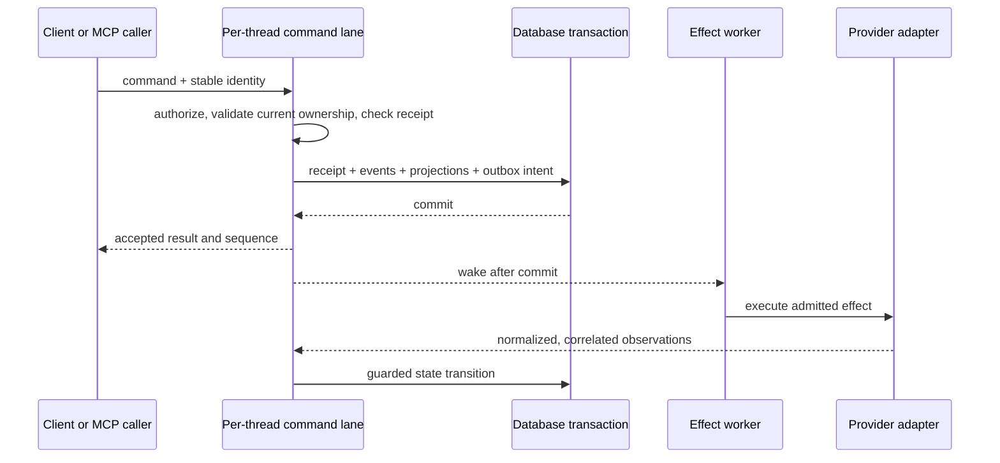

# T3 Code orchestration: implementation study

Research snapshot: 2026-10-29. This is a source audit for an Inertia design discussion, not an implementation specification or a claim that upstream behavior was exercised live. The [source map](t3code-source-map.md) provides pinned implementation and regression-test links for each citation. The [evolution study](t3code-evolution.md) separates the original merge from subsequent changes.

## What the announcement actually represents

[PR #2829](https://github.com/pingdotgg/t3code/pull/2829) merged on October 2, 2026 at `de343914273eceb852a1d1d739cd1d38df7796ee`. GitHub reports 823 commits and 1,912 changed files. This was a replacement of the orchestration foundation plus provider and client integrations, not just a multi-agent feature. The screenshots accurately identify that PR.

The central architectural move is to make the application own durable work and history independently of any provider's session. Provider adapters translate native behavior into that model. Switching providers, surviving restart, showing native children, queuing work, and exposing MCP control then share the same lifecycle machinery. [T01](t3code-source-map.md#t01), [T02](t3code-source-map.md#t02)

The current audit pins main at `dd148481531a0a090780a2ade20588566db099a2`, committed October 29 at 20:43:23 UTC. The first stable V2 was [v0.1.0](https://github.com/pingdotgg/t3code/releases/tag/v0.1.0) on October 15. The latest stable observed was [v0.1.5](https://github.com/pingdotgg/t3code/releases/tag/v0.1.5); the observed nightly was `v0.1.6-nightly.20261029.3892`. Main is later than both. “Current” below always means that pinned source, not a blanket stable-release guarantee.

## Execution and identity boundaries

Execution belongs to the server environment that owns the checkout. Clients render and issue commands. The desktop renderer does not become the authority for provider processes, Git, credentials, timers, or queue advancement. Shared client state lives in `packages/client-runtime`, so web, desktop, and mobile can consume the same projected state. [T01](t3code-source-map.md#t01), [T27](t3code-source-map.md#t27)

The data model separates concepts that are easy to collapse prematurely:

| Concept | Responsibility | Why the distinction matters |
| --- | --- | --- |
| App thread | Stable user conversation, project/workspace association and selection | Survives provider changes and runtime replacement. |
| Run | App-owned unit of admitted work, with queue and completion state | One visible task need not equal one native provider turn. |
| Run attempt | A particular execution attempt | Late events from an earlier attempt must not complete new work. |
| Execution node | Root and nested execution structure | Native child completion is not parent completion. |
| Provider instance | Configured integration/account lifecycle | Two accounts using the same driver must not share mutable runtime state. |
| Provider thread | Durable native conversation backing and coverage | Can survive a live process ending; several backings can belong to one app thread. |
| Provider session | Live adapter/runtime handle | Process loss does not erase app history or prove native resume is possible. |
| Provider turn/reference | Native correlation information | Native IDs are scoped; they are not global app IDs. |
| Runtime request | Question/approval and its response capability | A persisted question and a lost live RPC require different recovery. |
| Context transfer | Source, destination, boundary, intent and resolution | Records a fork or handoff before native resources necessarily exist. |
| Context handoff | Materialized, budgeted historical context and delivery state | Makes omitted history and uncertain delivery explicit. |
| Checkpoint scope | Ownership of a workspace snapshot | Conversation rollback and filesystem reversal are related but distinct. |

Contracts use typed identifiers and explicit relationships. Mapping a native item requires the relevant instance, session/thread and execution context; a raw ID alone cannot safely route an event. Ordered projected turn items are the application transcript. Raw protocol diagnostics remain a separate concern. [T02](t3code-source-map.md#t02)

An additional current nuance is native goals: a single app run can encompass several native turns while the provider continues a goal. A slash command that never starts a native turn must not increase the rollback count. Counting “assistant finished” events as app task completion is therefore insufficient. [T17](t3code-source-map.md#t17), [T18](t3code-source-map.md#t18)

## Commands, committed intent, and side effects

The important guarantee is local atomicity: accepted command receipt, domain events, persisted projections, and outbox entries commit together. `EventSink.commitCommand` reserves the receipt, appends events, updates projections, and records effects in the transaction. Publication happens afterward, under an ordered publication lane. A client acknowledgement proves intent was committed; it does not prove the provider finished. [T03](t3code-source-map.md#t03)

Per-thread command serialization protects state decisions. Some cross-thread operations also coordinate parent and child locks so a follow-up cannot race a stop into orphaned work. Receipt replay returns the original outcome; receipt identity is checked rather than allowing a command ID to silently act on another thread. Guarded writes compare ownership/current run before accepting asynchronous results. This is more than keeping an in-memory `busy` flag. [T03](t3code-source-map.md#t03)

The outbox records pending/running/succeeded/failed/cancelled effects. Workers use ordered lanes and bounded retry policies. Effects for separate threads may progress concurrently, while earlier retryable work can hold the relevant lane. Tests explicitly cover duplicate dispatch, stale start effects, concurrent claims, cancellation between claim and registration, and not reclaiming already running process-local effects merely because time passed. [T04](t3code-source-map.md#t04)

This is **not global exactly-once execution**. Database commit and external provider activity cannot share a transaction. Process-bound effects such as start, steer, interrupt, restart, and live request responses must be reconciled after process loss, not replayed as if they were harmless writes. Other effects are deliberately replay-safe. Ambiguous history delivery similarly requires a fresh native backing rather than blind reinjection. [T04](t3code-source-map.md#t04), [T07](t3code-source-map.md#t07)

The current `Orchestrator.ts` is still a very large module, despite many extracted services. Its useful lesson is the ownership and transaction boundary, not its size or a requirement to adopt Effect across Inertia.

## Queueing, steering, interruption, and completion

Queue entries are durable runs/messages with delivery positions and model selections. Editing a picker while one run is active must not retroactively change that run. Delivery resolves the queued selection and can apply a provider transition at the correct point. Users and tools can inspect, edit, cancel and reorder eligible queued work or promote it to steering. Provider capability determines whether steering is native or needs an interruption/restart strategy. [T03](t3code-source-map.md#t03), [T05](t3code-source-map.md#t05), [T06](t3code-source-map.md#t06), [T12](t3code-source-map.md#t12)

Current ordering has an explicit exception to simple FIFO: automatic delegated-completion runs take priority over ordinary queued runs. Within the remaining order, queue position and ordinal break ties. Automatic completion entries cannot be arbitrarily reordered or promoted to steer. Treat these as typed deliveries, not indistinguishable strings in one queue. [T05](t3code-source-map.md#t05), [T03](t3code-source-map.md#t03)

An interruption request is distinct from a confirmed terminal result. Stop also has to account for queued work, native background tasks, delegated work and pending continuation. Several later fixes specifically close races where a child follow-up or usage-limit sweep would restart something the user stopped. [T10](t3code-source-map.md#t10), [T14](t3code-source-map.md#t14), [evolution](t3code-evolution.md)

Provider completion, checkpoint finalization and workflow result availability are separate milestones. A slow diff/checkpoint should not inflate provider duration or leave the UI saying the provider is still working. A parent with unfinished children can need a workflow-level wait even after its foreground native turn ended. Tests await persisted outcomes or drainable workers, not just an empty queue or a sleep. [T05](t3code-source-map.md#t05), [T10](t3code-source-map.md#t10), [T28](t3code-source-map.md#t28)

## Provider changes and portable context

Provider selection is a plan, not a string replacement. The planner considers instance/account continuity, driver, workspace, runtime policy, requested model/options, backing coverage, and negotiated capabilities. Its outcomes distinguish reusing a session, changing a model in-session, restarting and resuming, creating with a handoff, and rejecting an unsupported transition. Unknown or incompatible transitions should be explicit failures. [T06](t3code-source-map.md#t06)

Returning to a previous provider can reuse that provider's native conversation and supply the intervening app history. A fresh provider gets a fuller handoff. Failed native resume can fall back to a fresh backing with portable context where the failure and capability policy allow it. A current context-exhaustion path also replaces the native conversation when appropriate, guarded against losing ongoing background work. None of this means every native state can be translated. [T06](t3code-source-map.md#t06), [T08](t3code-source-map.md#t08)

The code's “summary” terminology is misleading if read as “ask an LLM to summarize everything.” The audited portable path deterministically selects intact historical entries and renders them with provenance. Short histories fit intact; longer histories retain prioritized entries within a budget and expose what was omitted. The current prompt remains separate. [T07](t3code-source-map.md#t07)

The budget implementation:

- Uses estimated serialized/UTF-8 cost, not an exact provider tokenizer.
- Starts with a default history allowance of 16,000 and clamps configured allowance to 1,024–64,000.
- Reserves space for the new prompt, attachments, native occupancy and output/safety allowance; an unknown context window uses a conservative model default.
- Prioritizes latest user/assistant context and initial user context, then fits additional intact entries while restoring chronological order.
- Records omitted item IDs/counts and includes instructions for retrieving historical activity with pagination.
- Fails if required context framing cannot fit; it does not silently shorten the new request.

Historical portable content includes selected user/assistant text and normalized command outcomes, errors, interruption notices, filenames and proposed plans. It excludes private reasoning and live native tool state; this is not a faithful replay of the original provider's tool protocol or old attachments. Command outcome attribution was already present at the merge, so it must not be misreported as a post-merge enhancement. The release notes use a simpler description of lossy conversation handoff; the actual representation is more specific. [T07](t3code-source-map.md#t07)

Delivery records distinguish pending, injected and inline history for a native backing. Before native injection, delivery intent is persisted. If the process fails after it may have consumed that history, retrying the same injection risks duplication; the code reports uncertainty so the caller can replace the native thread. Multiple handoffs share one effective budget and deduplicate already delivered item IDs. Native injection and inline prompt context are alternatives, not two copies of the same history. [T07](t3code-source-map.md#t07)

For Inertia, this argues for recording explicit coverage and delivery state before expanding provider switching. It does not justify promising lossless migration. The [v0.1.0 release](https://github.com/pingdotgg/t3code/releases/tag/v0.1.0) itself recommends delegation as another way to combine different harnesses without repeatedly replacing a main conversation.

## Forks, native children, and delegated tasks

These are three different relationships:

1. **Fork:** an independently usable conversation derived from an explicit stable source boundary. Native resources are resolved lazily, so the first message can choose a different provider. Same-instance native fork is preferred when supported; portable context is the fallback. Failed/interrupted/cancelled terminal work can be a source, but an active or already rolled-back source is rejected. Provider-finished work can be forkable before checkpoint finalization completes. [T09](t3code-source-map.md#t09)
2. **Native subagent:** work created inside a provider's own runtime. T3 projects its lineage, model, status, history and results into child-thread views without pretending it owns an independent mutable application session for every native child. Cancellation still needs native task identity. [T11](t3code-source-map.md#t11)
3. **App-delegated task:** T3 creates an app-owned child with a selected provider, model, options, role and explicit task prompt. The child inherits compatible settings within the caller's permission ceiling, not a wholesale copy of the parent's transcript. Its progress and result are separately tracked. [T10](t3code-source-map.md#t10), [T13](t3code-source-map.md#t13)

Context merge-back transfers findings to the source conversation; it is not a Git merge. Forked workspace changes need their own Git review and integration. Inherited history, source rollback and inclusive native boundaries require explicit tests. Current Codex rollback uses paginated turn listing and `thread/revert`; the old lineage design note describing this as unimplemented is stale, including at the original merge. [T09](t3code-source-map.md#t09), [T17](t3code-source-map.md#t17)

Delegation supports asynchronous return or bounded wait. A timeout stops waiting, not the child's work. Status differentiates foreground work, waiting for nested work, actionable input and available results. A blocking question/approval must return a needs-action outcome rather than wait indefinitely for a completion that cannot happen. Follow-ups do not overwrite an earlier task's original result. [T10](t3code-source-map.md#t10)

Parent notification is a delivery problem of its own. Eligible child results can be batched, later completions produce later wakes, and durable acknowledgement prevents lost or repeated delivery. Current completion notifications are queued messages/mailbox work rather than historical-context handoffs; this was changed after the merge. Restart, pending child questions, checkpoint completion and parent Stop all participate in its guards. [T10](t3code-source-map.md#t10), [evolution](t3code-evolution.md)

## MCP control is a domain API with caller identity

T3 exposes discovery, delegation, task status/cancellation, thread creation/launch/list/read/search/send/wait/interrupt, fork/merge-back, queue management, model selection, metadata/PR links, schedules, attachments, worktree handoff and previews through typed tools. Current tools include grouped `action` forms; do not design against a frozen tool count from the original document. Tool handlers call the same command/services as client actions. [T12](t3code-source-map.md#t12)

Tool credentials bind an environment, calling thread, provider instance and provider session/request namespace. Tokens use random bytes and are held through a hashed in-memory registry, with revocation and an inactivity window. A request cannot revive an already expired credential; trusted runtime activity has a separate refresh path. Credentials for native background children may need to survive foreground turn completion, but that is not unlimited permission to mutate a stale thread. [T13](t3code-source-map.md#t13)

Access wrappers classify read, thread-write, environment-write, caller-only and thread-start operations. They enforce client read-only state, live caller ownership and runtime/interaction-mode ceilings. Dispatch checks again under the mutation lock, because authorization observed before a concurrent mode change can be stale. Delegation cannot silently grant a child more privilege than its parent. [T13](t3code-source-map.md#t13)

Two qualifications matter:

- The screenshots describe ordinary reads as project-scoped. Current explicit-target tools can read other projects in the same environment; the default project is a convenience, not a universal authorization boundary. This changed in [#15219](https://github.com/pingdotgg/t3code/pull/15219). Inertia should choose its own explicit cross-project policy.
- Current pending-request tools filter for user-input requests and cannot answer permission approvals. A later PR enabling approval responses was reverted. Do not infer permission power from a historical feature title. [T12](t3code-source-map.md#t12), [T13](t3code-source-map.md#t13)

Retry keys are operation-specific. Current thread launch accepts a `clientRequestId` scoped to the caller's namespace, derives stable IDs, and replays accepted work rather than provisioning another worktree. This does not make every tool automatically idempotent or make a key portable across all future sessions. [T12](t3code-source-map.md#t12), [T23](t3code-source-map.md#t23)

## Restart and usage-limit recovery

Recovery reconciles durable app intent against dead/live native resources before admitting new work. It retires process-bound outbox work, repairs or terminates incomplete execution, reconciles native/background children, and applies continuation policy. Ordinary queued user work can be held until resumed; eligible system notifications and controlled continuation have separate paths. “The queue survives” must not mean “everything immediately executes after boot.” [T14](t3code-source-map.md#t14)

Runtime requests carry a response capability. An approval tied to a lost live provider request cannot remain an actionable approval. A message-mode question can persist and be answered by a new message, including after a restart. Current async-question handling validates answers and atomically resolves the request with its answer-message intent. Repeating a command returns its receipt. [T14](t3code-source-map.md#t14), [T17](t3code-source-map.md#t17)

Automatic continuation considers archival, settlement, snooze, pending input, provider identity and ongoing children. Current restart continuation has a chain limit of three within the recent continuation window to avoid endless restart loops. The policy distinguishes continuation from blindly replaying an old native call. [T14](t3code-source-map.md#t14)

Usage-limit recovery requires a failed latest run classified as a usage limit, a valid future reset reported relative to that failure, and no conflicting pending request/state. A durable recovery record identifies the run and reset and records the user's auto-resume/snooze choice. The worker arms or resumes using stable command identities. Manual Stop disables recovery, including against a sweep that read an older candidate. A missing or already expired reset does not justify repeated speculative retries. [T15](t3code-source-map.md#t15), [T03](t3code-source-map.md#t03)

## Provider integrations: normalize capabilities, preserve differences

The current common adapter contract is in `packages/provider-core`; several integrations moved into provider packages after the merge. A driver describes an integration; an instance owns one configuration/account; a session negotiates actual supported behavior. Instance/session factories, transition planning and normalized events are the reusable design. Native hooks, auth storage, history models and process semantics remain provider-specific. [T16](t3code-source-map.md#t16)

| Integration | Implementation choices relevant to Inertia | Qualification |
| --- | --- | --- |
| Codex | Native thread/turn IDs, paginated turn boundaries, resume/fork/revert, native history injection when supported, async questions and goal/native-child correlation | Version capabilities matter. Legacy history mode does not provide the current revert path. [T17](t3code-source-map.md#t17) |
| Claude | SDK runtime, native session resume/fork, transcript/query reconciliation and child tracking | Native history and rollback semantics differ from Codex; source rollback must not destroy a fork's usable context. [T18](t3code-source-map.md#t18), [T09](t3code-source-map.md#t09) |
| Pi | User-installed RPC runtime, native session files, extensions/dialogs, skills, thinking levels and an injected namespaced T3 bridge | Forking into another directory uses a CLI path because native RPC switching retains the original cwd. Native extensions execute according to Pi's own trust behavior. [T19](t3code-source-map.md#t19) |
| Cursor | Official SDK integration, per-instance credentials/auth/catalog, normalized tools/plans/reasoning and native child display | Steering may interrupt/restart; portable forks are not native session cloning. Sandbox translation is platform-specific: the Windows SDK lacks filesystem sandboxing, so eligible defaults rely on auto-review; explicit policies remain authoritative. [T20](t3code-source-map.md#t20) |
| OpenCode | Version probe chooses 1.x or 2.x. V1 managed execution uses per-thread servers; V2 pools a server per instance and scopes MCP entries/rules per thread | Shared-server approvals must not escalate sibling sessions. Automatic replies use `once`; external servers remain externally owned. Native child/background/restart behavior requires its own mapping. [T21](t3code-source-map.md#t21) |
| ACP registry | Registry installation/probing plus a generic ACP runtime; discovery of models/config/modes, auth, questions, resources, tools and native session operations where advertised | Checksums are verified when provided; registry presence is not proof of uniform capabilities. Unsupported media/actions need explicit outcomes. [T22](t3code-source-map.md#t22) |

The October announcement names more providers than Inertia currently integrates. Provider breadth should follow a stable adapter and lifecycle contract, not drive a simultaneous rewrite of every adapter. Do not copy T3 credential storage into Inertia: Inertia's privileged vault invariant remains binding.

## Workspaces, checkpoints, scheduling and clients

Worktree handoff is a coordinated workspace change: serialize concurrent handoffs, create/validate the target, rebind the thread, detach the old provider session and optionally queue a continuation. Merely changing a thread's cwd field is insufficient. Current delegated work can also receive a dedicated worktree; branch/base and ownership checks prevent accepting arbitrary unrelated checkouts. [T23](t3code-source-map.md#t23)

Checkpoint restoration validates the checkpoint's scope and thread/provider relationship, rejects unsafe shared-workspace restoration and coordinates native rollback before filesystem changes. The ordered operations are not a magical atomic transaction across Git and the provider; failure handling and attributable state remain necessary. Inertia's existing reversal containment should be preserved and tested independently of conversation rollback. [T24](t3code-source-map.md#t24)

Schedules and automatic thread settlement live on the server. They do not need an open renderer to make progress. Scheduling launches work through ordinary lifecycle services; metadata actions cannot discard live or blocked work just because the UI decides a thread looks idle. PR discovery/settlement similarly rechecks current branch and activity. These are downstream uses of the same durable work model, not substitutes for it. [T25](t3code-source-map.md#t25)

Clients consume sequenced projections and bounded history, reconcile snapshots and events, and use shared native-child presentation. Provider/model transitions, question state, lineage and execution state are domain data rather than text guessed from messages. Mobile support follows from shared contracts and execution ownership, but mobile UI paths still need separate tests. [T27](t3code-source-map.md#t27)

## Migration is part of the architecture

T3 made a one-time copy from `state.sqlite` to `statev2.sqlite`, then migrated the copy. App metadata and user/assistant history are preserved; live sessions, historic checkpoints/diffs, approval history and native activity are not reconstructed as V2 state. Shells import first and transcript materialization can be lazy. First continuation creates a fresh native session with bounded legacy chat context. The legacy handoff uses its own 32,000-character suffix budget, distinct from current portable provider handoffs. [T26](t3code-source-map.md#t26)

V1 and V2 subsequently diverge; keeping both databases is not bidirectional sync. Client/server protocol compatibility is checked before allowing mixed orchestration versions. Current migration code also checks divergent preview migration histories because an ID-only ledger can silently skip a different migration with the same ID. Inertia must retain append-only transactional migrations and representative old-database tests regardless of which cutover mechanism is selected. [T26](t3code-source-map.md#t26)

## Evidence and test strategy to reuse

Upstream tests cover persistence transactions, receipt replay, per-thread effect ordering, stale-event guards, native protocol replay, handoff budgets and uncertain delivery, fork boundaries, checkpoint ownership, delegation wakes, permission races, restart recovery and queue behavior. Its replay harness substitutes provider transport/process boundaries and drives real normalization and orchestration rather than mocking every internal service. [T03](t3code-source-map.md#t03), [T07](t3code-source-map.md#t07), [T10](t3code-source-map.md#t10), [T13](t3code-source-map.md#t13), [T28](t3code-source-map.md#t28)

This study inspected those sources and selected test bodies; it did not run T3's suite or authenticate live providers. The test list is a map for later verification, not a claim of upstream correctness. Several historical design pages are demonstrably behind the implementation. Use [the evolution corrections](t3code-evolution.md#documentation-drift-and-reversals) before turning any of them into acceptance criteria.

The strongest transferable lesson is that identity, admitted intent, recovery policy and observable delivery must be designed together. A new “orchestrator” facade over unchanged session state would not by itself deliver the behavior in the screenshots.
