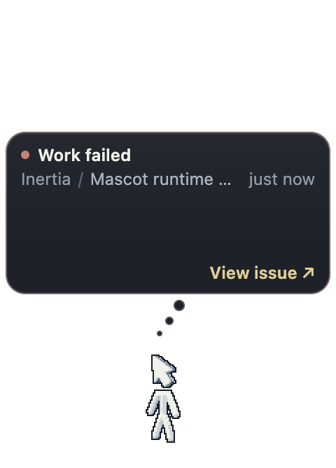
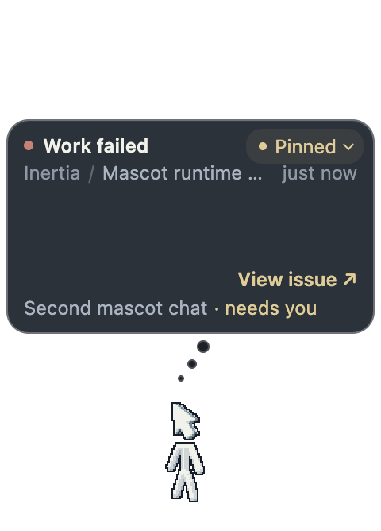

# Mascot failed label

Captures of the mascot overlay in the built Electron app on macOS (arm64),
taken by `tests/e2e/mascot.spec.ts` with its synthetic fixture (no real
provider, no user data).

## Why

The nightly "Linux ARM64 Electron (display-sensitive)" lane failed in
`tests/e2e/mascot-chats.spec.ts` because the failed-state label
"Something went wrong" did not fit beside the chat picker: the ARM64 runner
image has no Arial-like font, so the label falls back to DejaVu Sans, which is
about 13 px wider than the space left next to the picker. The label is set to
clip with an ellipsis, so Linux users on that font would see it cut off. With the
picker at its widest ("Pinned" plus the attention dot) even the narrower fonts
run out of room.

## What changed

The failed label is now "Work failed", in line with "Work complete",
"Work cancelled" and "Work interrupted". No layout or font changes.

| Before (main) | After |
| --- | --- |
|  |  |

Widest picker state, new in the spec:

## What the spec asserts

- `mascot.spec.ts`: after pinning one chat while another needs input, the picker
  reads "Pinned" with `data-attention`, the mascot is in the failed phase, and
  the label's `scrollWidth` is within its `clientWidth`.
- `mascot-chats.spec.ts`: the existing check that the label fits over running
  chats, with the new wording.
- `tests/renderer/mascot.dom.test.tsx`: status text and spoken summary use the
  new wording.

## Runs on this machine

- `mascot-chats.spec.ts` + `mascot.spec.ts --max-failures=1`: 3 passed.
- The same with `--repeat-each=3`: 9 passed.

## Not exercised

- Linux ARM64 itself: the lane runs only in the nightly schedule. The widest
  picker assertion is the local proof; the nightly run after merge is the final
  one.
