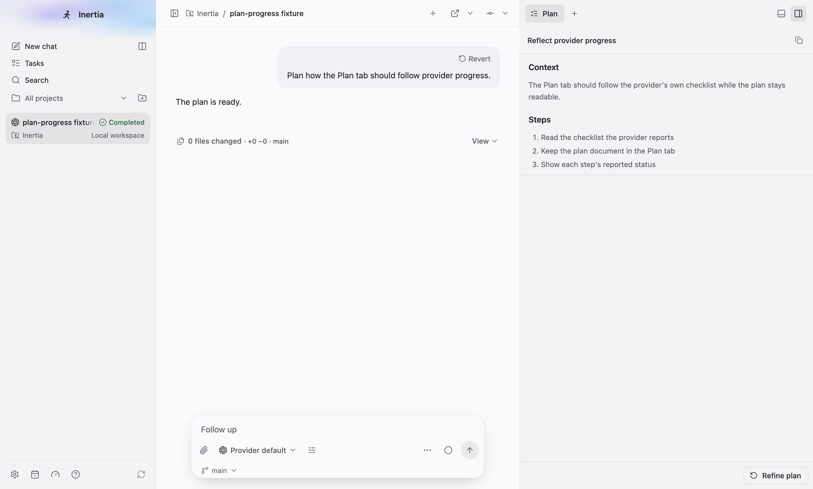
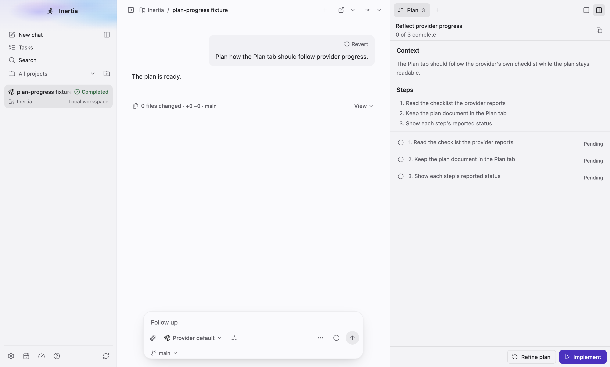
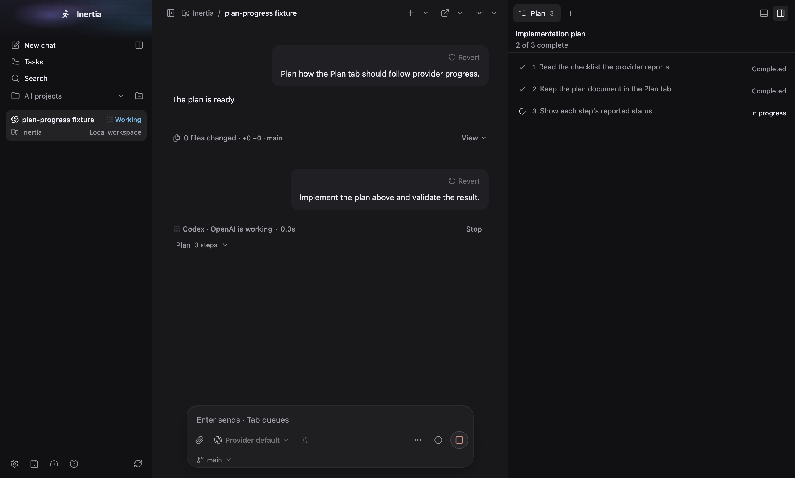
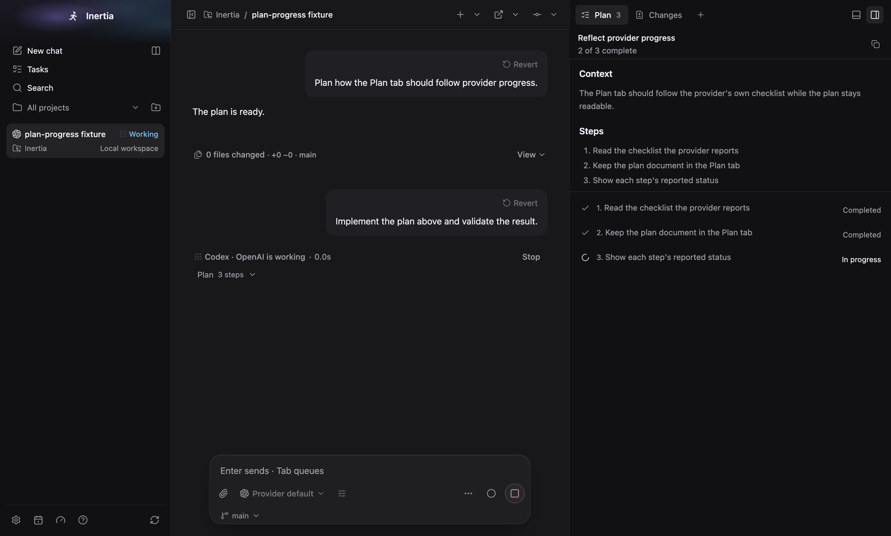
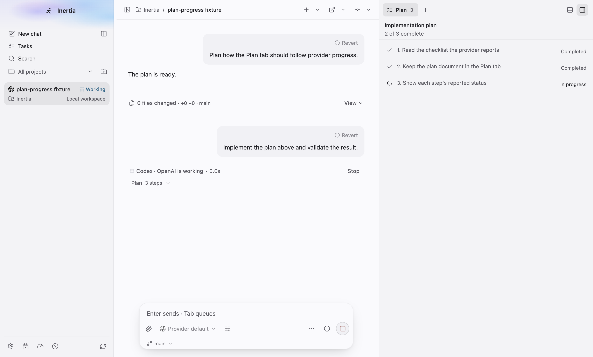
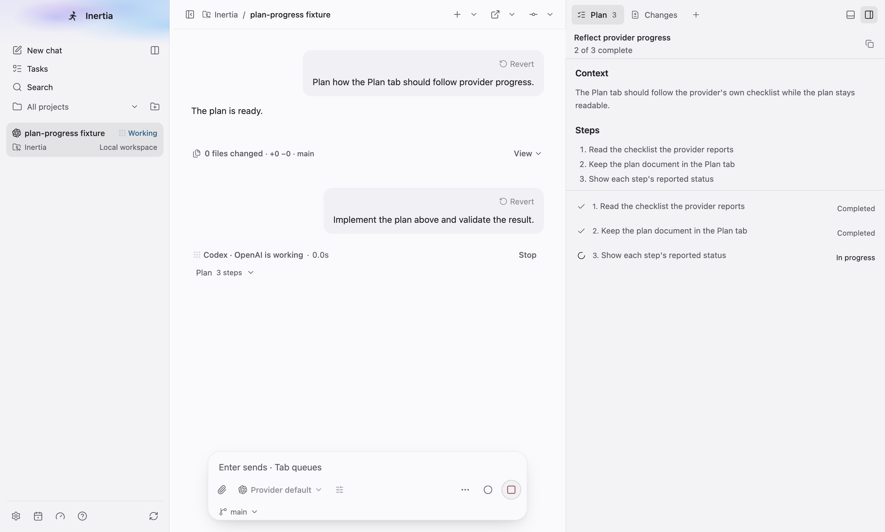
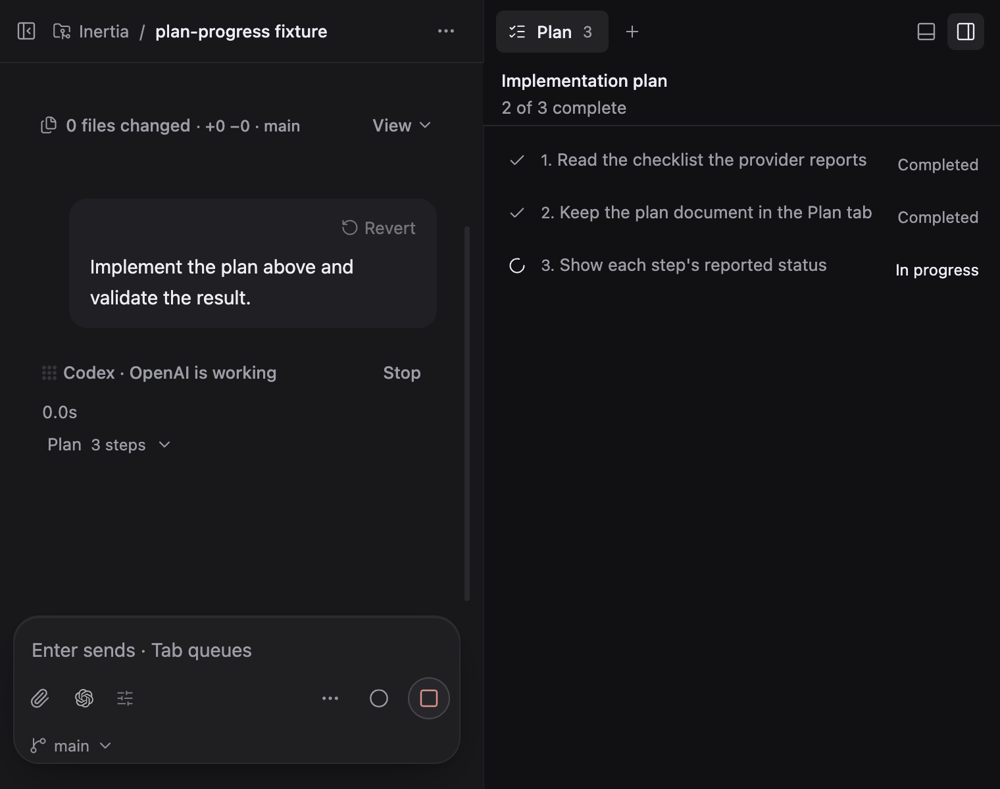
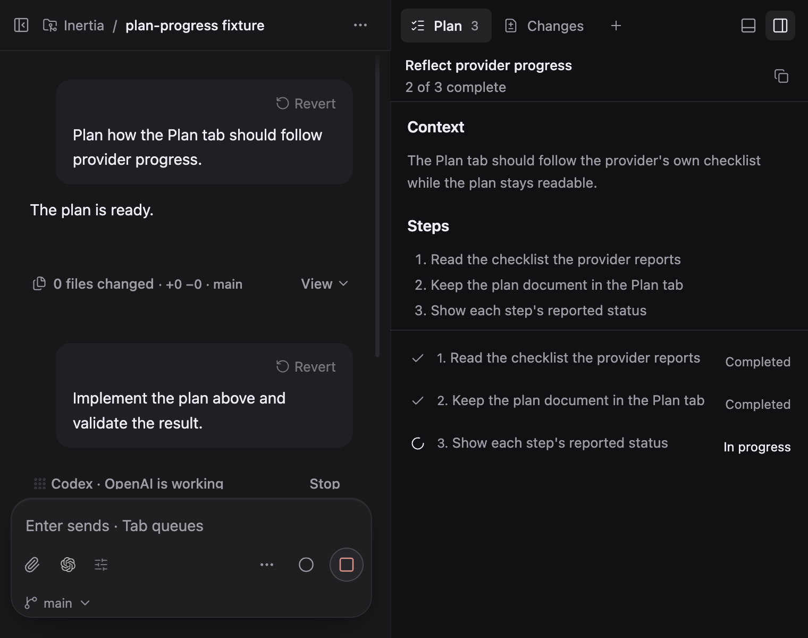
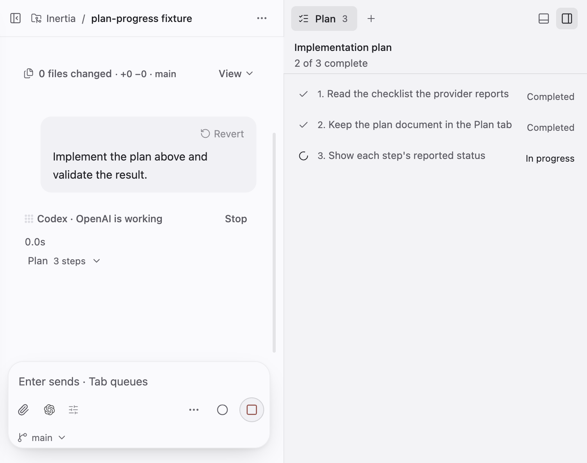
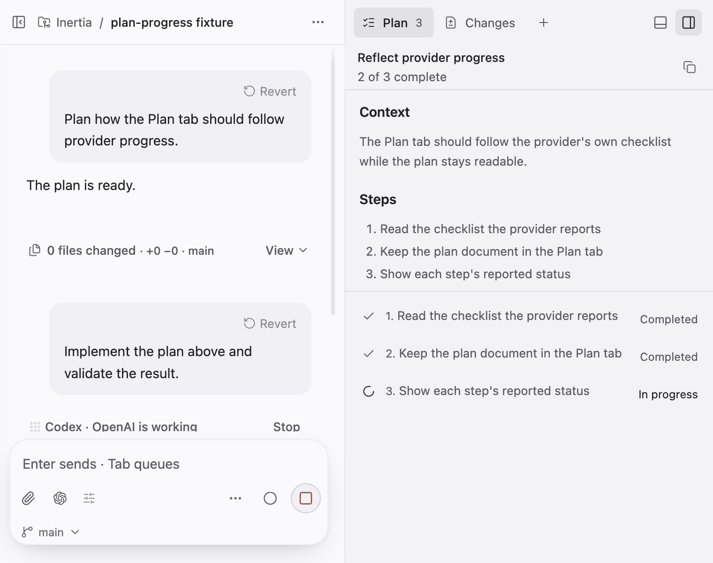

# Plan progress

Real screenshots of the built Electron app on macOS 27.0.1 (arm64), captured by
`tests/e2e/plan-progress.spec.ts` with `animations: "disabled"`. The spec starts
from the shared `conversation` fixture (one project, "Inertia", and one seeded
chat) and a fake Codex app server written into the fixture workspace. Provider
discovery is limited to the fixture's own bin directory, so no real provider
CLI, credentials, private prompt or user repository content is used.

The fake server answers a plan-mode turn with a Codex `plan` item whose text is
a markdown plan with three numbered steps. It answers the build turn with one
`turn/plan/updated` notification that reports the first two steps completed and
the third in progress, and it holds that turn open until the spec releases it.

The fake Claude in the app fixture only answers `claude auth`, and desktop test
runs disable every provider except the fake Codex app server, so these captures
use the Codex path. Claude's `TodoWrite` and task-list tools reach the same
plan event and the same Plan tab. The unit tests cover them.

"Before" is `origin/main` at `22e12e57f`, built in a throwaway worktree and
captured with the same fake server, window sizes and clock. Main has no
Implement button for a Codex plan, so the before capture switches the composer
to Build and sends the same "Implement the plan above and validate the result."
message by hand.

## After the plan turn (1440 × 1100, light)

| Before | After |
| --- | --- |
|  |  |
| The plan document with no steps and no Implement button | The same document, three pending steps, "0 of 3 complete" and Implement |

## While the build turn reports progress (1440 × 1100)

| Before | After |
| --- | --- |
|  |  |
|  |  |
| The document is gone; only the checklist and "2 of 3 complete" remain | The document stays above the live checklist and "2 of 3 complete" |

## Small window (760 × 600)

| Before | After |
| --- | --- |
|  |  |
|  |  |

## What the spec asserts

- After the plan turn, the Plan tab shows the plan's title "Reflect provider
  progress" as its heading, renders the body as markdown (an h2 "Context" and
  its paragraph), lists the three numbered steps as pending, reads "0 of 3
  complete" and offers Implement, which becomes enabled once the agent
  workflow refresh has finished.
- Implement is pressed without waiting for the plan turn's change capture,
  sends "Implement the plan above and validate the result." and the database
  records the two turns as `plan` then `build`.
- While the build turn runs, the Plan tab still shows the same document and
  heading, the steps read completed, completed and in progress, the count reads
  "2 of 3 complete", and there is no Implement button.
- No viewport overflow in either theme at either size.
- After the build turn completes and the page reloads, the Plan tab shows the
  same document, statuses and count from the stored plans.
- No renderer errors.

## Behaviour notes

- After the first turn the chat's provider thread id changes, so Inertia
  refreshes the agent workflow, and that refresh reserves the chat while it asks
  the provider for its native goal. A mode change sent during that refresh was
  refused with "Stop the active run or review before changing its agent
  configuration." Implement and Refine plan are now shown disabled while the
  workflow loads. The change capture was not the cause: in the current capture
  Implement is enabled while the transcript still reads "Capturing changes…".
- The committed screenshots were taken before this fix; the Plan tab in a fresh
  capture is identical, so they were not retaken.

## Runs on this machine

- `tests/e2e/plan-progress.spec.ts --max-failures=1`: 1 passed.
- `tests/e2e/plan-progress.spec.ts --max-failures=1 --repeat-each=3`: 3 passed,
  three times in a row.

## Not exercised

- Real providers. Every turn here comes from the fake Codex app server.
- Claude, Cursor, Kimi and OpenCode in the real window. Their checklist
  projections are covered by unit and portable tests.
- Linux and Windows rendering.
