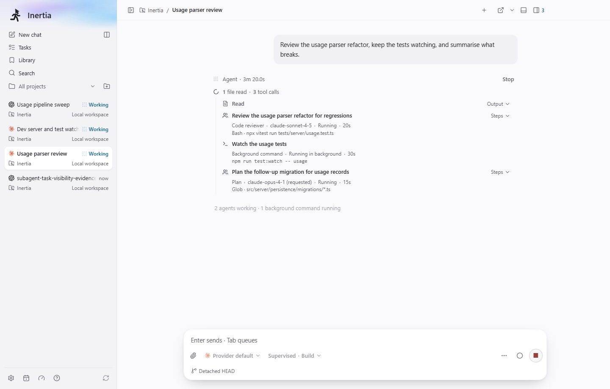
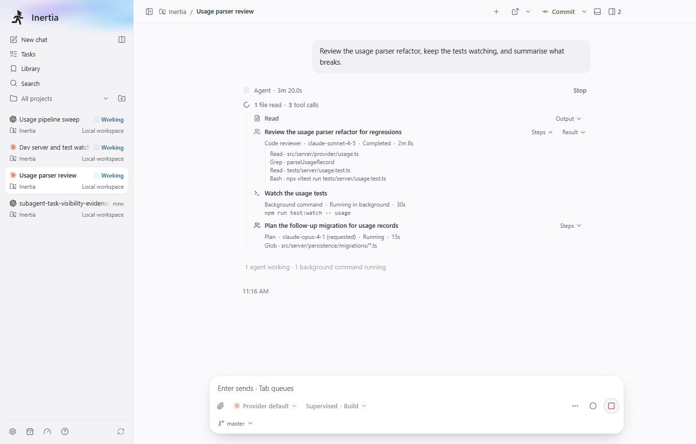
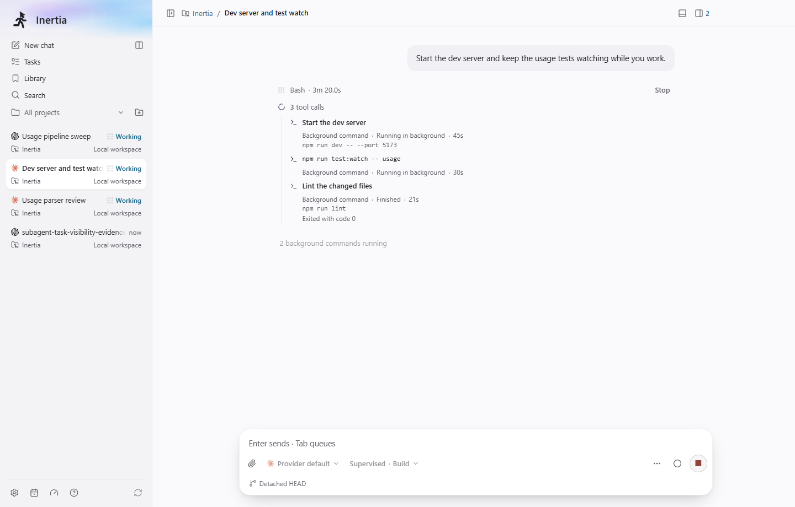
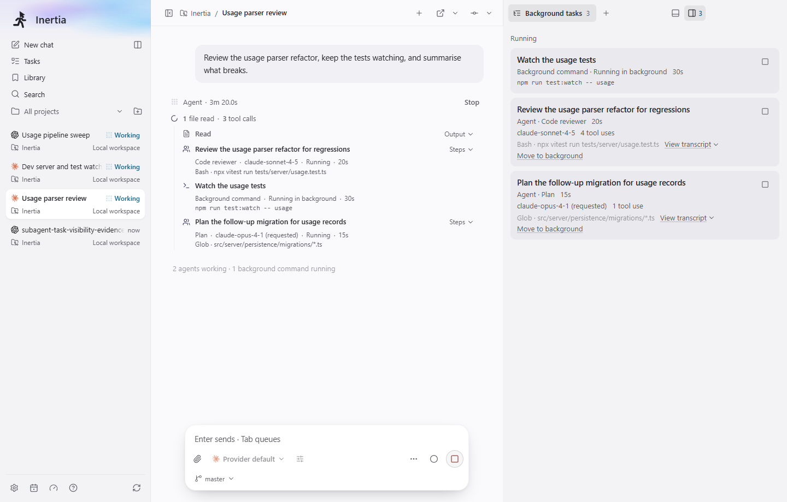
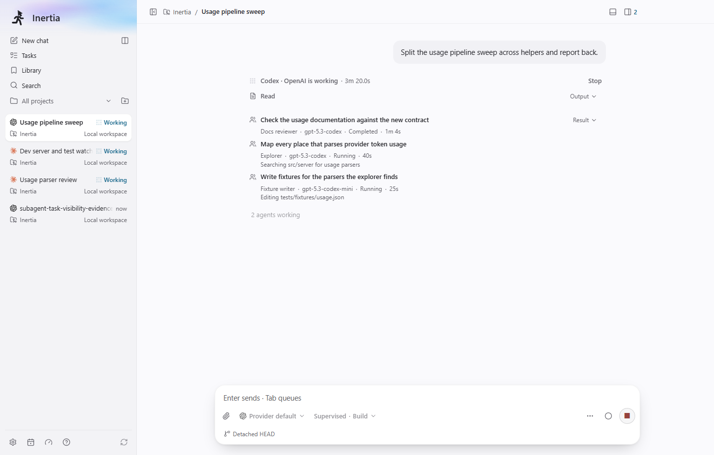

# Delegated agents and background tasks in the timeline

Screenshots of the built Electron app on Windows x64 with fake providers,
captured on 2026-10-31 at 1440 × 920 in the light theme with
`animations: "disabled"` and a frozen clock. A one-off Playwright capture,
using the same `createAppFixture` machinery as `tests/e2e/background-tasks.spec.ts`,
seeded an isolated synthetic database through `RuntimeStore.addActivity` and
`RuntimeStore.upsertSubagentTrace`. No live profile, credentials, provider CLI
or user repository content is used; the workspace is the fixture's own.

| Image | What it shows |
| --- | --- |
|  | `timeline-agent-running-light.png`: a Claude turn where the delegated agent "Review the usage parser refactor for regressions" sits in place of its Agent tool row, reading "Code reviewer · claude-sonnet-4-5 · Running · 20s" with its current step "Bash · npx vitest run tests/server/usage.test.ts" below. The second agent's model was only requested, so it reads "claude-opus-4-1 (requested)". |
|  | `timeline-agent-steps-light.png`: the same agent completed ("Completed · 2m 8s") with its Steps disclosure open, listing four steps labelled tool name and key input, and its Result disclosure next to it. The Jump to latest arrow comes from opening a disclosure, which main already treats as reading history (see the note below). |
|  | `timeline-background-command-light.png`: background commands in place of their Bash rows. "Start the dev server" reads "Background command · Running in background · 45s" with its command below; a command without a description uses the command itself as its title; a finished one reads "Finished" with its completion notice. |
|  | `background-tasks-panel-light.png`: the Background tasks panel beside the same Claude turn, listing the background command and both agents with their Stop buttons (named, for example, "Stop Code reviewer") and "Move to background" on the agents the parent is still waiting on. |
|  | `codex-compact-rows-light.png`: a Codex turn whose child agents have no tool row of their own, shown as compact rows under the turn's work: two running agents with their current activity and one completed agent with its Result disclosure. |

Note: opening any timeline disclosure, including a plain tool row's Output,
moves the reader into reading history and shows Jump to latest even when the
transcript fits the window. That behaviour comes from `captureExpansionAnchor`
in `src/renderer/src/components/response-timeline/viewport.tsx` (since #421)
and is unchanged by this branch.
