# Tasks

Real screenshots of the built Electron app on macOS 27.0.1 (arm64), captured by
`tests/e2e/tasks.spec.ts` with `animations: "disabled"`. The spec starts from the
shared `conversation` fixture (one project, "Inertia", and one seeded chat) and
a fake Codex app server written into the fixture workspace. Provider discovery
is limited to the fixture's own bin directory, so no real provider CLI,
credentials, private prompt or user repository content is used.

Tasks is a plain list the user owns. The heading and count use the same sizes as
the Usage page's Limits title and explanation. Each row has a circle checkbox,
the title, a muted due label, a red "!" when urgent and, once the task has been
handed to an agent, a muted status word. Finished tasks sit behind a quiet
"Done N ›" toggle. Rows take the app's quiet hover fill and the selected row the
stronger fill. Opening a task shows its detail beside the list (below it when
the view is narrower than 760 px): title, note, due and priority, then "Hand it
to an agent".

The hand-off is one grid in which every control has the same height, border,
radius, padding and type. The model chooser takes the full first row. Reasoning
and Speed share the second row in equal halves, and Reasoning spans the row when
the route has no native fast control. Project and "Folder…" share the third
row, and Start sits on the right below them. The selects use the same base
select and popover as Settings. Menus are the app's own conversation menus.

When the detail opens, the list slides left as its column grows and the card
fades in; on close it fades out (inert and hidden from assistive technology) as
the list slides back. Reduced motion turns every transition off.

## Sidebar: before and after

"Before" is `origin/main` at `ee291ad0`, built in a throwaway worktree and
captured with the same fixture, window and clock. "After" is this branch with
Tasks open.

| Before | After |
| --- | --- |
| 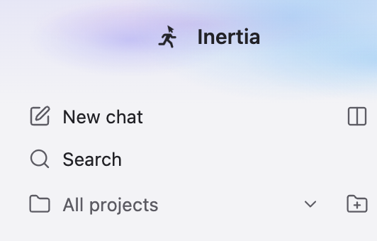 | 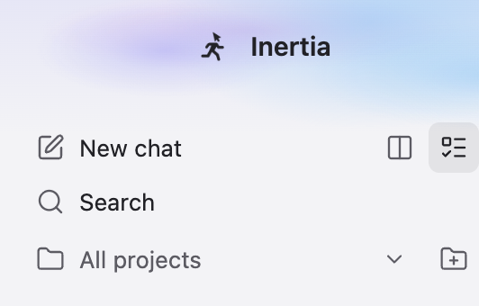 |
| New chat and "Launch two chats" | The Tasks button follows "Launch two chats" and shows as current while Tasks is open |

## First open

| Dark | Light |
| --- | --- |
| 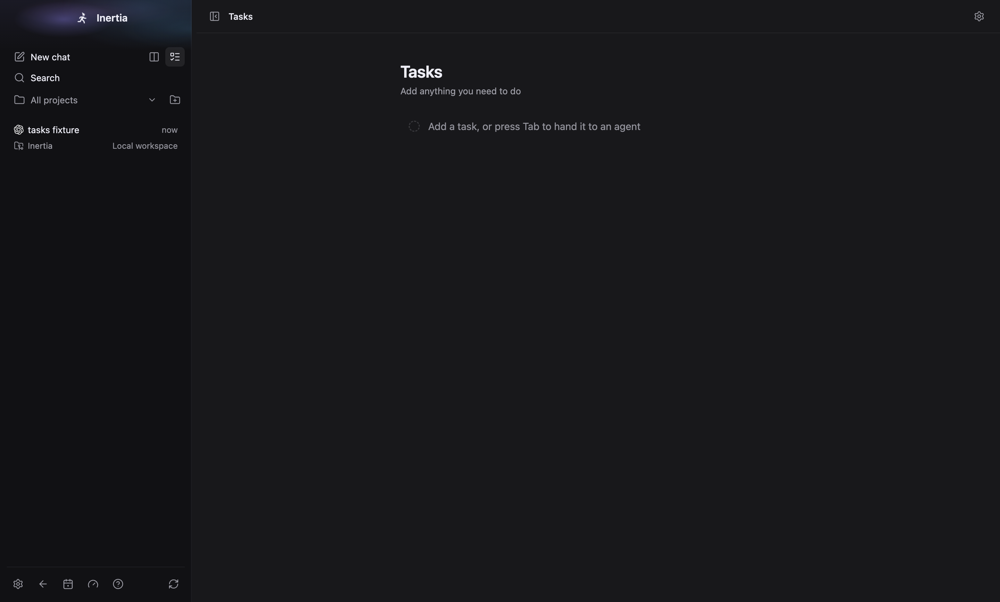 | 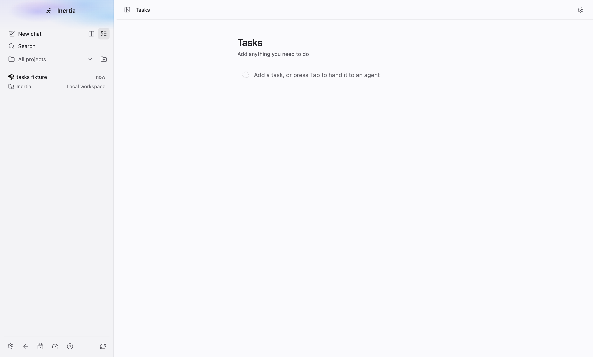 |

## List and detail (1440 × 1100)

| Dark | Light |
| --- | --- |
| 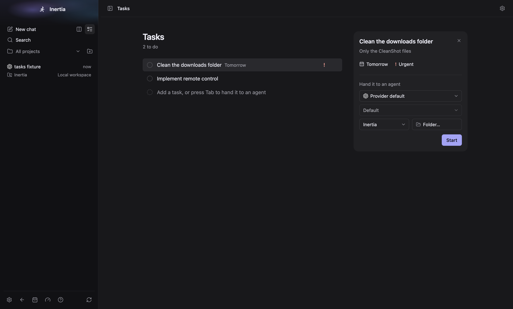 | 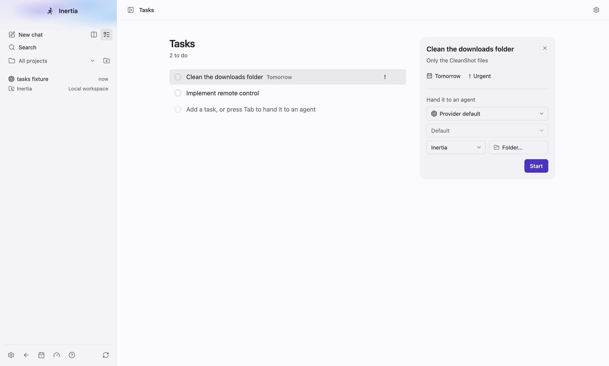 |

The fake app server reports no models, so the route has no reasoning options and
no fast control: Reasoning shows "Default", is disabled and spans its row.

## Small window (760 × 600)

| Dark | Light |
| --- | --- |
| 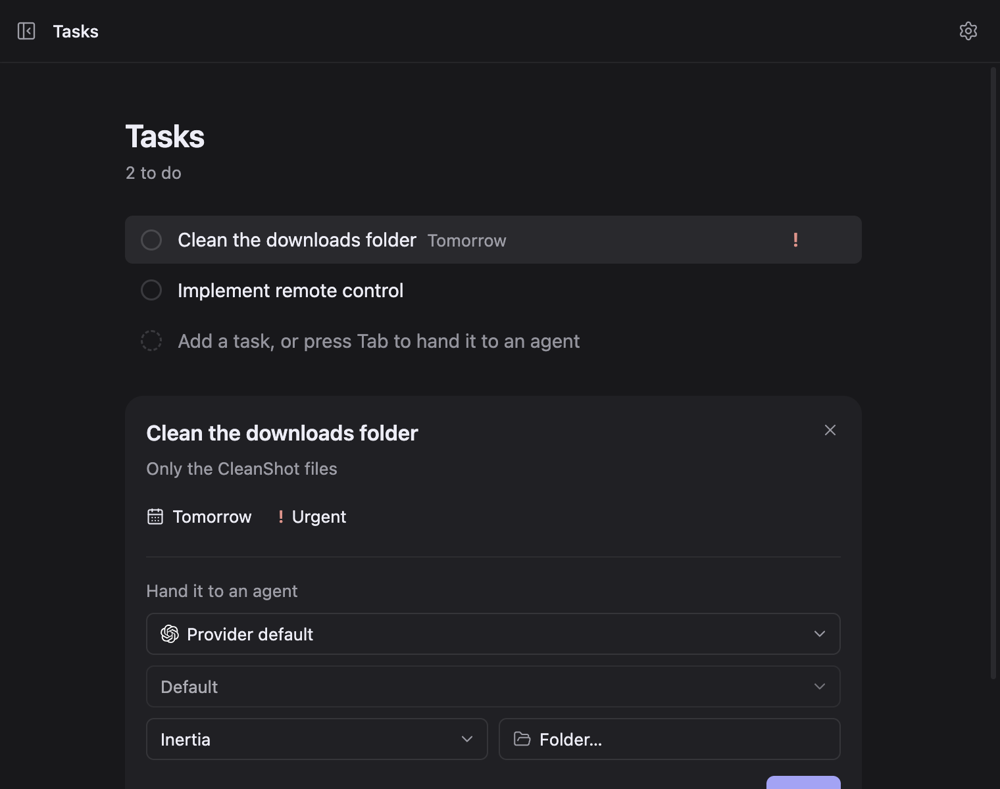 | 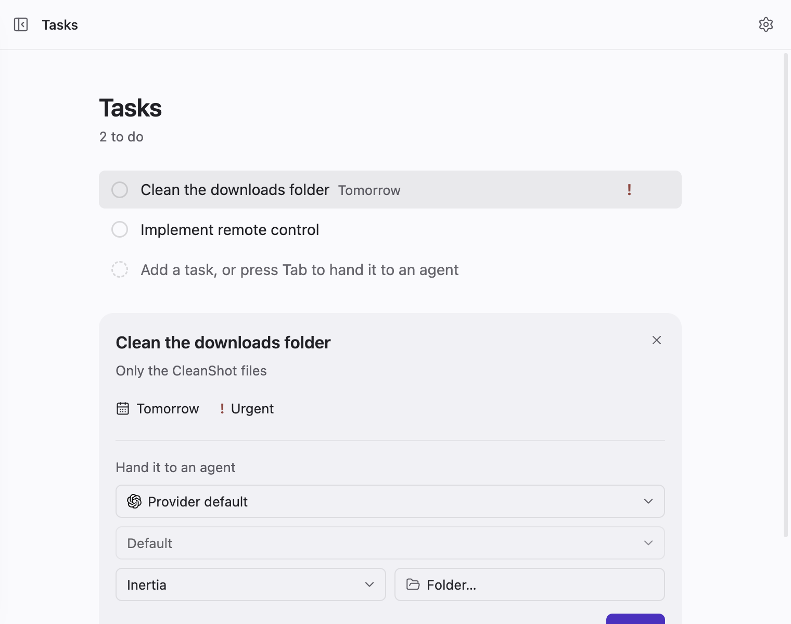 |

## Menus, Done and a started task

| Row menu | Priority menu |
| --- | --- |
| 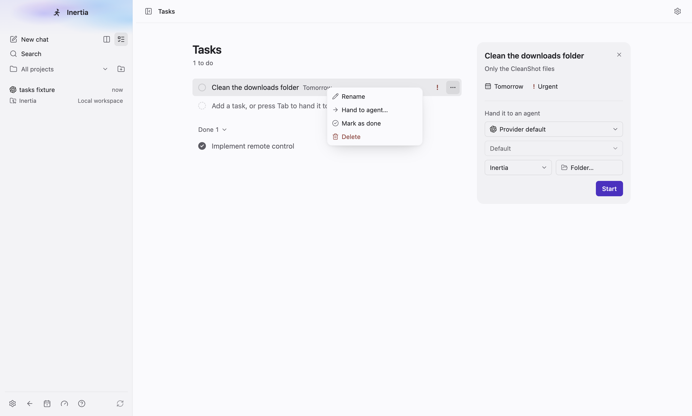 | 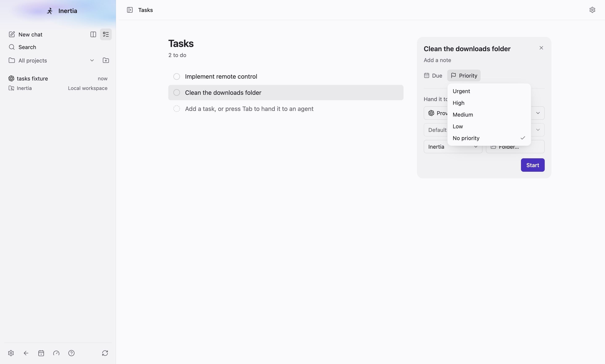 |

| Done expanded | Started |
| --- | --- |
| 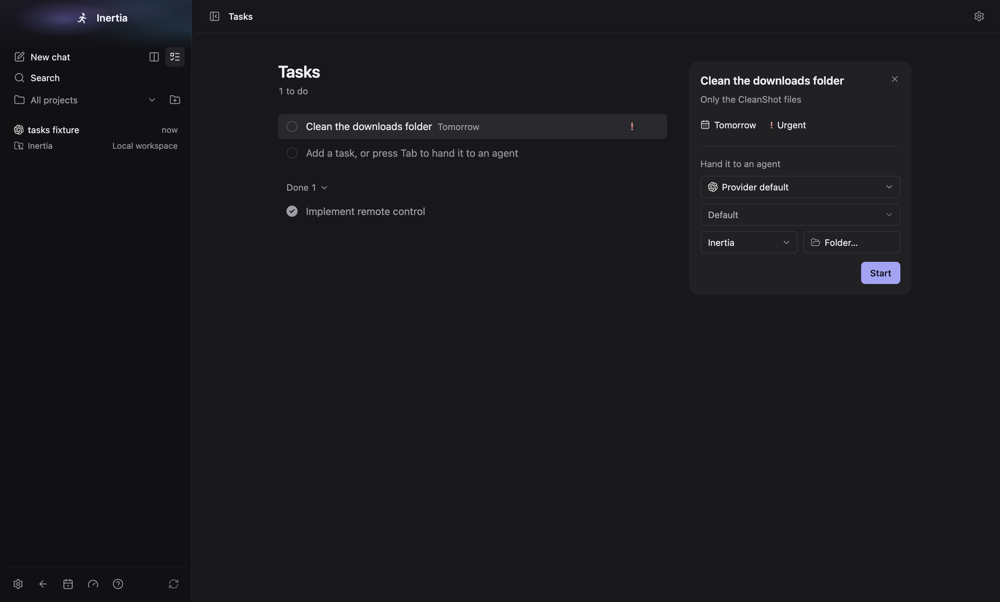 | 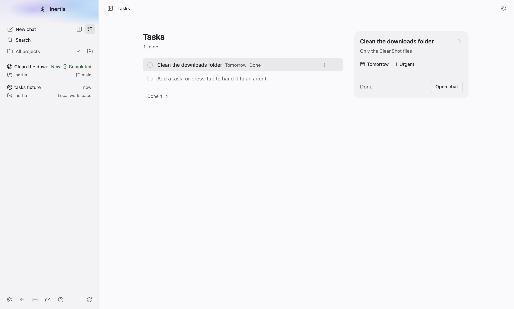 |

The started capture is taken after the fake provider finished the turn: the row
reads "Done" and the detail shows the status word and "Open chat" instead of the
hand-off.

## What the spec asserts

- The Tasks button in the sidebar's top row opens the view with
  `aria-current="page"`, and the header reads "Tasks".
- Enter in the add row adds a task and keeps focus there; the count follows;
  urgent work moves to the top and shows the red mark; due and priority menus
  set "Tomorrow" and "Urgent"; the note persists across closing and reopening
  the detail; the closed detail leaves the DOM.
- Hand-off geometry in light and dark at 1440 × 1100 and 760 × 600: every
  control has the same height; the model chooser, Reasoning (or Reasoning and
  Speed) and Project with Folder… share the same left and right edges; Project
  and Folder… are equal halves on one line.
- No viewport overflow in either theme at either size.
- Done: the checkbox moves a task under "Done 1", which expands to a checked
  row; the row menu reads Rename, Hand to agent…, Mark as done, Delete.
- Start: the view switches to the new chat, whose heading is the task title.
  The transcript has exactly one user message, and the database stores it as the
  title, a blank line and the note. The fake provider's answer appears.
- Back in Tasks the row reads "Working" while the turn runs, the detail shows
  "Working" and "Open chat" instead of the hand-off, and both read "Done" once
  the turn completes. "Open chat" returns to that chat.
- Deleting the chat from its sidebar row menu unlinks the task without a reload.
  The row loses its status word, the detail shows the hand-off again, and the
  database holds a NULL `conversation_id` and no conversation row.
- No renderer errors.

## Behaviour notes

- Choosing "Folder…" with a folder that is not yet a project adds it as a
  project before Start (`project.create`), which also makes it the active
  project. This is accepted behaviour.
- When providers are disabled (desktop test runs without the fake Codex server,
  or provider maintenance quarantine), Start creates and links the chat and
  stores the task as its first user message without starting a provider turn,
  as `message.send` does.
- Task edits (create, update, delete) are sent passively: they do not set the
  global busy state or clear unrelated error banners. Start and the folder's
  `project.create` report errors as normal actions.

## Runs on this machine

- `tests/e2e/tasks.spec.ts --max-failures=1`: 2 passed.
- `tests/e2e/tasks.spec.ts --max-failures=1 --repeat-each=3`: 6 passed.

## Not exercised

- Linux and Windows rendering. Forced colours and reduced motion in a real
  window are covered by stylesheet assertions in the DOM tests only.
- The opening and closing motion is not visible in still captures. The DOM
  tests cover the inert, hidden closing state and its removal.
- A route with reasoning options and a native fast control in the real window:
  the fake app server lists no models. The DOM tests cover the Reasoning and
  Speed values sent with Start.
- The native folder picker. The DOM tests stub `selectDirectory` and cover
  adding a new folder and reusing a known one.
- Real providers. Every turn here comes from the fake Codex app server.

See [renderer-bundle.json](renderer-bundle.json) for every closure measured on
this machine against a build of `origin/main`. The Tasks view is its own lazy
chunk (20,949 bytes, capped at exactly that). The workbench first load (+860),
detached chat first load (+104), shared core (+3,486) and entry stylesheet
(+182) caps are main's caps plus exactly the measured growth. Every other
closure keeps main's cap.
