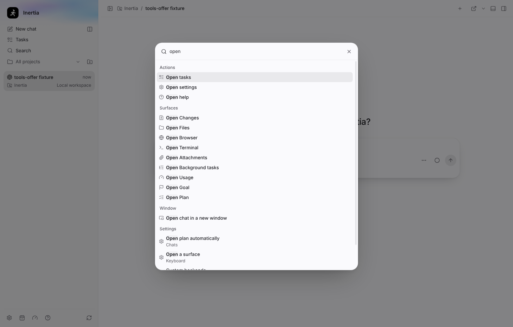
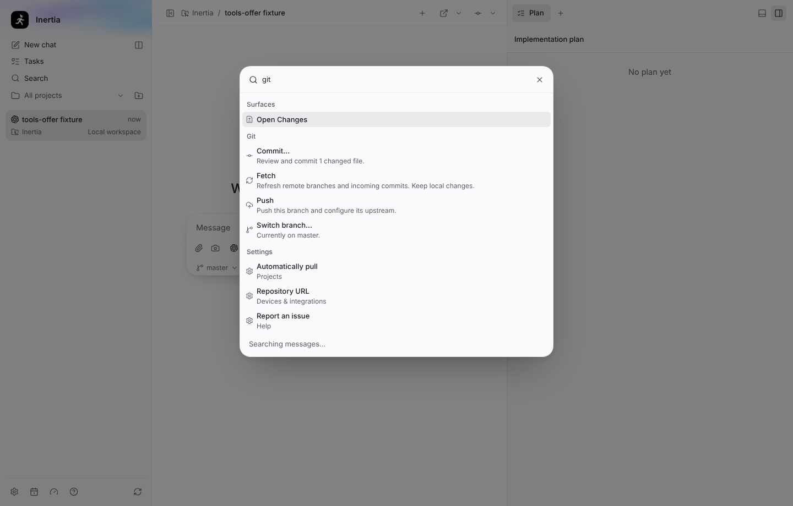
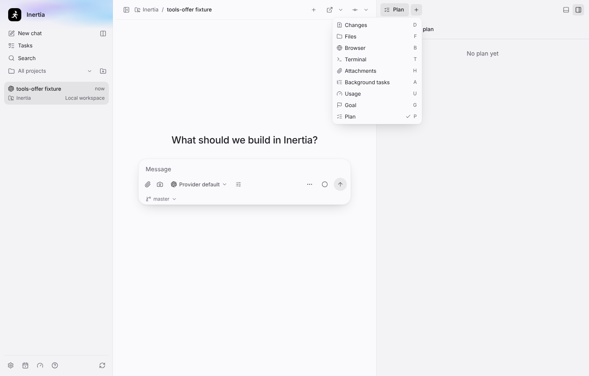
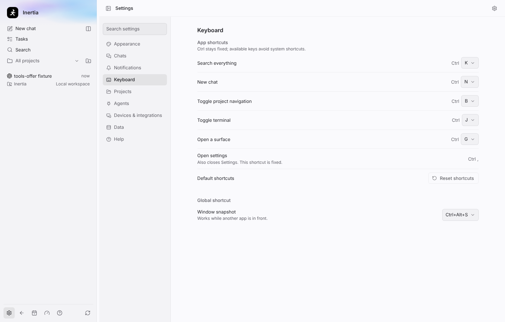
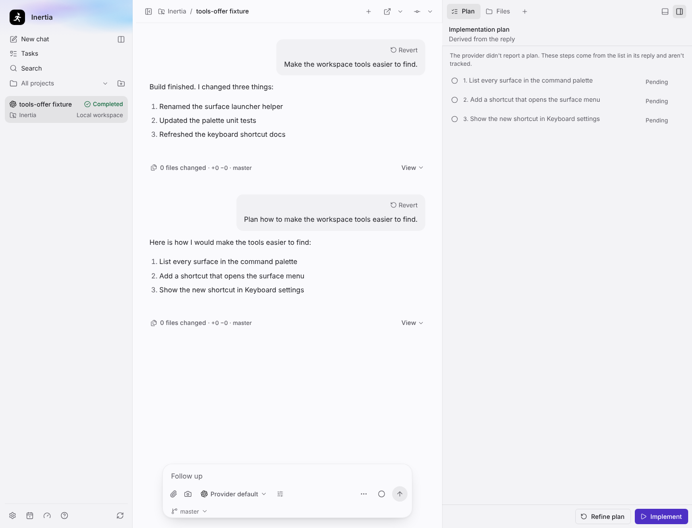
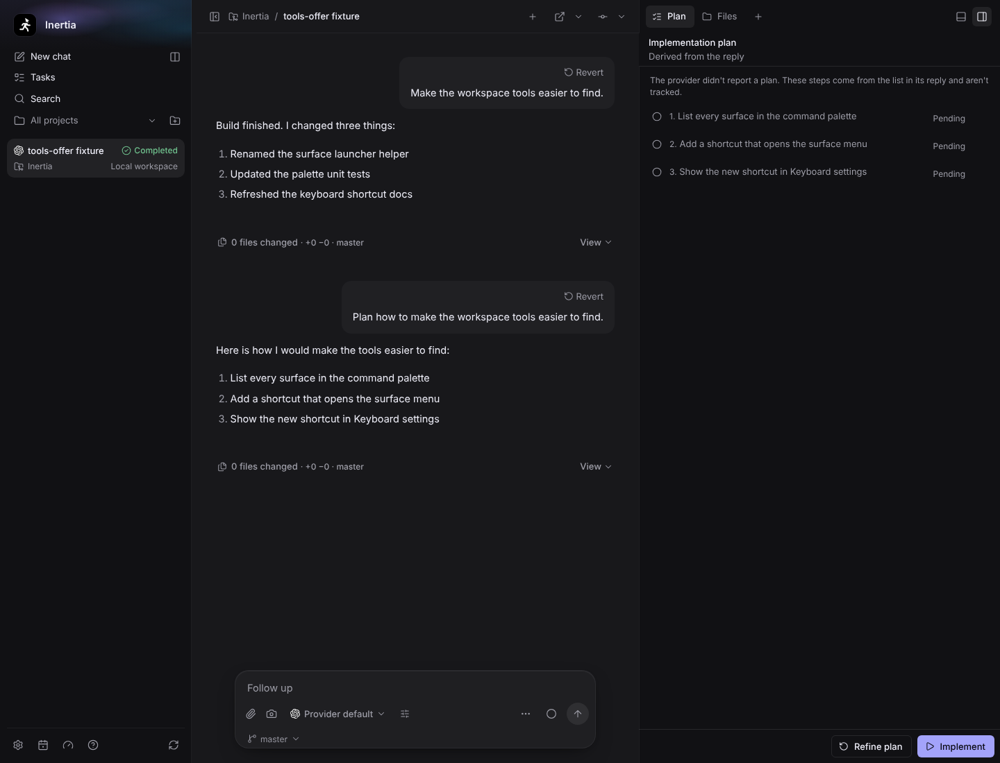

# Tools offer, wave 1: truth and discoverability

Real screenshots of the built Electron app on Linux (Xvfb, 1280 × 1024 display,
window resized to 1440 × 1100), captured by
`tests/e2e/tools-offer-discoverability.spec.ts` with `animations: "disabled"`.
The spec starts from the shared `conversation` fixture (one project, one seeded
chat, a bare `origin` remote) and a fake Codex app server written into the
fixture workspace. No real provider CLI, credentials, private prompt or user
repository content is used.

## Command palette: surfaces and Git

Type at least one character and the palette offers the chat's surfaces and the
Git actions the header currently allows. Surfaces that need a workspace are
listed but disabled with the panel's own reason.

| Surfaces | Git |
| --- | --- |
|  |  |

## Open a surface (Cmd/Ctrl+G)

With a surface already active, the shortcut opens the "+" surface menu so the
single-letter surface shortcuts work; with no surface active it focuses the
launcher. The shortcut is rebindable in Settings → Keyboard.

| Surface menu | Settings → Keyboard |
| --- | --- |
|  |  |

## Plan tab: derived steps only from Plan-mode replies

After a Build-mode reply that contains a numbered list, the Plan tab stays
empty and shows no badge. After a Plan-mode reply with the same shape, the
steps appear under "Derived from the reply", none is marked done, and the badge
still shows no count.

| Light | Dark |
| --- | --- |
|  |  |
