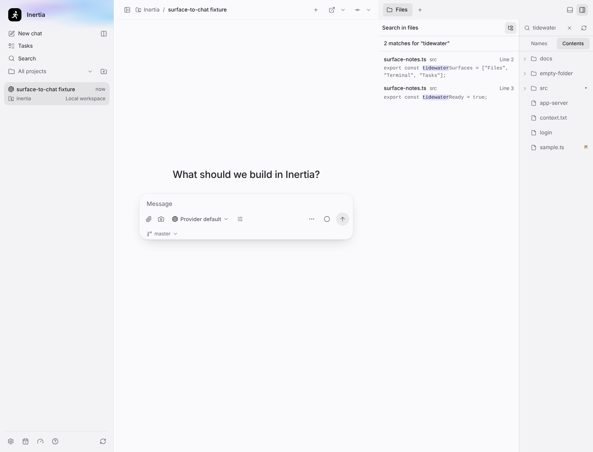
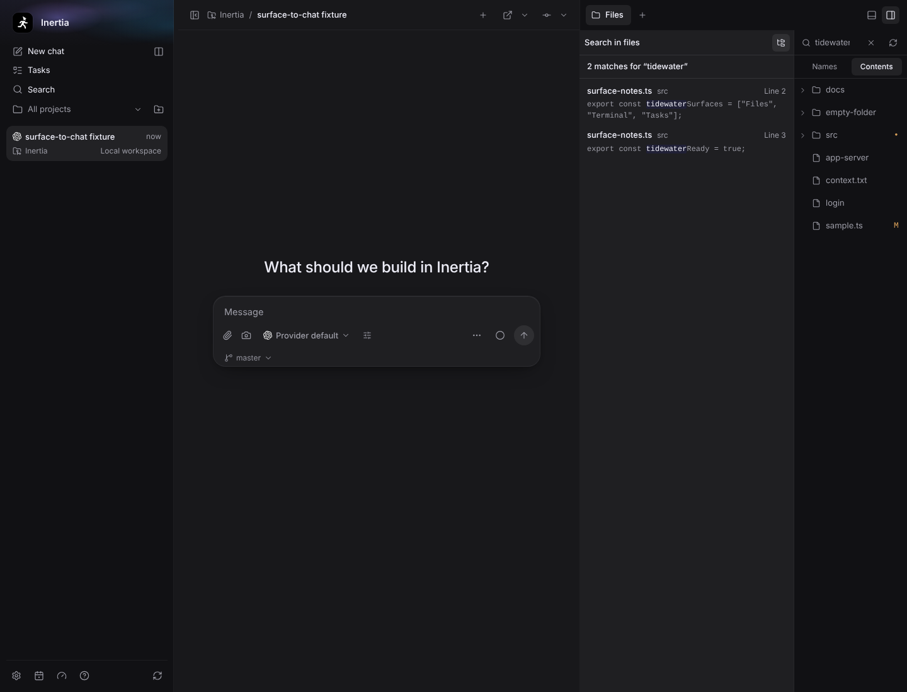
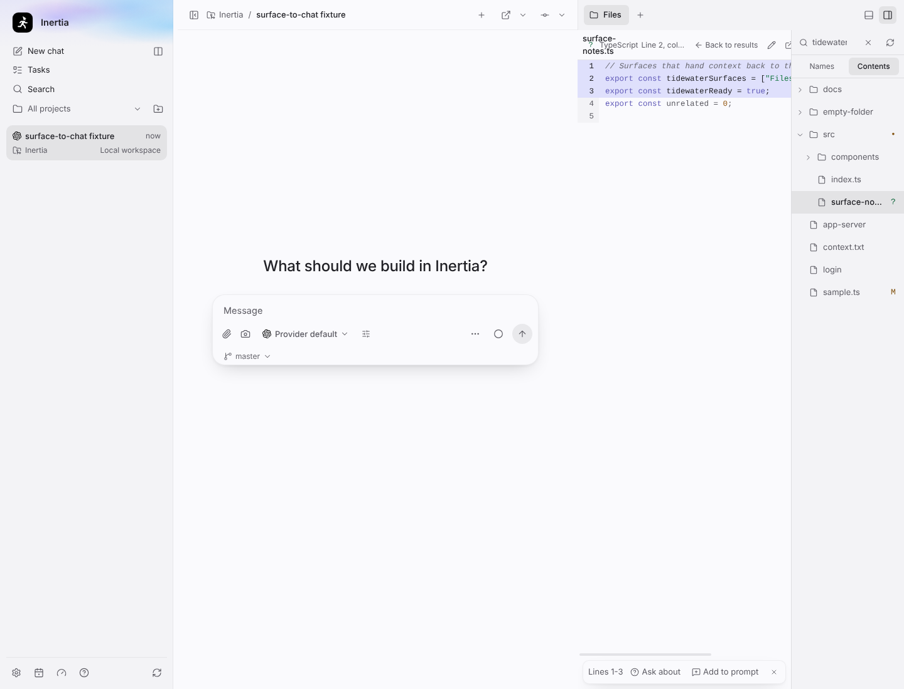
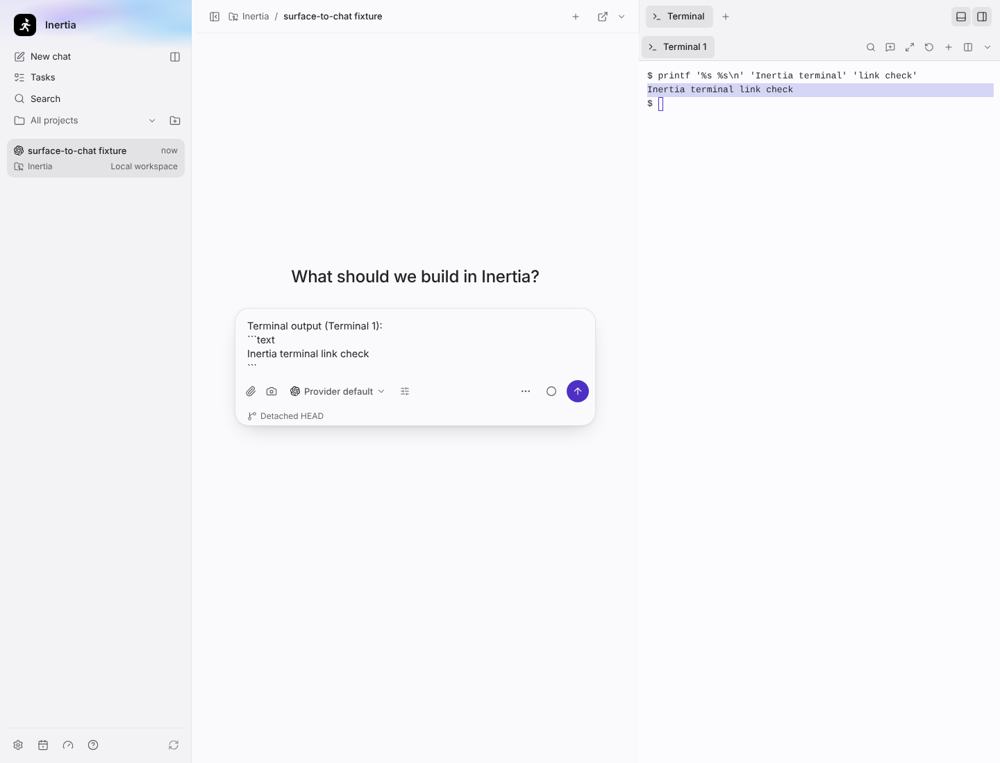
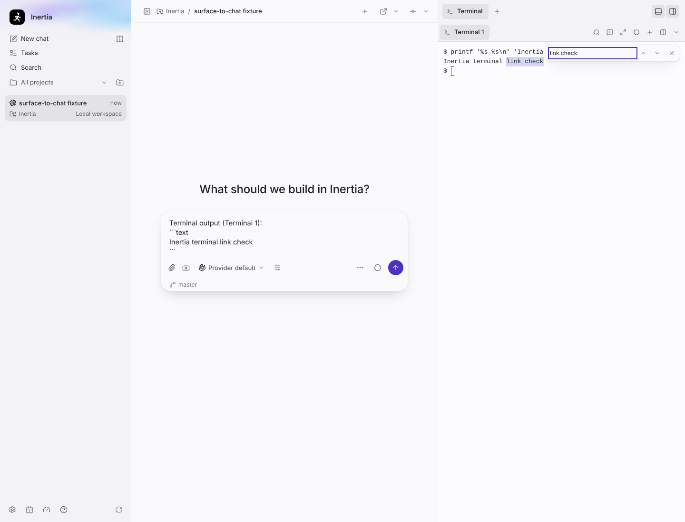
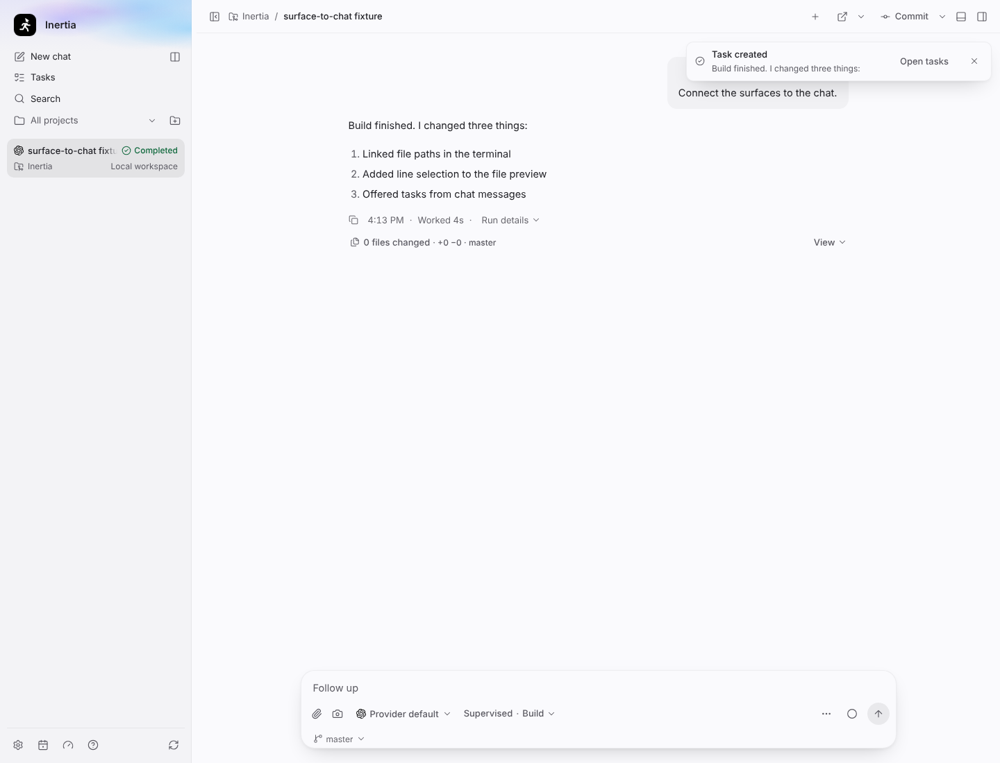
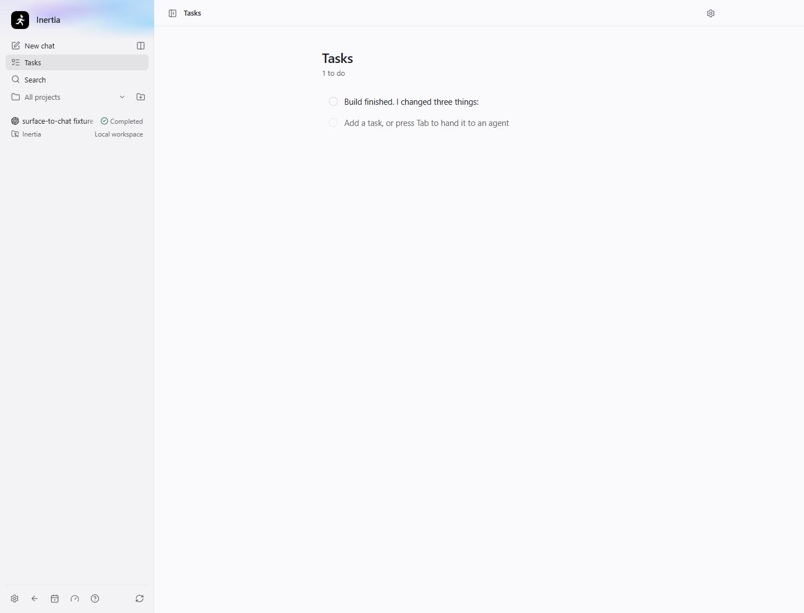
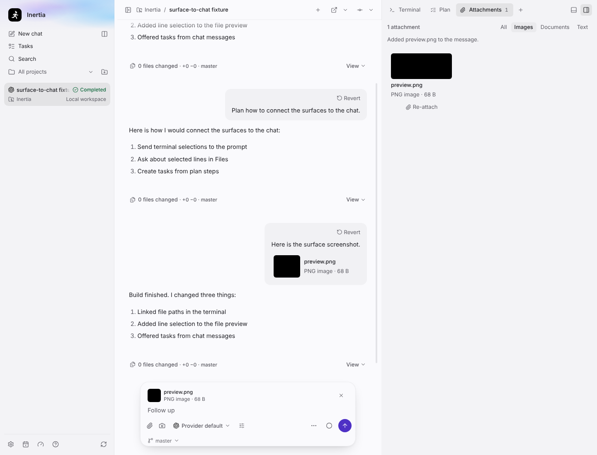

# Tools offer, wave 2: surface to chat

Real screenshots of the built Electron app on Linux (Xvfb, 1280 × 1024 display,
window resized to 1440 × 1100), captured by
`tests/e2e/tools-offer-surface-to-chat.spec.ts` (display-sensitive lane, because
the terminal scenario drags a real pointer selection) with
`animations: "disabled"`. The spec starts from the shared `conversation`
fixture with a fake Codex app server, a small `src/surface-notes.ts` written
into the fixture workspace, and a 68-byte `preview.png` attached through a
stubbed file dialog. No real provider CLI, credentials, private prompt or user
repository content is used.

## Files: content search and line selection

Switch the search field to **Contents** to search inside files; a match opens
the file at its line. Click a line number in the source preview and Shift+click
another to select a range, then **Ask about** or **Add to prompt**.

| Content search, light | Content search, dark |
| --- | --- |
|  |  |

| Line selection |
| --- |
|  |

## Terminal: selection to prompt and find

Select terminal text and choose **Add selection to prompt** (toolbar or
right-click); the composer receives a bounded fenced excerpt. Cmd+F on macOS,
or Ctrl+Shift+F on Windows and Linux, opens the find bar while the terminal has
focus; Ctrl+F stays with the shell.

| Add selection to prompt | Find bar |
| --- | --- |
|  |  |

## Tasks from the chat

**Create task from message** in a message's menu, or **Create task** on a plan
step, creates an ordinary task that remembers its source chat (**From chat**
in the task details) and shows a notice with **Open tasks**. The task is not
handed to that chat.

| Notice | Tasks page |
| --- | --- |
|  |  |

`tasks-from-chat-light.png` was re-captured on Windows x64 by the same spec after the task stopped showing its source chat's status as a hand-off; the other screenshots on this page came from Linux.

## Attachments: re-attach

The Attachments surface filters by All / Images / Documents / Text, and
**Re-attach** adds a stored file to the composer again as a fresh copy.

| Re-attach |
| --- |
|  |

Measured renderer bundle closures for this wave are in `renderer-bundle.json`.
