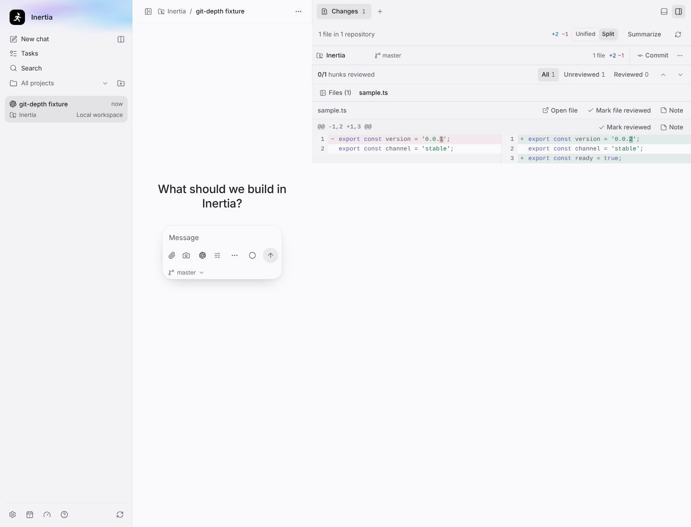
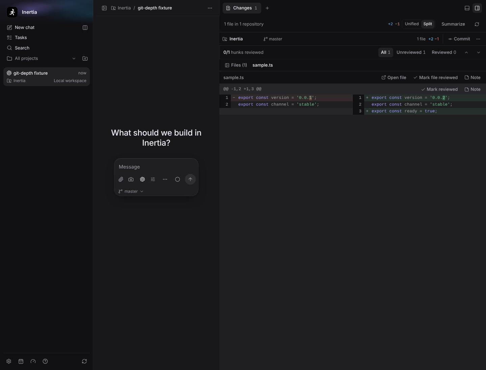
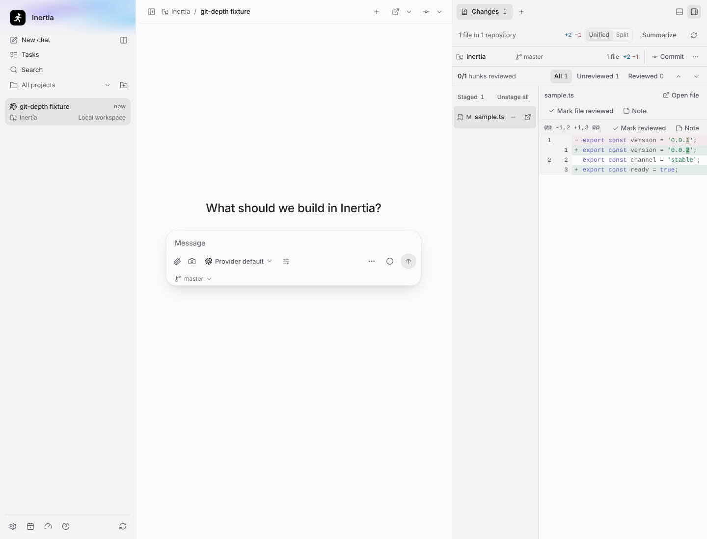
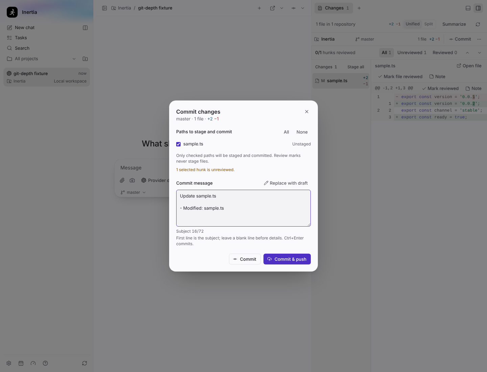
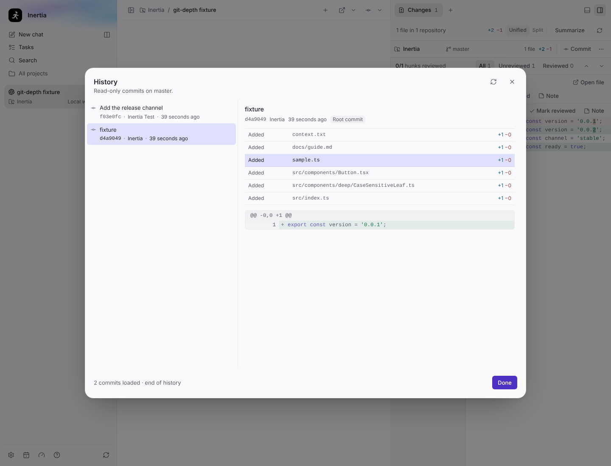
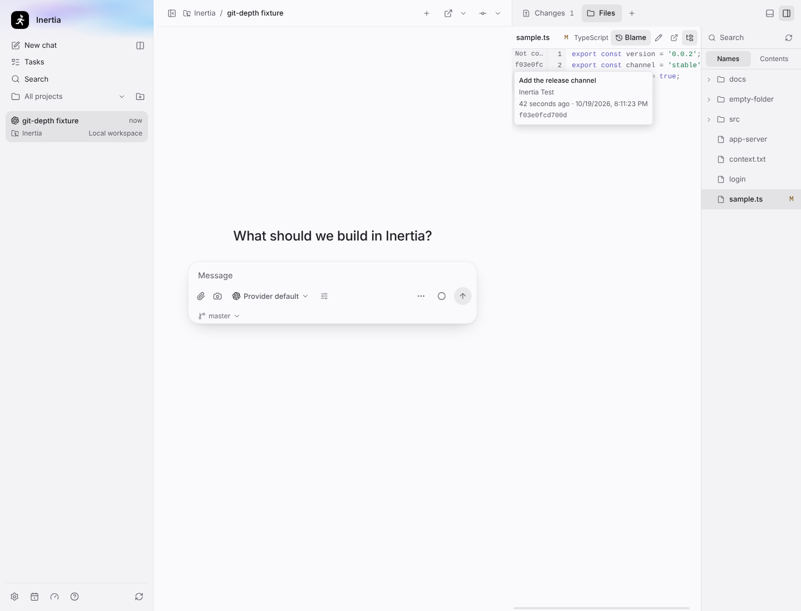
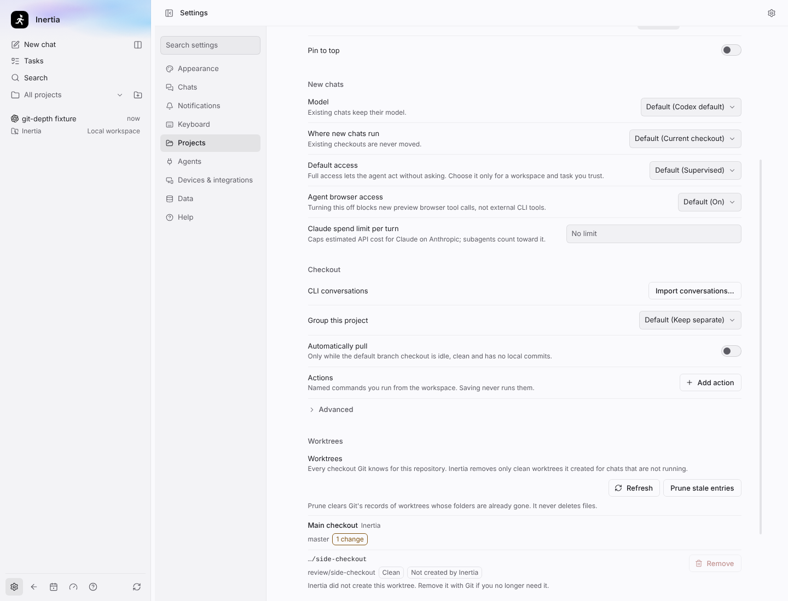

# Tools offer, wave 4: Git depth

Real screenshots of the built Electron app on Linux (Xvfb, 1280 × 1024 display,
window resized to 1440 × 1100), captured by `tests/e2e/tools-offer-git-depth.spec.ts`
with `animations: "disabled"`. The spec starts from the shared `conversation`
fixture with a fake Codex app server, a modified `sample.ts`, a second commit
and a bare `origin` remote in the fixture repository. No real provider CLI,
credentials, private prompt or user repository content is used.

## Changes: readable diffs

Diff lines are syntax-highlighted with the same highlighter as the Files
preview, paired deletion/addition runs get word-level emphasis, and a
**Unified | Split** toggle (persisted per chat, and per unsaved draft) shows old
and new side by side. Switching the view, or crossing the 720-pixel split width,
keeps the diff pane and file list mounted, so focus and scroll stay. Word-level
emphasis follows the highlighting bounds and stops once a file has spent its
comparison allowance, so one very large diff cannot hold the main thread. A
partially staged file offers both Stage and Unstage.

| Unified, highlighted | Split, light |
| --- | --- |
|  |  |

| Split, dark | Stage and unstage per file |
| --- | --- |
|  |  |

## Commit authoring

The commit message is a textarea (Enter adds a line, Cmd/Ctrl+Enter commits)
with a 72-character subject hint and a **Draft message** button that composes a
message locally from the review summary or the selected files. The review
summary is used only when it describes the exact change set being committed.
Replacing typed text with a draft leaves an inline **Restore your text** action
until the message is edited.

| Commit dialog with a drafted message |
| --- |
|  |

## History and blame

**History…** in the Git menu lists commits (read-only) and shows a commit's
files and diff. A status refresh while History is open keeps the loaded list,
the selection and focus. The Files preview gets a **Blame** toggle with a gutter
and a popover per line.

| History | Blame in Files |
| --- | --- |
|  |  |

## Worktrees

Settings → Projects lists the repository's worktrees with their branch, chat,
and clean/dirty state. **Remove** works only for Inertia-owned, clean, idle,
unshared worktrees with no ignored files and no assume-unchanged or
skip-worktree edits; if Git removes the registration but cannot delete every
file, the result names the folder left to delete by hand. **Prune** only drops
stale Git entries inside Inertia's worktree folder, one at a time; stale
entries elsewhere (for example on a disconnected drive) are kept and counted.

| Worktrees in Settings |
| --- |
|  |

Measured renderer bundle closures for this wave are in `renderer-bundle.json`.
