# Watcher: attach, dock, receipts, findings and notes

Real screenshots of the built Electron app on macOS (window content 1440 × 868,
saved at 1×), captured by `tests/e2e/watcher.spec.ts` with
`animations: "disabled"`. The spec starts from the shared `conversation`
fixture (one project in a temporary workspace, the watched chat renamed to
"Parser cleanup", three more seeded chats for split view) and a fake Codex app
server written into the fixture workspace. The same fake serves both the
watched chat and its watcher; the test scripts every watcher reply (`SILENT` or
one finding) and releases each of the watched turn's commands. No real provider
CLI, credentials, private prompt, user repository or account data appears in
these images; the timestamps are the capture run's local clock.

`renderer-bundle.json` in this folder is the separate renderer bundle
measurement and is not part of this capture.

## Attach a watcher to a running chat

The chat's actions offer **Add a watcher…** while its turn runs. The dialog
offers only ready routes on watcher agents, defaults to **Reviewer** and says in
its description, above the fold, that the watcher reads and reports: it may run
read-only commands and never edits files or changes the workspace. Under what the
watcher sees, two plain switches: **Send findings to the main chat
automatically** (off by default, with one line on what it does) and **Review
the last turn now**, which is available because the chat already has a turn,
here a running one. **Budgets** stays folded at the end.

## The dock

The dock opens beside the chat. Its bar names the chat (read as **Watching
Parser cleanup**), with a plain **Check now** and **More** beside the title,
and one muted line under both: **Codex · Reviewer · Watching**. Before the first
check it says **No checks yet**.

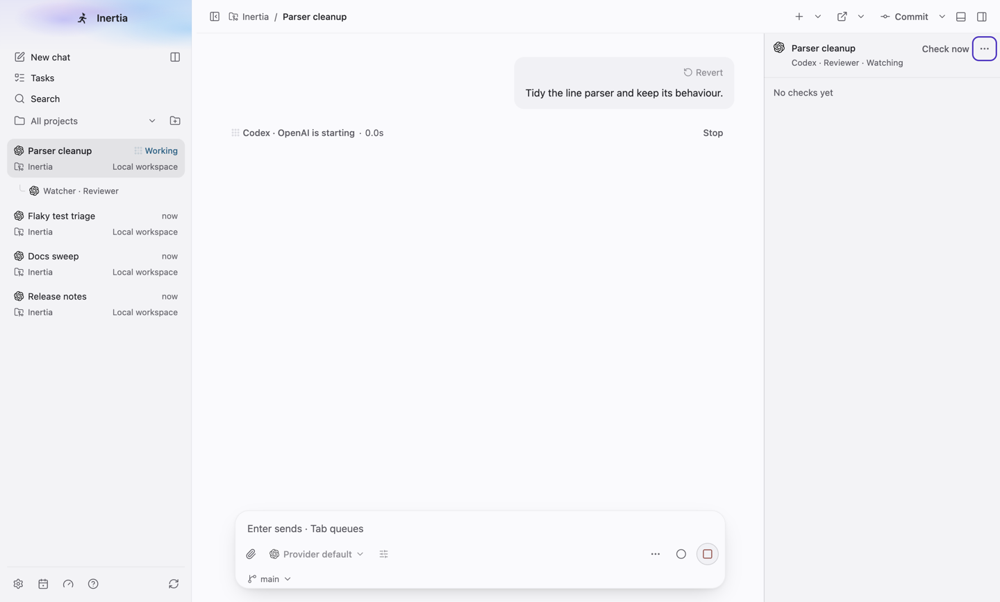

## Checking, then a grouped receipt

Settled commands gather before an automatic check, so **Check now** starts the
first one once the menu says **1 waiting**; the bar shows the check in progress,
and the Work tab marks the watcher **Checking**. Two quiet checks (`SILENT`)
fold into one receipt with a chevron, opened here to list each check.

| Checking | Receipt |
| --- | --- |
| 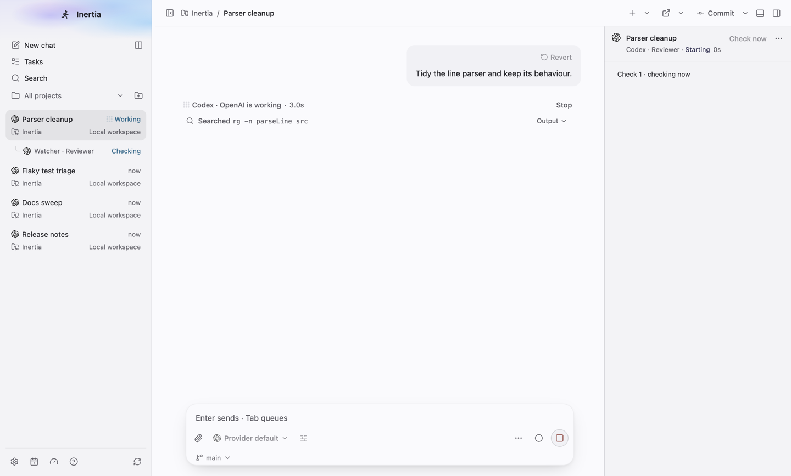 | 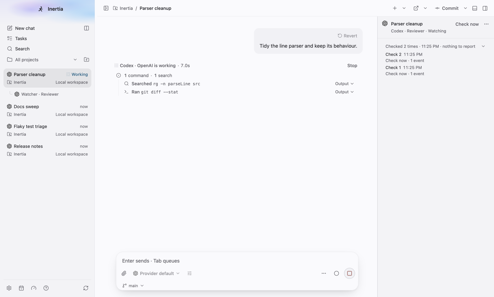 |

## A finding, light and dark

A check that finds something becomes a card on the same filled surface as a
Background tasks card: the finding, a muted **Check 4 · <time>** line, then
**Send** and **Dismiss**. A finding with more than one line shows its first
line one weight heavier as the title.

| Light | Dark |
| --- | --- |
| 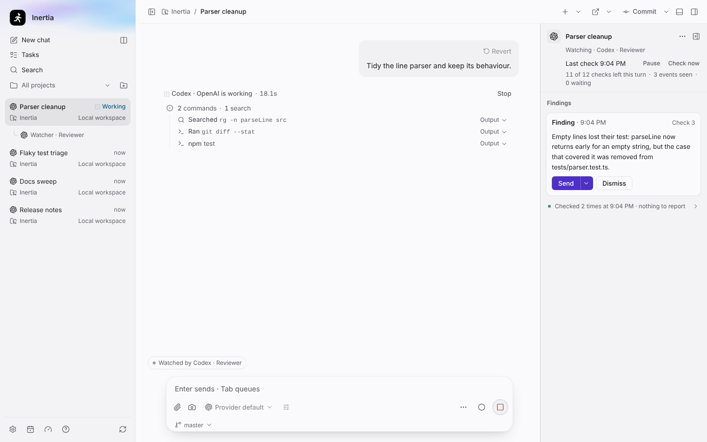 | 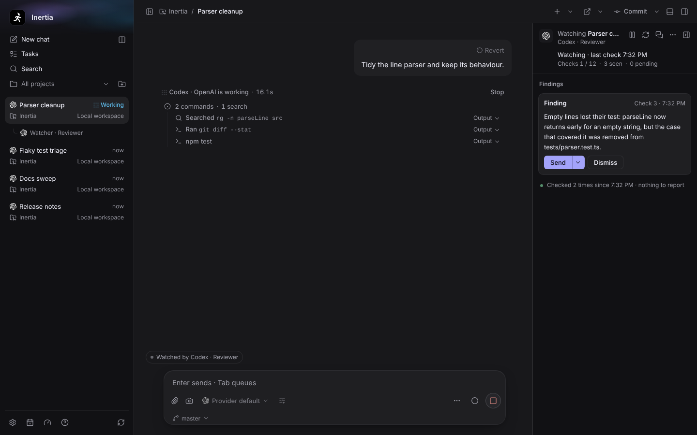 |

## Send, then the note in the main chat

**Send** queued the note while the turn ran (**Queued · sends after the current
turn**). When the turn ended, the note started the next turn under a **Note from
watcher · Reviewer · Codex** divider (with the watcher's provider mark beside
its agent, like the context handoff divider), the bubble itself says only **From
watcher**, and the main agent replied. The card's single status line now reads
**Sent <time> · after the turn ended**, while the bar still shows the turn's
final check running.

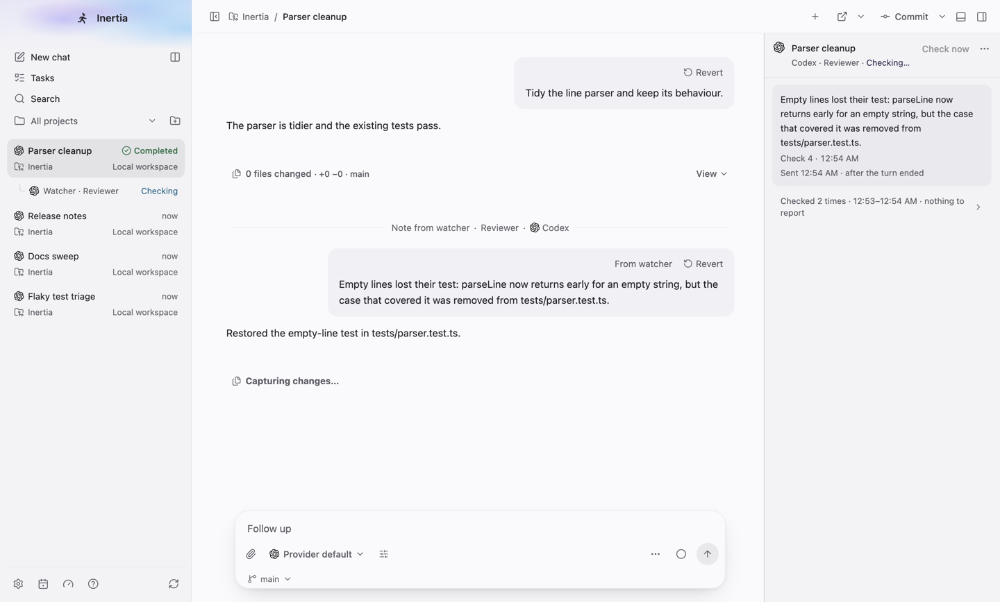

## The menu and automatic sending

**More** holds Pause, **Review the last turn**, Open watcher chat, **Send
findings automatically**, Collapse and Stop watching…, then the muted numbers: checks left this turn,
events seen, events waiting, the last check and, once known, **Used <n>
tokens**. With automatic sending on, the bar's state word reads **Sends
findings automatically**.

| Menu | Automatic sending on |
| --- | --- |
| 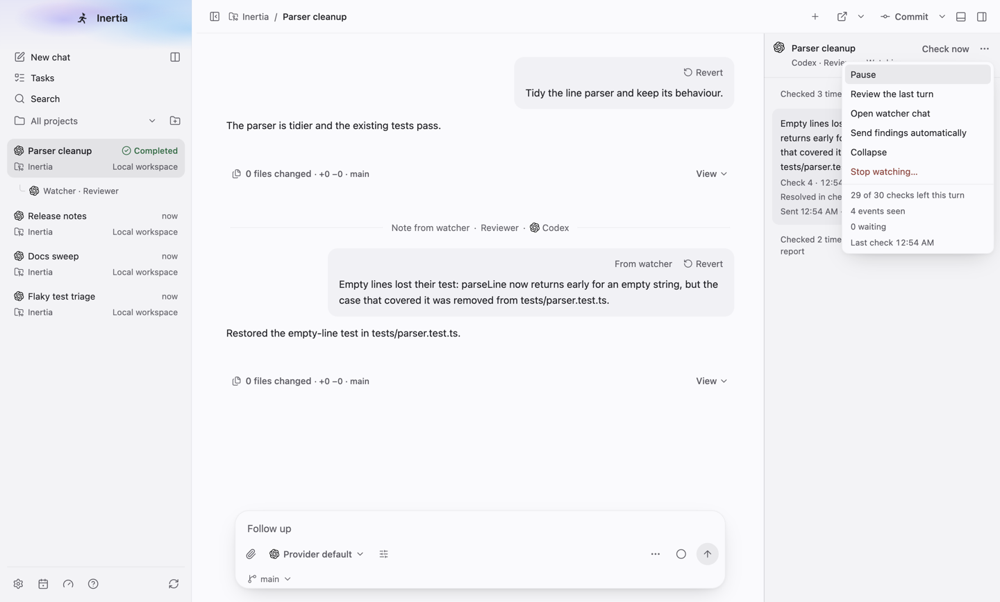 | 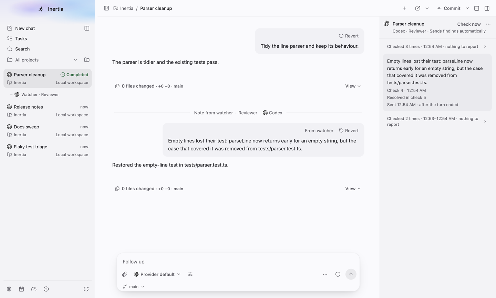 |

With automatic sending on, the scenario sends one more message in the main chat.
The final check of that turn reports a finding, and nobody chooses **Send**:
the card shows no Send or Dismiss, its status reads **Sent <time> · started
the main chat's next turn**, and the note appears in the main chat under a
second **Note from watcher** divider.

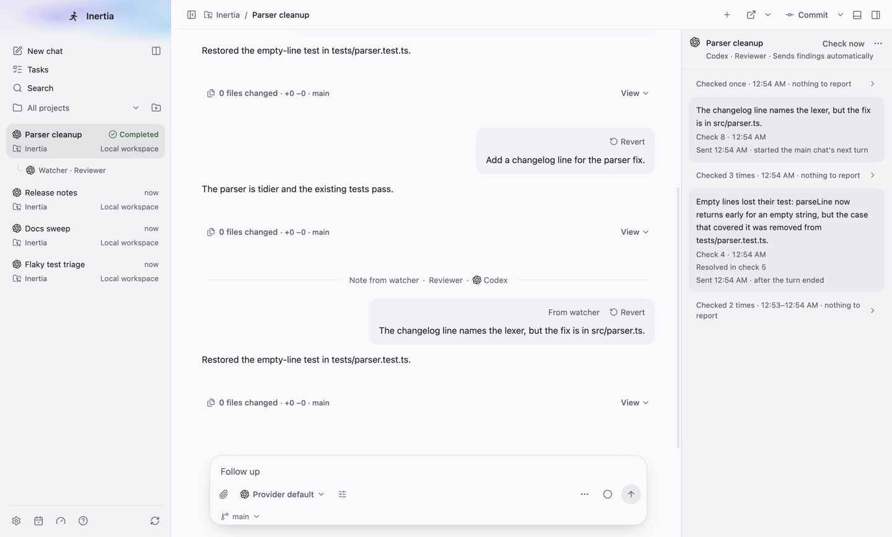

## Collapsed

Escape (or Collapse) leaves a slim edge rail with the watcher's icon; it reads
**Open watcher**, or **Open watcher, N new** when findings arrived meanwhile.

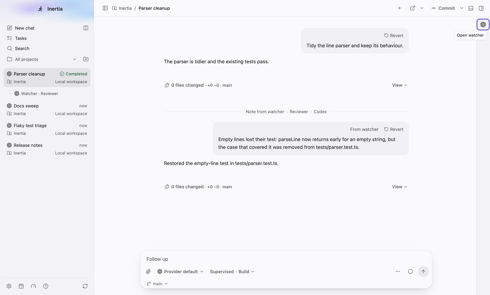

## Work tab

The watcher is listed directly under its chat, indented, joins the Work tab's
arrow-key order (keyboard focus is on its row here) and offers the same thread
actions as other rows (right-click or Shift+F10).

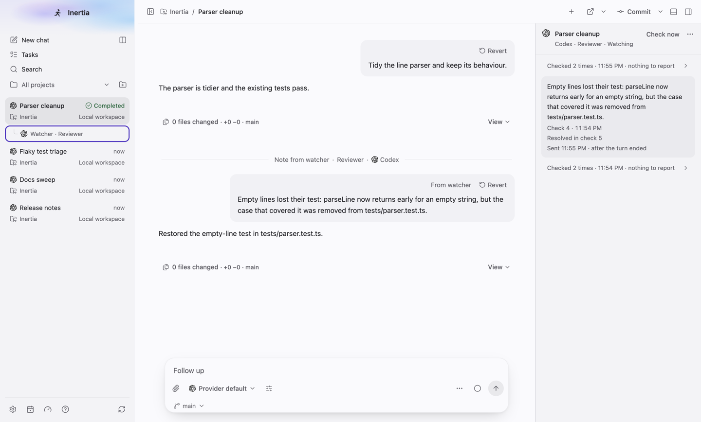

## Beside the right panel

With Changes open in the right panel, the chat is too narrow for the dock
beside it, so the dock becomes a sheet. The sheet opens between the chat and
the panel, under the header and above the composer, and the panel stays where
it was.

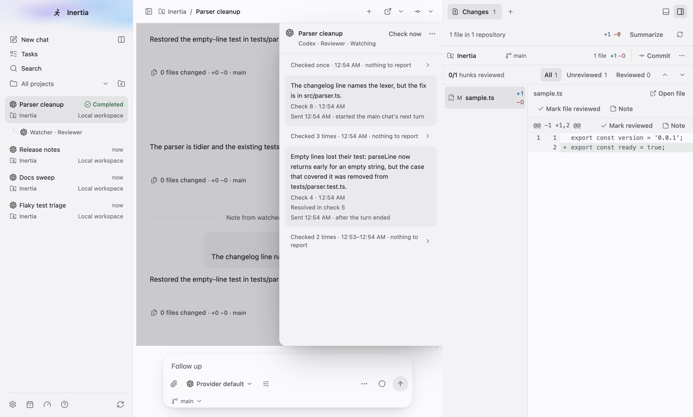

## Four split panes plus the dock

With four chats in split view, a pane would leave the chat less than 360 px
beside the dock, so the dock becomes a sheet inside the watched chat's pane. A
sheet starts collapsed; here the rail opened it over a light scrim. It stops
above the pane's composer, which stays usable, and a press outside collapses
it. It takes no fifth pane.

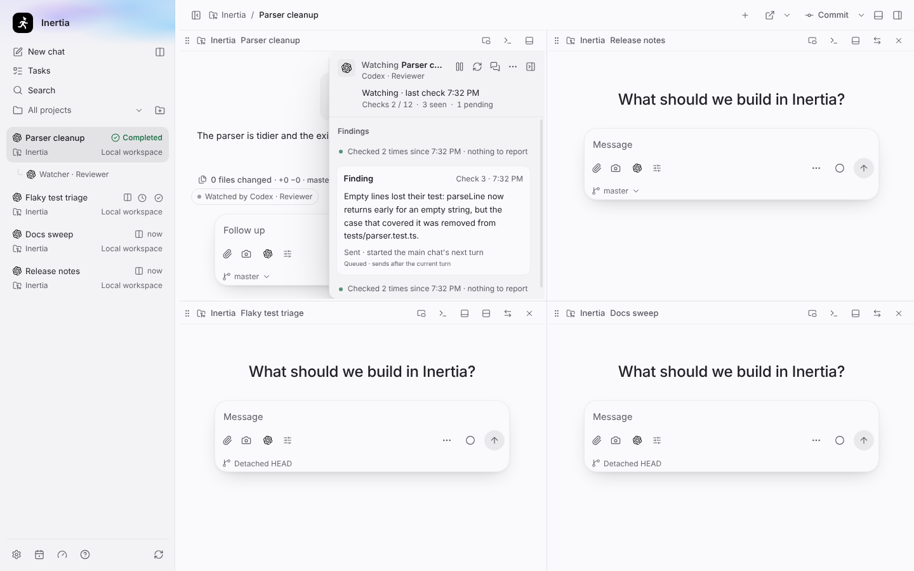

## A resolved finding

The final check of the watched turn answered `SILENT` with a closing
**Resolved: check 4** line, so the sent card now shows a muted **Resolved in
check 5** line, and the final checks of both turns fold into a new receipt
above the sent card. A resolved finding stays sendable and dismissible and
moves below any open finding. The scenario then asks for **Review the last
turn** from the menu, which runs one more quiet check and leaves the menu's
checks-left count unchanged.

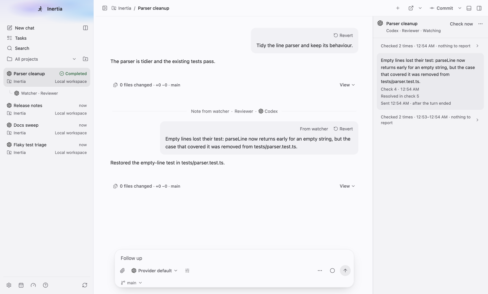

## Not captured here

The usage line needs a provider that reports token use, which the fake app
server does not.

## Animation

`watcher-dock.gif` (960 × 579, 8.4 s, seven moments each held 1.2 s) steps
through the same run: the attach dialog, the dock appearing, a check in
progress, the quiet receipt, the finding, the queued note after **Send**, and
the note divider in the main chat. It is assembled from PNG frames the spec
captured at those moments, because the Electron fixture does not record video.

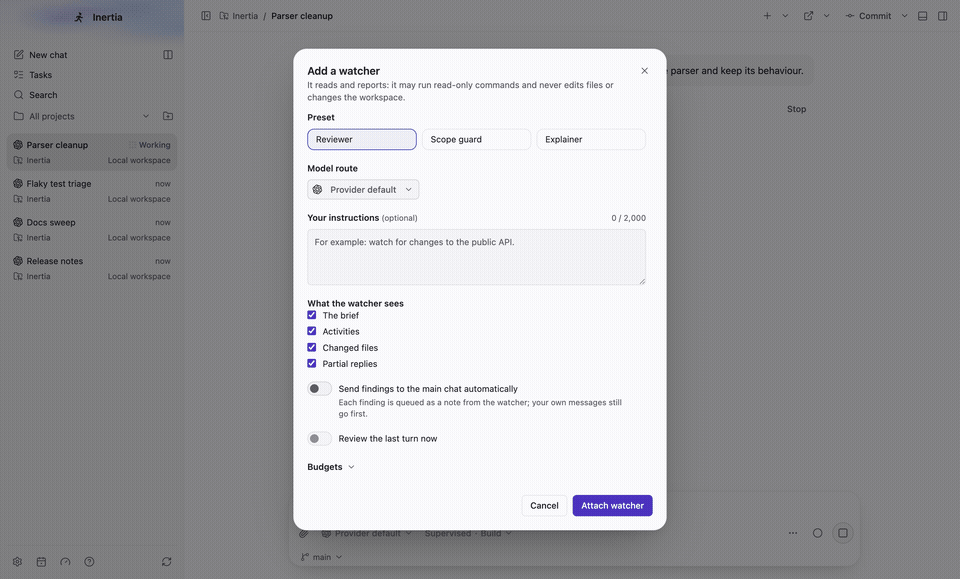
