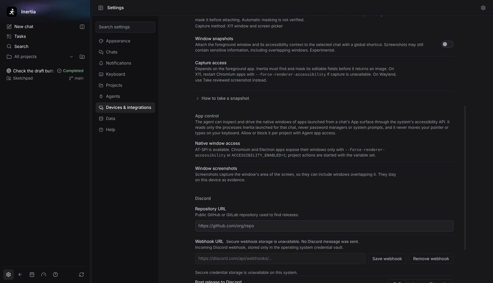

# Chats and agents

## Give the agent context

- **Attach** images, documents and spreadsheets, and mention project files.
- **Reference a chat** by typing `@` and part of its title, or `@this` for this chat's earlier messages. The agent gets a size-limited copy taken when you pick the chat, refreshed if that chat was still working and finishes before you send. Select a reference in the composer or on a sent message to see exactly what the agent gets. Inertia asks before it shares a chat from another workspace.
- **Choose** the model, reasoning level and access mode for each chat. The composer border animates at the selected model’s highest supported reasoning level; reduced motion keeps it still.
- **Switch provider** in a chat that already has messages: choose a model from another provider and keep going in the same chat. The next message starts a new session on that provider with the chat's earlier visible messages and a list of the files its turns changed as context; tool output, file contents, and hidden provider state stay behind, and secrets are redacted only where they match known patterns. The timeline marks the switch with a **Context handoff** divider that names both providers and how many earlier messages were carried, or left behind when they did not fit. Start a goal only after that first message.
- **Invoke a skill** by typing `$` and part of its name. Use ↑/↓ to choose, Tab or Enter to insert, and Escape to dismiss. You can edit a skill token anywhere in your draft.
- **Follow up** while an agent is working: send a message right away or queue it for the next turn. The composer shows *Enter sends · Tab queues* while this is possible. If the turn ends or the agent refuses the message before it arrives, the message is queued for the next turn instead. Cursor, Kimi and Antigravity cannot take a message mid-turn: the composer shows *Enter stops and sends · Tab queues*, and **Stop and send** stops the agent and sends your message as the next turn. While another message is queued, send or remove it first.
- **Keep queued work moving.** Up to three queued messages, including images, are saved by the local service and continue after a successful turn even when another chat is open. They survive an app restart. A stopped, failed or interrupted turn leaves its queue waiting for **Send now**. Changing the model, access or workspace pauses the affected message; remove and queue it again to confirm the new settings. Older local queues remain available for manual review.
- **Capture a window.** Turn on [Snapshots](../SNAPSHOTS_AND_COMPACTION.md) in **Settings → Devices & integrations → Snapshots** to attach a screenshot of the foreground window with its accessibility context.
- **Compact long chats** with `/compact`. A successful compaction leaves a receipt in the timeline with the provider-reported context counts.

## Follow the work

- The **Work** tab lists your chats. Running chats show the agent pixels and elapsed time, and a chat that needs your input or finishes gets a brief cue.
- The **Plan** and **Goal** panels show the plan and objective that the provider reports. Inertia doesn't invent a goal from the chat text.
- **Daily work** in the sidebar summarizes processed tokens, agent runtime and conversations.
- Switching between chats in the same window preserves your reading position. **Jump to latest** resumes following new content. This navigation memory lasts while the window remains open.

If a Claude provider update requires a fresh native session, Inertia supplies a bounded excerpt of this chat’s recent visible messages as historical reference. The execution context records any truncation. Recovery is omitted if it cannot fit alongside your selected context within the turn limits. Hidden provider state, attachment contents and tool output are not recovered; compatible native sessions continue normally.

## Visual replies

An agent can answer with a page as well as text: a chart, a table, a diagram or an interface mockup. Ask for it in plain words, for example *“Chart the test durations by package and explain the slowest ones.”* The page appears in the chat above the agent’s written reply for that turn and follows your light or dark mode and color theme.

- Point at the page and choose **Open full size** (or Tab to the button) to view it in a larger dialog. Escape closes it.
- HTTPS links in the page open in your default browser when you click them.
- The page runs in a sandbox. It cannot fetch from the network, load remote content, or reach your files, the project or the rest of Inertia, so everything it shows must be inside the page itself. A script in the page can still open a WebRTC connection through a relay server over TCP.
- Private Connect clients, chats you share as context, and another model continuing the chat see only a one-line *[page: title]* note in its place, so the agent’s reply also says in one sentence what the page shows.

## Run and test your app

The **App** surface runs the desktop app the chat is building, shows its output and windows, and lets the agent test it. Open the panel and choose **App** in **Open a surface** (or press L there). It is available once the chat's first message has created its workspace.

- **Launch Electron app** starts the project's own Electron app: the Electron installed in the project's `node_modules/electron`, with the entry from `package.json` `main`. Electron's own profile folder (its cookies, storage and caches) is a new, empty one, so your everyday profile of that app is not used, and it is deleted when the app stops. The app is not sandboxed: it runs the project's code with your permissions and can read and write your files like any program you start.
- **Launch action…** runs one of the project's reviewed actions from **Settings → Projects → Actions**, such as a dev server, a build or a native app. Its output and status always show; if it opens windows, they are read through the system's accessibility support (see below).
- **Stop** ends the app and every process it started. Inertia asks you to confirm before stopping a launch you started yourself. A chat can run two launches at once.
- **Logs** shows the app's output with a tag on each line: `stdout` and `stderr`, `console` and `exception` from an Electron app's windows, and `inertia` for Inertia's own notes. Filter lines, copy them, or choose **Jump to latest** after scrolling up. Inertia keeps the newest 64 KiB of each launch.
- Each launch says how Inertia reaches its windows: **Transport** is **Debugging pipe** for an Electron launch, **Accessibility** for an action, or **None yet**.
- **Windows** lists the app's open windows, at most eight per chat. **Evidence** records launches, exits, the agent's actions and screenshots. Everything stays on this computer and clears when you archive or delete the chat, remove its project or quit Inertia. Inertia also forgets the App history of chats you have not used recently once more than 16 chats have finished launches, or their screenshots pass 16 MiB; a chat with a running launch is never forgotten.

The agent can do the same with its App tools: launch the app, read its logs, read a window's text and controls, click, type, press keys, scroll, wait for text, take a screenshot for your Evidence list and stop the app. It can only start the project's Electron app or an action you reviewed, never a command of its own, and its App tools act only on the windows of apps Inertia launched for that chat, never on your desktop, other apps or Inertia itself. Password fields show as `[redacted]`, and a secret the app shows or the agent types into such a field is hidden from later logs and window titles too. The agent never sees screenshot pixels. In **Supervised** and **Auto-edit** mode it asks before every launch, because the app runs project code with your permissions; only **Full Access** launches without asking. In **Supervised** mode it also asks before every stop, click, key press, typing and scroll. When the app shows a dialog, the agent's next click, type or press answers it, as accept or dismiss; reading the window waits for that. Turns sent through Private Connect cannot use the App tools.

### Native windows

A project action that opens windows, such as a GTK, Qt, WinUI or macOS app, or an Electron app started without Inertia's debugging pipe, is read and driven through the operating system's accessibility API: the agent reads a window's controls and text, presses buttons, chooses items, sets field values where the app allows it, presses Enter or Space on the focused control and scrolls a control into view. It never moves your pointer or types on your keyboard, and other keys and pixel scrolling are not available. Only the processes of that launch are reached. Password managers, credential, password and PIN prompts, keyrings, consent prompts and system settings that the app opens are never read; the **Windows** list counts those apps as "protected apps are not inspectable". Screenshots capture the window's area of the screen on Windows and Linux X11, so they can include windows on top of it, and are unavailable on Wayland.

Each platform needs its accessibility support. **Settings → Devices & integrations → App control** shows what this computer allows and, on macOS, opens **Accessibility** and **Screen Recording** in System Settings when you click their buttons; the Accessibility button also shows macOS's own permission prompt. When something blocks a launch's windows, the App surface says so under **Windows** with a link to that card.

To keep agents out of the App surface for one project, set **Settings → Projects → Agent app access** to **Off**. You can still launch the app yourself. See [App under test](../APP_UNDER_TEST.md) for the full contract.

## Keep work organized

Right-click a chat in the sidebar, or focus it and press Shift+F10 or the Menu key, to open its actions:

- **Pin** or **unpin** it.
- **Snooze** it for one or three hours, until this evening, tomorrow or next week.
- **Settle** finished work, or **reopen** it.
- **Rename** it, **regenerate the title** from the latest message, or **mark it unread**.
- **Copy** its path or thread ID.
- **Archive** it with **Archive thread**.
- **Open it in a new window** or **add it to split view**. See [Working side by side](working-side-by-side.md).

## Right-click menus

Right-click inside Inertia, or focus an item and press Shift+F10 or the Menu key, for the actions that fit where you are:

- **Messages:** **Copy** when text is selected, **Copy message** as plain text, and **Copy as Markdown** for agent answers.
- **Code blocks:** **Copy code**.
- **File links in answers, files in Files and changed files in Changes:** **Open**, **Reveal in Finder** (File Explorer on Windows, your file manager on Linux), **Copy path** and **Copy relative path**. Folders leave out **Open**.
- **Web links:** **Copy link address** and **Open link**. Images offer **Copy image**.
- **Text fields:** the usual editing actions, with up to five spelling suggestions for a misspelled word.
- **Terminal:** **Copy** the selection, **Paste**, **Select all** and **Clear**. On Windows, Ctrl+V also pastes into the terminal; on Linux, Ctrl+V still reaches terminal programs, so paste with Ctrl+Shift+V.
- **Browser pane:** the page's editing actions, **Copy link address**, **Back**, **Forward** and **Reload**. Pages that show their own menu keep it. A right-click the agent sends opens nothing, and **Back**, **Forward** and **Reload** are unavailable while an agent Browser command runs.

## Find anything

Press ⌘K (Ctrl+K elsewhere) to find commands, projects, chats and saved messages. Type at least two characters to search your messages and final agent answers across unarchived chats, then open a result to jump to its turn, including in a separate chat window. Search matches literal phrases, ignores case and shows up to 20 of the newest matches.

## Optional desktop mascot

Turn on the mascot in **Settings → Notifications** for a movable companion that previews progress, questions, approvals and results in a small bubble. Click the bubble to open the chat; right-click to pause or hide it. **Animate mascot** in the same place pauses or resumes its animation. The bubble shows the chat that needs you most and lists up to five other active or unread chats; click one to open it. Hiding lasts until you choose **Unhide** in Settings, **Show mascot** in the Window menu or the macOS Dock menu, or restart Inertia.

## Notifications

Desktop notifications tell you when a chat finishes, fails or needs your approval or answer, without prompt or response text. In **Settings → Notifications**, **Only when Inertia is in the background** skips them while any Inertia window is focused; completion sounds are not affected.
