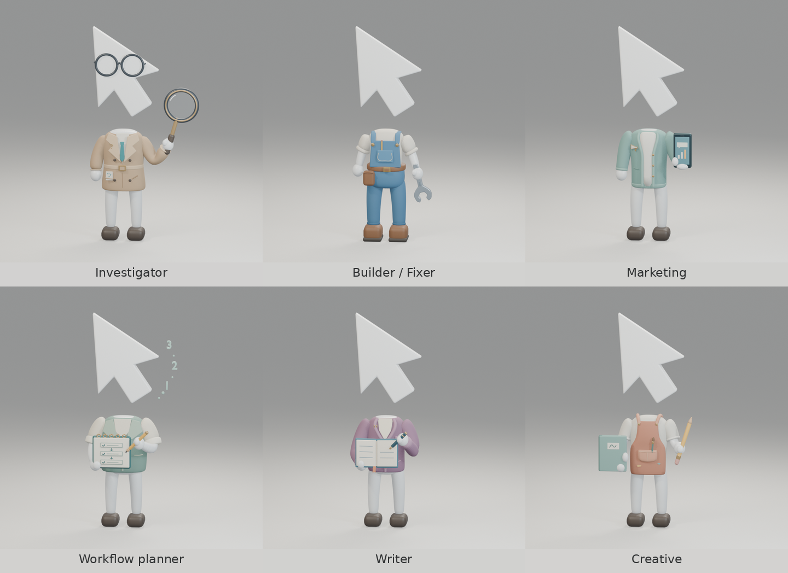

# Cute floating-cursor agent family

Six editable Blender characters with a shared compact body, smaller floating logo head,
short rounded limbs, small feet, and calm standing poses. The cursor floats above
the shoulders with an intentional gap: **none of the characters has a neck**.
Heads are scaled to 70% of the earlier study around their lower tip, preserving
the floating gap; glasses and the planner’s thought motif follow that scale.
The seven-vertex head outline comes directly from `src/renderer/public/inertia-logo.svg`.



| Character | Outfit and role | Editable model | Preview |
| --- | --- | --- | --- |
| Investigator | Honey trench coat, glasses, magnifier, tiny enquiry pin and pocket clue card | [Blender](investigator/investigator.blend) | [PNG](investigator/investigator-preview.png) |
| Builder / Fixer | Blue overalls, cream rolled sleeves, tool belt and a short wrench | [Blender](builder/builder.blend) | [PNG](builder/builder-preview.png) |
| Marketing | Seafoam cardigan, megaphone pin and phone with chart/message | [Blender](marketer/marketer.blend) | [PNG](marketer/marketer-preview.png) |
| Workflow planner | Broad work vest, linked checklist, pencil and floating numbers | [Blender](workflow-planner/workflow-planner.blend) | [PNG](workflow-planner/workflow-planner-preview.png) |
| Writer | Mulberry cardigan, open notebook, pen, bookmark and quotation pin | [Blender](writer/writer.blend) | [PNG](writer/writer-preview.png) |
| Creative | Clay apron, sketchbook, pencil, pocket brush and two small paint dabs | [Blender](creative/creative.blend) | [PNG](creative/creative-preview.png) |

Each directory also contains `<role>-transparent.png`. All images are 900×900.
Every scene uses the same orthographic camera, soft studio lights and background.
Materials and geometry remain editable; the stage is separate from the model
collection. The app uses the twelve WebPs exported from these transparent renders. Existing
mark IDs are preserved for saved agents and imports; display labels match the roles.

The Builder / Fixer replaces the earlier Roman worker concept. The retired
Roman study is preserved under `archive/roman-worker` and is not part of the
six-character family or review sheets. The detail pass keeps the approved
silhouettes and floating heads, adding only small role cues to clothes and props.

## Rebuild

Geometry helpers, proportions and the studio live in
[`themed_common.py`](../../scripts/custom-agent-marks/themed_common.py). Each role
has its own `build-<role>.py` script in that directory. Use Blender 5.2 and the
Blender skill's `blender-run` wrapper; check the shared host load before rendering.
The lock keeps simultaneous agent work from running multiple GPU renders:

```sh
flock /tmp/inertia-themed-render.lock blender-run --threads 2 \
  scripts/custom-agent-marks/build-investigator.py \
  --output source-assets/custom-agent-marks/investigator --size 900
```

Substitute `builder`, `marketer`, `workflow-planner`, `writer`, or `creative`
for `investigator` to rebuild that character. The scripts save an editable scene,
then render its studio and transparent images. No existing mascot rig is modified.

Assemble the gallery and validate every image pair after all six builds finish:

```sh
python3 scripts/custom-agent-marks/review-themed-family.py
```

This writes [the gallery](family-preview.png), [outfit/prop close-ups](family-details.png), [dark/light readability views](family-readability.png),
and [an artifact manifest](review-manifest.json). The review script checks model
presence, image dimensions, transparent alpha and contained framing. The small
views show the actual transparent assets at 128 and 64 pixels; runtime-size
exports are shown in `app-review`.

## App exports

```sh
python3 scripts/custom-agent-marks/export-themed-marks.py
```

The exporter maps planner → `runner`, investigator → `scout`, marketing →
`guard`, builder → `builder`, writer → `scribe`, and creative → `spark`. It uses
the existing framing pipeline to produce twelve transparent 256×256 WebPs,
with mild contrast for light tiles and a small brightness lift for dark tiles.
See [app contact sheet](app-review/contact-sheet.png) and
[actual-size readability](app-review/readability.png).

Updated renderer screenshots are in
[`docs/screenshots/custom-agent-marks`](../../docs/screenshots/custom-agent-marks/README.md).
